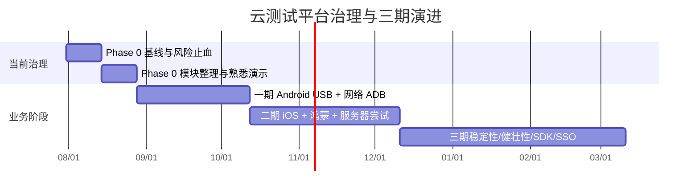
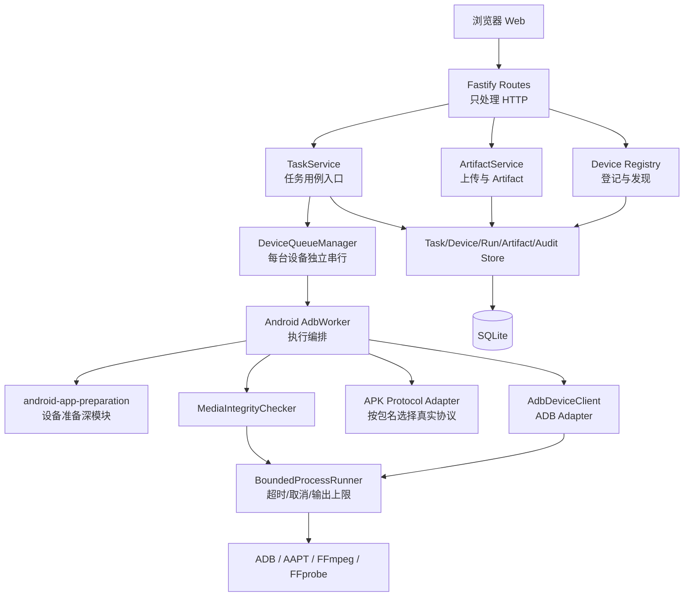
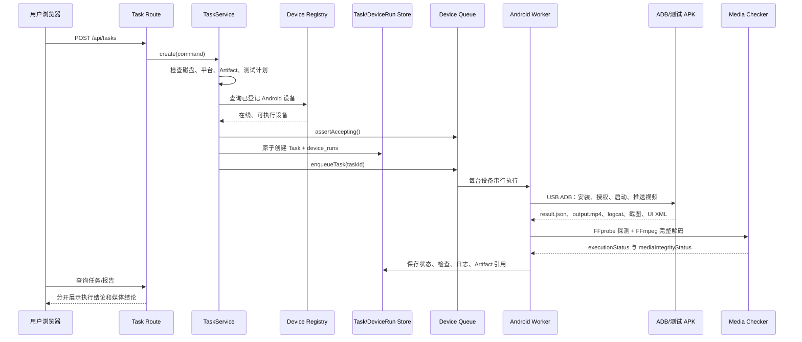

# Phase 0 基础治理与项目熟悉手册

> 面向不熟悉 TypeScript/Node.js 的项目负责人。本文解释“现在有什么、为什么这样分、出错看哪里、下一次改需求从哪里开始”，不把 Phase 0 描述成一期网络 ADB 产品。

## 1. 阶段目标和禁止越界

Phase 0 是原三期业务规划前的治理阶段，原则是：**不改变现有核心业务行为，小步重构、测试保护、每批可回滚**。

### 要完成

- Git、备份、测试和构建基线；
- 本机访问边界和运行环境检查；
- 上传、磁盘、进程、孤儿文件、数据库 migration 可靠性；
- 路由、用例、Store、ADB、文件系统职责分离；
- 输出媒体基础完整性可信；
- 中文架构、运行、调试、恢复和学习资料；
- 通过小提交、演示和练习让负责人逐步熟悉代码。

### 明确不做

网络 ADB、远程 Runner、账号/RBAC、iOS、鸿蒙、设备预约/设备池、公网部署、稳定性/健壮性/SDK 场景测试、企业 SSO、L3 视频质量规则、插件市场和 APK 签名白名单都不属于 Phase 0。

## 2. 阶段路线图



日期仅表示实施顺序示意，不能替代项目排期确认。

## 3. 总体模块关系



### Composition Root 为什么只有一个

`apps/api/src/server.ts` 是 Composition Root，负责创建和连接对象，类似“插座板”：

1. 读取 `AppConfig`；
2. 创建 `ProcessRunner`、SQLite、设备注册模块、媒体检查模块、队列和服务；
3. 注册路由；
4. 注册启动/关闭钩子。

它不应该包含具体业务判断、SQL 或 ADB 命令。这样未来更换某个 Adapter 时，只需在组装处替换实现，业务调用者不需要知道实现细节。

## 4. 一次任务时序



### 不能自动回退

如果 UI 点击失败、ADB 命令失败或 APK 没有生成真实输出，不能读取预设结果、模拟数据或上一次的旧文件来“补成成功”。可以做清理和失败记录，但最终必须保留真实失败代码，例如 `ADB_COMMAND_FAILED`、`OUTPUT_MISSING`、`MEDIA_DECODE_FAILED`。

## 5. 核心模块职责

| 模块 | 负责 | 不负责 |
|---|---|---|
| Route | 解析 HTTP、校验基础输入、调用用例、映射响应 | SQL、ADB、任务编排 |
| TaskService | 创建、查询、取消任务的业务规则 | 直接写 SQL、拼 ADB 命令 |
| DeviceRegistry | 设备登记、发现、在线状态 | 执行完整兼容性测试 |
| DeviceQueueManager | 单设备串行、不同设备并行、恢复和关闭 | 设备具体操作 |
| Android AdbWorker | 编排 Android 测试全流程 | HTTP 响应和通用 SQL |
| ArtifactService | 隔离上传、校验、登记、移动、补偿清理 | 设备操作 |
| MediaIntegrityChecker | 基础媒体探测与完整解码 | 808 帧等未确认业务规则 |
| Store | SQLite 持久化 | 任务编排、文件移动、ADB |
| ProcessRunner | 进程超时、取消、输出限长、TERM→KILL | 判断业务是否通过 |
| TaskDeletionService | 任务、文件、数据库记录一致删除 | 新任务执行 |

“深模块”指接口小但内部处理多。例如调用方只需知道 `MediaIntegrityChecker.check(path, signal)`，不用学习 FFprobe 参数、FFmpeg 解码命令和错误翻译。

## 6. 最小 TypeScript/Node.js 知识

### TypeScript

- `interface`：描述对象必须有哪些字段；它通常只在编译阶段存在。
- `type`：给字符串联合、组合类型起名字，例如 `RunStatus = 'queued' | 'running' | ...`。
- `async/await`：等待异步文件、进程或 HTTP 操作；`await` 是潜在失败和耗时点。
- `Promise<T>`：未来会得到一个 `T` 的结果。
- `unknown`：不知道错误是什么时使用，先用 `instanceof Error` 再读取 `message`。
- `private readonly`：依赖由构造函数传进来，模块内部使用，调用方不能随意改。
- `import type`：只引入类型，不在运行时加载代码。

### Node.js

- Node.js 是运行后端 TypeScript/JavaScript 的进程。
- `Fastify` 接收 HTTP 请求和返回响应。
- `node:fs/promises` 负责文件和目录；文件写入失败必须考虑补偿清理。
- `node:child_process` 启动 ADB、FFmpeg 等外部进程；不要使用拼接 shell 字符串执行用户输入。
- `node:sqlite` 连接本地 SQLite；Store 封装 SQL，业务层不直接碰数据库。
- `process.env` 是环境变量；统一由 `loadConfig()` 读取和校验，不要在业务模块到处读取。
- `import.meta.url` 是当前脚本位置；用它定位项目根目录，避免依赖 `process.cwd()`。

### 一个小接口例子

```ts
interface ProcessRunner {
  run(command: string, args: string[], options?: RunOptions): Promise<ProcessResult>
}
```

`AdbWorker` 只依赖这个接口。正式环境使用 `BoundedProcessRunner`，测试时可以注入一个 fake；这样不用连接真机也能测试超时和失败处理。

## 7. 数据库和 Artifact 生命周期

### 数据库

1. 服务打开 SQLite；
2. 开启 foreign keys 和 WAL；
3. 创建/检查 `schema_migrations`；
4. 依序校验 migration checksum；
5. 有待迁移时先 `VACUUM INTO` 备份；
6. migration 全部成功后才继续组装服务；
7. 任一步失败都停止启动。

当前 Store：

- `TaskStore`：Task 聚合、任务视图、聚合状态；
- `DeviceStore`：设备登记和 Serial 幂等；
- `DeviceRunStore`：每设备运行状态和状态转换；
- `ArtifactStore`：Artifact/输出登记；
- `AuditStore`：检查项和日志。

### Artifact

```text
上传流
  → data/.quarantine/store-<id>
  → 流式大小限制、SHA-256、APK 包名/视频类型校验
  → 校验通过后移动到 data/artifacts/store-<id>
  → 数据库登记
  → 数据库失败则删除已移动目录
```

启动时只报告 `artifacts/store-*` 中没有数据库登记的目录，不自动删除。上传失败、任务创建失败和删除任务都必须检查是否留下孤儿文件。

### 建议保留时间

输入/输出视频、APK、日志、截图和 UI XML 暂定 7 天；Task/报告元数据 30 天；审计 180 天；金样本在引用期间保留。真正上线自动清理前，需要单独确认责任人、时区、金样本引用和恢复演练。

## 8. 常见故障排查

### 8.1 先定位对象

- **Task**：一次用户提交的测试任务，包含 APK、输入视频和多个设备运行。
- **DeviceRun**：Task 在一台设备上的独立执行，设备并行、同设备串行。
- **Artifact**：上传或生成的文件及其数据库引用。
- **Check**：一个可解释的过程检查项，例如安装、处理、媒体完整性。

### 8.2 按层排查

1. **前端**：浏览器 Network 查看 URL、状态码和响应体；页面显示的是 API 返回结果。
2. **API**：终端看 Fastify 日志；`403 LOCAL_ACCESS_ONLY` 是本机边界保护，不是业务失败。
3. **Task/Queue**：查看任务状态、DeviceRun 状态和失败代码；关闭期间提交会返回 `503 QUEUE_NOT_ACCEPTING`。
4. **ADB/设备**：执行 `adb devices -l`，检查 Serial、授权、锁屏、弹窗和 USB 线。
5. **APK/SDK**：检查包名是否有已配置执行协议，日志中查看 SDK 事件。
6. **媒体**：先看 `mediaIntegrityStatus` 和元数据，再独立运行 `ffprobe`/`ffmpeg` 复现。
7. **文件/数据库**：对照 Artifact `storage_path`，运行 `pnpm report:orphans`，不要直接删除目录。

### 8.3 重点错误含义

| 错误码 | 含义 |
|---|---|
| `LOCAL_ACCESS_ONLY` | 请求的 Host/Origin/转发来源不是 loopback |
| `QUEUE_NOT_ACCEPTING` | 服务正在关闭，不再接收新任务 |
| `INSUFFICIENT_DISK_SPACE` | 低于磁盘水位，拒绝上传和新任务 |
| `FILE_TOO_LARGE` | 上传流超过对应 APK/视频限制 |
| `DEVICE_NOT_ELIGIBLE` | 设备未登记、无 Serial 或不可执行 |
| `ADB_COMMAND_FAILED` | ADB 命令真实失败 |
| `OUTPUT_MISSING` / `OUTPUT_EMPTY` | APK 没有生成可用输出 |
| `MEDIA_PROBE_FAILED` | FFprobe 无法识别输出媒体 |
| `MEDIA_DECODE_FAILED` | FFmpeg 无法完整解码到结尾 |
| `SERVICE_RESTARTED` | 服务重启时中断了未完成执行 |

## 9. 每个改造批次的交接模板

每批代码改动必须在提交说明或文档中回答：

1. 本批解决了什么风险？
2. 修改前调用关系是什么？修改后调用关系是什么？
3. 修改了哪些核心文件？入口在哪里？
4. 如何启动、如何验证？
5. 出错后从哪里看日志、Task、DeviceRun 和 Artifact？
6. 如何回滚？对应 Git commit 是什么？
7. 项目负责人可以亲自完成哪一项小练习？

推荐提交粒度：配置/本机安全、上传/进程/migration、Composition Root/Store 拆分、媒体结果拆分、文档、CI 分开。不要把结构重构和业务行为修改混在同一提交中。

## 10. 回滚原则

- 回滚前先保留当前 `git diff` 和运行数据备份；
- 只回滚对应批次的 commit，不执行未经确认的 `git reset --hard` 或删除 `data/`；
- 数据库 migration 已执行时，不要只回滚代码然后直接启动；先查看 migration 备份，必要时恢复到独立目录验证；
- 文件和数据库不一致时，以数据库备份和 Artifact manifest 为依据，先报告、再人工处理；
- 任何回滚后都重新运行 `pnpm test`、`pnpm build` 和 Android 构建。

## 11. 进入一期前熟悉度演示清单

负责人应能独立完成：

- 启动/停止项目；
- 运行测试和构建；
- 配置一台 USB Android 真机并提交测试；
- 查找一个 Task、DeviceRun、日志、截图、UI XML 和输出视频；
- 判断问题属于前端、API、ADB、设备还是媒体；
- 修改一个小校验规则并补充测试；
- 使用 Git 查看差异、提交和回滚；
- 备份并在单独绝对目录恢复数据库和关键文件。

## 12. APK 签名指纹延期说明

APK 签名证书指纹是 APK 签名证书的摘要。平台可以把“包名 + 证书指纹”绑定到可信开发者，拒绝同包名但由其他证书签名的伪造 APK。Phase 0 按当前对齐结论暂不增加白名单校验；补偿边界是本机、可信人员和专用设备。正式接入网络 ADB、服务器或公网前，必须重新确认白名单维护人、证书轮换流程和失败处置。

## 13. Phase 0 验收与后续准入

自动化验收：当前既有 19 个测试文件、78 个测试作为历史基线，重构后应持续通过；新增治理测试也必须通过；`pnpm build` 和 Android `assembleDebug` 通过。

风险验收：

- 默认局域网无法访问 Web/API；
- 不同工作目录仍使用同一绝对数据目录；
- 未配置 Serial 不会操作真机；
- 超限上传尽早返回 413 且无临时文件；
- 低磁盘拒绝新上传/新任务但可查询、下载和清理；
- 子进程输出有上限，取消/超时后无残留进程；
- migration 可重复检查，失败不启动；
- 上传/任务失败后无孤儿 Artifact；
- 合法 MP4 可完整解码，损坏 MP4 必须失败；
- 808、分辨率、音频、帧率和时长不会在未确认前改变结论；
- 数据库和关键 Artifact 能实际备份恢复。

当上述条件和熟悉度演示全部通过，才进入一期网络 ADB 设计和实现。每一台真机的 USB Endpoint 都要继续保留，网络连接不能成为唯一测试方式。
