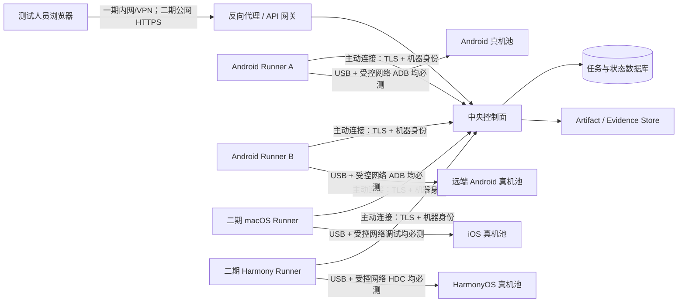

# SDK 视频兼容性测试平台三期需求规划报告

> 文档版本：V1.5-Draft  
> 对齐日期：2026-07-31  
> 文档状态：**三期需求对齐稿；一期、二期方向已由产品负责人确认，三期建议待确认**  
> 前置分析：[《需求与架构重新对齐深度报告》](./需求与架构重新对齐深度报告.md)  
> 官方依据：[《官方文档架构证据》](./research/官方文档架构证据.md)  
> 实现架构：[《整体框架设计与分期演进方案》](./整体框架设计与分期演进方案.md)

---

## 0. 本轮已确认的规划调整

本轮将原“两期规划”调整为“三期规划”。

### 已确认

1. **一期：交付 Android 兼容性测试功能，实现 8 台 Android 真机联网 ADB 与数据线双闭环。**  
   用户可通过平台选择 Android 真机和连接方式执行软件兼容性测试。现有 **8 台 Android 真机必须全部具备网络 ADB 测试能力，同时持续保留数据线测试能力**；网络 ADB 不能是缩减版流程，必须与数据线执行同一 Test Plan、SDK 调用、证据回收、L0/L1/L2 验证和报告流程。

2. **二期：交付 iOS 和鸿蒙兼容性测试，并实施公网服务器部署试点。**  
   在一期控制面、Runner、任务、证据和报告模型上，分别建设 iOS 与 HarmonyOS 独立 Adapter。现有 **4 台 iOS 真机和 5 台 HarmonyOS 真机**均需完成受控网络连接与数据线连接两套完整兼容性测试流程；同时将控制面部署到可通过公网 HTTPS 访问的服务器进行受控试点，但不向公网暴露 ADB、HDC 或 iOS 调试端口。

3. **一期部署与访问边界已确认。**  
   Control Plane 与 Android Runner 拆为独立进程和稳定协议；一期允许先部署在同一台机器。网络 ADB 仅允许在受控局域网或 VPN 中使用。账号先采用简单账号体系，只区分管理员和测试人员；企业 SSO 放到三期。

4. **一期设备登记方式已确认。**  
   8 台 Android 由管理员受控登记；每台 Physical Device 只登记一次，并将 USB Endpoint 与网络 ADB Endpoint 显式绑定到同一设备，避免同一真机被重复调度。

### 已确认的设备基线

| 平台 | 数量 | 交付阶段 | 每台设备必须通过的连接流程 |
|---|---:|---|---|
| Android | 8 台 | 一期 | 数据线完整流程 + 网络 ADB 完整流程 |
| iOS | 4 台 | 二期 | 数据线完整流程 + 受控网络调试完整流程 |
| HarmonyOS | 5 台 | 二期 | 数据线完整流程 + 网络 HDC 完整流程 |
| **合计** | **17 台** | 一、二期 | 同一设备只登记一次，有线/网络分别验收 |

### 本报告建议

3. **三期：将公网试点升级为企业级生产平台、SDK 多模式测试平台和发布质量门禁。**  
   在 Android、iOS、HarmonyOS 三平台双连接闭环和二期公网服务器试点之上，正式交付稳定性、健壮性和 SDK 升级回归测试，并完成公网部署生产化、多团队治理、规模化设备调度、L3 媒体质量分析、CI/CD 发布门禁、高可用与运营体系。

### 三期主线

```text
一期：Android 兼容性测试（8 台真机联网 ADB + 数据线双闭环）
  ↓ 稳定统一的 Task / Run / Attempt / Evidence / Runner 语义
二期：iOS + HarmonyOS 双连接闭环 + 公网服务器试点
  ↓ 稳定三平台 Adapter、Scenario/Case 模型与统一报告
三期：稳定性/健壮性正式交付 + 公网生产化 + 企业共享 + 质量门禁
```

---

# 1. 产品定义

## 1.1 产品定位

> 面向 SDK 集成、测试和质量人员的联网真机视频兼容性测试平台。平台通过受管 Runner 连接 Android、iOS、HarmonyOS 真机，使用可复现的应用包、视频、设备环境、测试计划和证据链，判断指定版本 SDK 是否完成约定的视频处理链路，以及输出媒体是否满足已配置的检查和发布策略。

## 1.2 产品北极星

平台优先追求**结论可信度**，而不是先追求页面数量、设备数量或平台入口数量。

1. **真实**：必须调用真实 SDK，不允许复制输入或生成占位输出伪造成功；
2. **可复现**：能还原应用、SDK、视频、设备、计划、工具链和平台版本；
3. **可解释**：失败有稳定分类、阶段、检查项和证据；
4. **可恢复**：断网、重启、离线、重试和取消都有确定语义；
5. **可治理**：网络访问、Runner、上传、设备、数据和操作在受控边界内；
6. **可扩展**：新增平台、验证器或存储实现时，不复制核心业务逻辑。

## 1.3 产品边界

### 本规划覆盖

- 联网访问控制面；
- 远端 Runner 与真机接入，且每台正式真机保留数据线直连能力；
- Android、iOS、HarmonyOS 三平台真机执行；
- 真实 SDK 视频处理验证；
- 输入、输出、日志、截图和平台专属证据；
- 媒体结构、完整解码和三期质量规则；
- 任务调度、失败恢复、报告和发布门禁；
- 三期多团队、配额、高可用和运营治理。

### 本规划默认不覆盖

- 公有云商业化、计费、订单和套餐；
- 面向匿名互联网用户开放；
- 自动绕过 Android RSA、iOS Trust/Developer Mode 或 OEM 安全确认；
- 上传任意不可信应用并保证绝对安全；
- 任意第三方插件在线安装、热更新和不可信代码沙箱；
- 替代人工主观视频质量评审的全部责任。

---

# 2. 推荐联网架构与安全边界

## 2.1 “联网连接真机”的推荐定义

一期的“联网连接真机”建议定义为：

> 用户通过 HTTPS 访问中央控制面；真机连接到部署在设备现场的 Runner；Runner 主动建立到控制面的受认证加密连接，并代替控制面执行 ADB、Xcode/XCTest 或 HDC 命令。**数据线能力是所有正式设备必须持续保留的基础能力；本项目验收范围内的 8 台 Android、4 台 iOS 和 5 台 HarmonyOS 真机还必须分别具备受控网络连接能力，并通过与数据线等价的完整兼容性测试流程。**

不建议把 ADB、HDC、iOS 调试端口直接映射到互联网，也不建议让浏览器直接控制真机。

## 2.2 推荐拓扑



## 2.3 硬性安全约束

1. **每台注册到平台的正式真机必须具备并持续保留数据线连接 Runner 的能力；不得存在只支持网络连接、无法回退到数据线的正式设备；**
2. Android、iOS、HarmonyOS 的数据线连接都必须纳入相应 Adapter、readiness、设备详情和验收用例；
3. 网络/Wi-Fi 设备连接只允许在受控实验室网络内使用；一期 8 台 Android、二期 4 台 iOS 与 5 台 HarmonyOS 验收设备必须同时通过有线和网络两种模式的完整流程；
4. 不在公网暴露 ADB、HDC、Xcode 调试端口；
5. Runner 只接受控制面签发且属于当前 Attempt 的命令；
6. 控制面和 Runner 之间使用 TLS 与机器身份；
7. 用户联网访问必须登录，不能继续使用无认证 LAN 暴露；
8. 所有设备命令必须显式指定 device serial/UDID/target ID；
9. 使用无个人账号、无个人数据的专用测试设备；
10. 每个 Attempt 使用独立工作目录、设备目录和证据目录；
11. Runner 采用最小权限系统账号，并限制可执行命令范围；
12. 每个 Attempt 的 Manifest 必须记录实际连接模式（如 `usb`、`network`）和设备连接标识；
13. 运行中的 Attempt 不得无感地在网络和数据线之间切换；连接模式变化后必须重新执行 readiness，并通过新 Attempt 重试；
14. 网络中断时宁可中断或等待确认，也不能重复执行或产生伪成功；
15. 同一台物理设备同时通过数据线和网络被发现时，只登记为一个 Device，不得作为两台设备并发分配。

## 2.4 物理设备与连接方式模型

为确保“每台真机均可使用数据线测试”在实现中不会退化，平台必须区分物理设备和连接端点：

| 对象 | 定义 | 关键约束 |
|---|---|---|
| Physical Device | 一台真实手机或平板，由平台可获得的稳定硬件/设备标识识别 | 同一物理设备在平台中只有一条 Device 记录 |
| Device Connection | Runner 到该设备的一种可用连接端点，例如 USB 或受控网络 | 一个 Device 可有多个连接端点，但 `usb` 必须存在且可周期验证 |
| Connection Policy | Task/Device Run 对连接方式的要求 | 支持 `wired_only`、`network_only`、`prefer_wired`、`network_allowed` |
| Actual Connection | Attempt 实际使用的连接端点 | Attempt 开始后锁定并写入 Manifest，不可无感切换 |

规则如下：

1. 日常正式测试可默认使用 `wired_only`，但阶段验收必须分别以 `wired_only` 和 `network_only` 执行同一套完整兼容性 Test Plan；
2. `wired_only` 只允许调度到当前 USB readiness 通过的设备；`network_only` 只允许调度到当前受控网络 readiness 通过的设备；
3. `prefer_wired` 在 USB 可用时必须选择 USB，仅在 USB 不可用且策略允许时使用受控网络；`network_allowed` 允许调度器按策略选择任一已就绪端点；
4. 同一物理设备的 USB 和网络端点共享一个 Lease，不能分别运行两个 Attempt；
5. 设备列表展示物理设备一次，并在详情中展示所有连接端点及状态；
6. 数据线能力失效不删除设备记录，而是标记 USB 端点不可用；正式设备因此进入 maintenance，修复并重新验证后才能恢复；
7. Android、iOS、HarmonyOS Adapter 均应实现相同的连接方式语义，但使用各自平台的设备标识和命令；网络执行不得绕过安装、SDK 调用、Evidence、Validator 或报告阶段。

---

# 3. 统一领域模型与结果口径

## 3.1 核心术语

| 术语 | 定义 |
|---|---|
| Artifact | 不可变输入或输出内容，如 APK、IPA、HAP/APP、视频和结果文件；由哈希标识内容 |
| Test Plan | 版本化规则集合，包括平台协议、输入约束、超时、检查项和结论规则 |
| Test Campaign | 二期引入的一次跨平台 SDK 验证目标，由一个或多个 Platform Task 组成 |
| Task | 针对一个平台的一次测试意图：平台应用 Artifact + 视频 + Test Plan + Device Set |
| Device Run | 一个 Task 在一台设备上的逻辑运行目标 |
| Attempt | Device Run 的一次物理执行尝试；重试必须创建新 Attempt |
| Device Snapshot | Attempt 开始时记录的设备、系统、补丁、构建、连接与能力快照 |
| Platform Protocol | 平台如何安装、传入输入、启动、判断完成、回收输出、取消和清理的版本化契约 |
| Check | 一条可独立解释的验证断言，具有规则版本、严重级别和证据 |
| Evidence | 支撑 Check 和 Conclusion 的文件或结构化记录 |
| Conclusion | 根据版本化规则从 Attempt 和 Check 计算出的业务结论，不等同于生命周期状态 |
| Runner | 连接并控制真机、执行平台 Adapter 的受管节点 |
| Device Lease | 一个 Attempt 对一台设备在指定时间内的独占使用权 |
| Fencing Token | Lease 的单调令牌，用于拒绝失效 Runner 或旧 Attempt 的晚到写入 |
| Physical Device | 一台真实手机或平板；即使同时存在 USB 和网络端点，也只形成一个 Device |
| Device Connection | Runner 到物理设备的连接端点，如 `usb` 或 `network`；每台正式设备必须有可用的 `usb` 端点 |
| Connection Policy | Task/Device Run 的连接要求：`wired_only`、`network_only`、`prefer_wired` 或 `network_allowed` |
| Actual Connection | Attempt 实际使用并在其生命周期内锁定的连接端点 |

## 3.2 状态与结论分离

平台必须分别表达：

- **生命周期状态**：queued、running、completed、cancelled、interrupted；
- **执行结果**：执行成功、SDK 失败、设备失败、超时、崩溃等；
- **媒体结论**：结构通过、完整解码通过、质量通过或未检查；
- **矩阵结论**：单平台或跨平台设备矩阵是否满足策略。

不得使用一个 `passed` 同时代表“任务跑完”“SDK 调用成功”“视频可解码”和“可以发布”。

## 3.3 通过等级

| 等级 | 判断问题 | 一期 | 二期 | 三期 |
|---|---|---:|---:|---:|
| L0 协议合规 | 应用包、输入、启动、完成和输出契约是否受支持 | Android 必须 | 三平台必须 | 持续维护 |
| L1 执行链路通过 | 安装、授权、真实 SDK 处理和结果回收是否完成 | Android 必须 | 三平台必须 | 持续维护 |
| L2 媒体完整通过 | 容器/流可探测，指定流可完整解码，关键元数据符合规则 | Android 必须 | 三平台必须 | 持续维护 |
| L3 媒体质量通过 | 黑/绿帧、冻结、音画同步、时长偏差、内容一致性等规则是否通过 | 只预留 seam | 允许少量试验性规则 | 三期正式建设 |
| L4 发布矩阵通过 | 设备、系统、芯片和平台矩阵是否满足发布策略 | Android 基础聚合 | 三平台统一聚合 | 正式发布门禁 |


## 3.4 测试模式扩展

结合 Morpho 正式版本测试报告，平台后续不仅需要“一次输入视频 → 一次输出视频”的兼容性测试，还需要支持长时间稳定性 Session 和异常输入健壮性矩阵。

统一 Test Plan 增加 `test_mode`，并复用同一套 Task、Device Run、Attempt、Lease、Manifest、Evidence 和报告链路：

| 测试模式 | 主要目标 | 典型工作负载 | 典型判定 |
|---|---|---|---|
| `compatibility` | 功能在设备/系统/芯片矩阵上可用 | 多素材、Feature Matrix | 真实 SDK 成功、输出和 L0/L1/L2 符合规则 |
| `stability` | 长时间、多轮和生命周期变化下持续稳定 | 循环次数/时长、前后台切换、大文件/大批量输入 | 无 crash/ANR、成功率、资源趋势和耗时阈值符合规则 |
| `robustness` | 异常输入下行为符合约定 | 文件缺失/损坏/截断、音频/IMU/Meta 异常、时序错乱 | 预期错误码、fallback/降级符合规则且不得 crash |

推荐统一执行层级：

```text
Task → DeviceRun → Attempt → ScenarioRun → CaseExecution
```

每个 CaseExecution 必须保存输入变体、预期结果、实际结果、错误码/fallback、指标摘要和 Evidence。网络/数据线只改变 Actual Connection，不改变 Scenario 业务逻辑。

分期口径：

| 能力 | 一期 | 二期 | 三期 |
|---|---|---|---|
| 兼容性 | Android 正式交付 | 三平台正式交付 | 持续维护并进入发布门禁 |
| 稳定性 | 预留 Workload/Metrics/Oracle；允许 Android Spike | 指定平台和 SDK 试点 | 正式交付 |
| 健壮性 | 预留异常输入 Recipe/ExpectedOutcome/Oracle | 指定平台和 SDK 试点 | 正式交付 |
| 性能/压力/恢复 | 不做 | 预研 | 按业务目标正式建设 |
| SDK 升级回归 | 保存 SDK/规则版本 | 三平台版本矩阵 | 纳入 CI/CD 发布门禁 |

一期只要求架构和数据模型能容纳这些模式，并让兼容性多素材使用 ScenarioRun/CaseExecution；不要求一期一次性交付完整稳定性和健壮性产品功能。

---

# 4. 三期总览

| 阶段 | 发布主题 | 核心目标 | 核心交付 |
|---|---|---|---|
| 一期 | **Android 兼容性测试功能** | 8 台 Android 真机全部通过网络 ADB 与数据线执行等价的 L0/L1/L2 兼容性测试闭环 | Android 兼容性测试入口、双连接调度、真实 SDK、Evidence、媒体完整验证、统一报告 |
| 二期 | **iOS + HarmonyOS 双连接闭环与公网试点** | 4 台 iOS、5 台鸿蒙完成联网和数据线完整流程，并把控制面部署到公网服务器试点 | iOS/Harmony Adapter、双连接 readiness、跨平台 Campaign、三平台报告、公网服务器部署 |
| 三期 | **SDK 多模式测试、公网生产化与发布质量门禁** | 正式支持稳定性/健壮性/升级回归，并将二期公网试点和三平台能力升级为可规模运营的平台 | Scenario Framework、稳定性、健壮性、企业治理、设备池、L3、CI/CD、HA、运营分析 |

## 4.1 阶段依赖原则

1. 一期先把联网 Runner、Attempt、Lease、证据和报告语义做稳；
2. 二期只新增平台 Adapter 和跨平台编排，不重写一期 Core；
3. 三期先复用已稳定的三平台闭环，再扩展规模、质量和治理；
4. 前一期 Gate 未通过，后一期只能做独立技术 spike，不能宣告产品能力完成。

---

# 5. 一期：Android 兼容性测试功能（联网 ADB + 数据线）

## 5.1 一期目标

> 交付可独立使用的“Android 兼容性测试”功能：将现有 8 台 Android 真机全部接入平台，每台设备均可通过受控网络 ADB 和数据线两种方式执行同一套软件兼容性测试；两种连接方式都必须完成上传、调度、安装、权限处理、真实 SDK 调用、视频处理、证据回收、L0/L1/L2 验证、报告、取消、重试和故障恢复闭环。

## 5.2 一期完成后可以宣称

- 用户可从网络访问平台并登录；
- Android 真机可部署在与控制面不同的主机或实验室；
- Runner 可通过网络注册、上报设备并领取执行任务；
- 8 台 Android 真机全部支持数据线和受控网络 ADB 两种完整执行方式；
- Android 兼容性测试页面可选择设备、Test Plan 和连接策略，并展示双连接兼容矩阵；
- 网络 ADB 与数据线执行复用同一 Protocol、阶段、Validator、Evidence 和报告，只允许连接信息不同；
- 平台能够证明真实 SDK 在指定 Android 真机上完成或未完成处理；
- 输出媒体经过结构探测和完整解码验证；
- 网络中断、Runner 重启、设备离线和用户重试有确定结果；
- 报告包含复现所需的输入、设备、版本、检查和证据。

## 5.3 一期建议验收包络

| 项目 | 建议验收值 |
|---|---:|
| 中央控制面 | 1 个实例 |
| Android Runner | 至少 2 个，部署在不同主机；至少 1 个与控制面不在同一主机 |
| Android 真机 | 固定 8 台，接入至少 2 个 Runner；每台分别通过数据线和网络 ADB 完成一次完整验收 |
| 同时在线用户 | 5 人 |
| 用户组织 | 1 个内部团队；一期不做多租户 |
| 角色 | 管理员、执行人员、只读用户 |
| 并发 Attempt | 至少 4 个；8 台设备均可在线，单台设备严格串行 |
| 持久排队 | 至少 100 个 Task |
| APK 默认上限 | 1 GiB，可配置 |
| 视频默认上限 | 4 GiB，可配置 |
| 网络 | 一期采用内网/VPN；8 台设备的网络 ADB 位于受控实验室网络；Runner 主动连接控制面 |
| 数据 | 中央数据库 + Artifact/Evidence Store；允许一期使用单实例部署 |

## 5.4 一期 P0 功能需求

### P1-FR-001 用户登录与网络访问

1. 平台通过 HTTPS 提供 Web 和受控接口；
2. 所有业务接口必须认证，健康检查仅暴露必要信息；
3. 一期至少提供管理员、执行人员、只读用户三类角色；
4. 管理员可创建/禁用用户或接入一个可替换的企业身份 Adapter；
5. 执行人员可上传、创建、取消和重试任务；
6. 只读用户只能查看报告和被授权证据；
7. 登录、失败登录、上传、执行、取消、重试、下载、删除和管理员操作必须记录审计；
8. 不允许通过开发服务器代理绕过认证访问控制面。

**验收：**未登录用户无法访问任务、设备和 Evidence；只读用户无法创建或取消任务；关键操作均有 actor、时间、对象和结果。

### P1-FR-002 Android Runner 注册与机器身份

1. Runner 使用唯一 Runner ID 和独立机器凭证注册；
2. Runner 主动连接控制面，控制面不反向扫描或直接登录实验室主机；
3. Runner 上报版本、主机信息、Android 工具链、容量、健康状态和设备能力；
4. 控制面可禁用、维护、排空或吊销 Runner；
5. Runner 凭证过期、吊销或版本不兼容时不得领取新任务；
6. Runner 只接受结构化 Attempt Spec，不接受任意 Shell 命令；
7. Runner 使用专用低权限系统账号，并限制工作目录和可执行程序。

**验收：**无效凭证、被禁用 Runner、版本不兼容 Runner 均无法领取任务；有效 Runner 可在重启后恢复注册。

### P1-FR-003 Android 设备发现与 readiness

1. 设备状态至少包括：`unauthorized`、`offline`、`online_not_ready`、`ready`、`busy`、`maintenance`；
2. 所有 ADB 命令必须在 Android Adapter 中强制显式传 serial；
3. 每台设备必须支持 USB 数据线连接 Runner；设备登记时记录物理设备标识和全部连接端点，`usb` 为必备能力；
4. 8 台一期 Android 验收设备必须全部通过受控实验室网络连接 Runner，并持续保留 USB 模式；任一模式不可替代另一模式的验收；
5. ADB over TCP/Wi-Fi 不得直接暴露到公网；
6. readiness 分别检查 USB 端点和网络 ADB 端点，包括当前连接模式、端点可达性、RSA 授权、shell、存储余量、安装条件、所需权限、测试目录和工具链；
7. 首次 RSA 授权、解锁、受限设置和 OEM 确认允许人工完成，但页面必须展示原因和操作指引；
8. 只有 `ready` 设备可分配；
9. Runner 失联后，其设备立即停止接受新任务；
10. 设备详情必须展示当前连接模式、支持的连接模式、最近一次 USB 验证时间和连接异常；
11. 同一物理设备同时被 USB ADB 和网络 ADB 发现时必须合并为一台 Device，并共享一个 Lease；
12. Task/Device Run 支持选择 `wired_only`、`network_only`、`prefer_wired` 或 `network_allowed`；一期对每台设备分别以 `wired_only` 和 `network_only` 完成正式验收；
13. 任一 Android 设备若无法稳定完成网络 ADB readiness 和完整 Test Plan，则不能通过一期 Gate，不能以数据线通过结果代替。

**验收：**未授权、离线、权限不完整和 ready 设备被准确区分；任何命令不得发送到非目标 serial；8 台设备每台均通过 USB 数据线和网络 ADB 各完成一次相同 Test Plan 的完整 E2E，形成至少 16 条设备-连接验收记录；同一手机同时通过 USB 与网络出现时，列表中仍只有一个 Device，且不能被并发调度两次。

### P1-FR-004 Artifact 上传、分发与输入治理

1. APK 和视频使用独立大小上限；
2. 超限稳定返回 HTTP 413 和机器可识别错误码；
3. 上传先进入隔离区，完成大小、类型、结构、签名摘要和 SHA-256 后才可使用；
4. 失败或中断上传不得遗留无主临时文件；
5. 相同内容哈希应复用或建立去重关系；
6. 被 Task 引用的 Artifact 不可原地覆盖；
7. Runner 通过短期授权下载 Artifact，并在本地再次校验哈希；
8. Evidence 回传后由控制面校验大小、哈希、Attempt ID 和 fencing token；
9. APK 只接受可信构建流水线或证书 allowlist 来源；
10. 磁盘低水位时拒绝新上传或新 Attempt，不破坏已有任务。

**验收：**覆盖超限、伪扩展名、截断、重复内容、损坏传输、不可信签名、磁盘不足和回传哈希不一致。

### P1-FR-005 真实 SDK 与版本化 Android Protocol

1. 至少接入一个真实厂商 SDK Bridge；
2. 禁止复制输入或生成占位输出伪造成功；
3. Test Plan 与 Android Platform Protocol 具有稳定 ID 和不可变版本；
4. Protocol 描述安装、输入推送、启动、进度、完成信号、输出、取消和清理；
5. Manifest 记录 SDK、Bridge、APK、Protocol、Plan、Runner 和验证器版本；
6. SDK 初始化、处理、取消和释放应有结构化事件或稳定错误码；
7. 未知或不兼容 Protocol 在调度前失败。

**验收：**移除真实 Bridge 后必须明确失败；修改 Plan 新版本不改变历史任务结论。

### P1-FR-006 Task、Device Run、Attempt 与幂等

1. 一个 Task 可选择多台 Android 设备；
2. 每台设备创建一个 Device Run；
3. 每次物理执行创建一个 Attempt；
4. 重试不得覆盖历史 Attempt、日志或输出；
5. Task 创建支持幂等键；
6. 一期默认人工重试，自动重试默认关闭；
7. 取消、重试、完成和超时的并发竞争必须有确定状态；
8. 生命周期状态与业务 Conclusion 分离。

**建议状态：**

```text
Task:       queued → running → completed | cancelled
DeviceRun:  pending → running → completed | cancelled
Attempt:    queued → preparing → executing → collecting → validating
                     ↘ failed | timed_out | cancelled | interrupted
                     validating → succeeded | failed
```

### P1-FR-007 联网调度、Lease 与 fencing

1. queued Task、Device Run、Attempt 和 Lease 必须持久化；
2. 一个设备同一时间只能有一个有效 Lease；
3. Lease 具有 Runner、Attempt、开始时间、到期时间和 fencing token；
4. Runner 心跳续租；失联后 Lease 到期并进入恢复流程；
5. 旧 token 的晚到状态、结果和 Evidence 不得覆盖新 Attempt；
6. Attempt Spec 和取消命令均可重复投递，Runner 必须幂等；
7. 服务重启后排队任务恢复，运行中任务进入明确的恢复或 interrupted 状态；
8. 一期默认不自动接管失联设备上的运行中任务，避免双重执行；
9. 远端 Runner 不直接访问控制面数据库。

**验收：**断网、Runner 强杀、控制面重启、命令重复投递和旧结果晚到均不产生双重执行或状态覆盖。

### P1-FR-008 Android 兼容性测试执行链

1. 同一设备严格串行，不同设备可并发；
2. 执行阶段至少包括预检、应用准备、输入推送、启动、SDK 处理、回收、清理和媒体验证；
3. 每个阶段记录开始、结束、结果和错误分类；
4. 取消必须传递到 Runner 和当前执行；
5. 超时必须终止受控进程、回收可用诊断并释放或隔离设备；
6. 设备中途离线时 Attempt 明确失败或中断，设备重新进入 readiness；
7. 每个 Attempt 使用独立 Runner 工作目录和设备目录；
8. 清理应用数据、任务目录或重装由 Test Plan 配置；
9. Attempt 开始后锁定 Actual Connection；若连接方式或端点发生变化，当前 Attempt 进入 `interrupted` 或明确失败，不在原 Attempt 内继续执行；
10. 执行器必须遵守 Device Run 的 Connection Policy；`wired_only` 不得回退到网络端点，`network_only` 不得回退到 USB 端点；
11. 网络 ADB 和数据线模式必须执行相同 Platform Protocol 与 Test Plan，不得为网络模式设置跳过安装、跳过 SDK、减少 Evidence 或降低 Validator 标准的旁路；
12. 报告按 Device 展示有线与网络两次结果，并支持比较阶段耗时、错误和 Check；
13. Android 兼容性测试功能支持按 8 台设备全选、按设备筛选、按连接策略执行和查看兼容矩阵；
14. 同一设备的有线与网络 Attempt 必须串行或由明确的批次编排控制，不能因存在两个端点而并发占用同一手机。

### P1-FR-009 Evidence 与 Execution Manifest

1. 每个 Attempt 生成不可变 Manifest；
2. Manifest 至少记录输入哈希、SDK/Bridge、Plan/Protocol、Device Snapshot、Runner、阶段、错误、Check 和 Evidence 索引；
3. Evidence 至少包括结构化结果、logcat、最终截图、输出媒体和异常诊断；
4. Evidence 不得静默覆盖；重复回传必须幂等；
5. 缺少必需 Evidence 时不能通过；
6. 用户可以按权限在线查看或下载证据。

### P1-FR-010 L2 媒体完整性验证

1. 独立 `MediaValidator` 负责媒体检查；
2. `media_structure_pass` 检查容器、流、codec、时长、分辨率、帧率或 time base；
3. `media_full_decode_pass` 对 Plan 指定流进行完整解码到 EOF；
4. `ffprobe` 探测成功不能替代完整解码成功；
5. 验证设置超时与资源上限，并记录工具版本、exit code 和 stderr；
6. 截断、损坏、无视频流和完整解码失败形成稳定阻断 Check；
7. 已确认标准 MP4 的 `frame_count` 为 808 帧；平台可以采集和展示该值，但一期不采用“808 ±5”黄色警告或失败规则；
8. 分辨率、fps、时长、总帧数和音频流作为独立媒体元数据记录；本轮不接受“分辨率默认与输入一致”“输入有音频则输出必须保留音频”或默认 fps 偏差规则，因此这些字段不得默认影响结论；
9. 后续如需增加帧数、分辨率、fps、音频或时长门槛，必须通过经过业务确认的版本化 Test Plan/Check 发布，不能静默改变历史报告；
10. 一期不把黑屏、绿屏、冻结和音画同步作为正式阻断规则，但保留 Validator seam。

### P1-FR-011 报告与联网执行详情

1. 用户可通过联网页面查看 Task 快照和执行进度；
2. 报告展示输入、Plan、Android 设备矩阵和整体结论；
3. 每个 Device Run 展示全部 Attempt 历史；
4. 报告区分生命周期、执行结果、L0/L1/L2 和“L3 未检查”；
5. 错误展示机器码、阶段、可读原因、是否可重试和 Evidence；
6. pass rate 明确分母和统计口径；
7. 页面刷新或网络重连后从权威快照恢复，不依赖前端猜测；
8. 一期可采用轮询或 SSE，但断线不能导致状态丢失；若使用 SSE，必须实现事件 ID 和 gap 回快照。

### P1-FR-012 数据生命周期与运维

1. Artifact、Task、Attempt、Evidence、审计和备份有保留策略；
2. 展示数据库、输入、输出、诊断和备份占用；
3. 支持磁盘低水位拒绝；
4. 删除先生成计划，再隔离文件、执行事务并记录审计；
5. 被引用 Artifact 不可删除；
6. 孤儿文件和未完成上传可扫描清理；
7. 数据库使用一致性备份机制；
8. 至少完成一次独立目录恢复演练。

**已确认默认值：**普通任务的输入副本、输出、日志、截图和 UI XML 在 Task 完成后保留 7 天；Task/Attempt/Manifest/Check/结论及 Evidence 索引保留 30 天；安全审计保留 180 天；被标准 Test Plan 引用的金样本和 SDK/模型 Artifact 在引用期间不自动删除。


### P1-FR-013 测试模式与场景模型

1. Test Plan 必须具有稳定 ID、版本和 `test_mode`；
2. 一期正式支持 `compatibility`，但模型不能假定一个 Attempt 只有一个输入和一个输出；
3. 一个 Attempt 允许产生多个 ScenarioRun 和 CaseExecution；
4. CaseExecution 保存输入 Artifact/Variant、预期结果、实际结果、指标摘要和 Evidence 引用；
5. 网络 ADB 与数据线执行同一 Scenario，连接差异只记录在 Actual Connection；
6. 稳定性和健壮性后续继续复用同一 Lease、Attempt、Manifest、Evidence 和报告链路；
7. Morpho 业务解析放入 SDK Scenario Adapter，不能塞入通用 Android Platform Adapter；
8. SDK、Bridge、模型、参数、校准文件、Scenario 和 Oracle 版本必须进入 Manifest。

## 5.5 一期非功能需求

### 正确性

- 伪成功为 0；
- 必需 Evidence 缺失仍通过为 0；
- 串设备、串目录、串 Evidence 为 0；
- 重试覆盖历史为 0；
- 旧 fencing token 覆盖新 Attempt 为 0。

### 网络与安全

- Web、接口和 Runner 通道均通过 TLS；
- 业务接口必须认证；
- Runner 使用机器身份；
- 不暴露底层设备控制端口；
- 秘密不得进入日志、报告和 Evidence；
- 关键操作审计覆盖率 100%。

### 可靠性

- 排队工作在正常重启后不丢失；
- Runner 失联建议在 30 秒内识别；
- 运行中 Attempt 在 Lease 到期后 60 秒内进入确定处理状态；
- 重复命令和重复 Evidence 回传幂等；
- 单 Runner 故障不影响其他 Runner 上的查询和执行。

### 性能

在一期验收包络内：

- 不含大文件上传，Task 创建接口 P95 小于 2 秒；
- 状态变化到 UI 可见 P95 小于 3 秒；
- 100 个排队 Task 下列表和详情 P95 小于 2 秒；
- 4 台设备并发不因共享目录或全局执行锁而串行。

## 5.6 一期关键 E2E

| 编号 | 场景 | 预期结果 |
|---|---|---|
| P1-E2E-01 | 用户从 Android 兼容性测试功能提交 8 台设备任务 | 8 台设备被正确拆分、调度并生成独立证据 |
| P1-E2E-01A | 8 台 Android 分别通过数据线执行完整兼容性任务 | 每台设备均完成 USB readiness、真实 SDK、回收、L0/L1/L2 和报告，Manifest 记录 `usb` |
| P1-E2E-01B | 8 台 Android 分别通过网络 ADB 执行与数据线相同的兼容性任务 | 每台设备均完成 network readiness、真实 SDK、回收、L0/L1/L2 和报告，Manifest 记录 `network` |
| P1-E2E-01C | 对比同一设备的有线与网络流程 | 阶段、Evidence 和 Check 结构一致，不存在网络简化流程 |
| P1-E2E-01D | 同一 Android 手机同时通过 USB 和网络被发现 | 只形成一个 Device、共享一个 Lease，不会并发执行两次 |
| P1-E2E-02 | 真实 SDK 正常处理 | L0/L1/L2 通过，Manifest 可复现 |
| P1-E2E-03 | SDK 初始化/处理失败 | 稳定错误码，无伪输出 |
| P1-E2E-04 | 应用崩溃、超时或无输出 | 正确失败并回收诊断 |
| P1-E2E-05 | 输出截断或损坏 | 媒体结构或完整解码失败 |
| P1-E2E-06 | Android 设备执行中离线 | 当前 Attempt 失败/中断，其他设备不受影响 |
| P1-E2E-07 | Runner 执行中断网 | Lease 到期，无双重执行；恢复后的旧结果不能覆盖 |
| P1-E2E-07A | 设备从网络模式断开并改接数据线 | 原 Attempt 不无感续跑；重新 readiness 后以新 Attempt 通过 USB 重试 |
| P1-E2E-08 | Runner 重启和命令重复投递 | 同一 Attempt 不重复启动物理执行 |
| P1-E2E-09 | 控制面重启 | 排队恢复，运行中 Attempt 有确定状态 |
| P1-E2E-10 | 人工重试 | 创建新 Attempt，旧历史保留 |
| P1-E2E-11 | 无权限用户访问或操作 | 拒绝并记录审计 |
| P1-E2E-12 | 上传超限、中断、哈希不一致 | 明确失败，无孤儿文件 |
| P1-E2E-13 | 磁盘低水位 | 拒绝新工作，不破坏已有结果 |
| P1-E2E-14 | 备份恢复 | 恢复后历史报告和 Evidence 可读 |
| P1-E2E-15 | 一个兼容性 Task 包含多个 Video/Photo Case | 每个 Case 独立保留结论和 Evidence，单个失败不覆盖其他 Case 事实 |
| P1-E2E-16 | Test Plan 配置循环次数、SDK/模型和规则版本 | Attempt 启动前写入不可变 Manifest，可准确复现 |
| P1-E2E-17 | 健壮性预留 Case 返回预期错误码或预期 fallback | 记录为“预期匹配”，不被简单误判成成功或失败 |
| P1-E2E-18 | 稳定性 Spike 长时间采样指标 | Runner 汇总并限制数据量，API、SQLite 和磁盘不会无限增长 |

## 5.7 一期明确不做

- iOS、HarmonyOS 真机执行；
- 多组织/多租户；
- 完整企业 SSO 和复杂 RBAC；
- 大规模设备池公平调度、预约和配额；
- 控制面高可用和多地域容灾；
- L3 媒体质量正式门禁；
- 公有云或匿名访问；
- 任意应用和任意 Runner 的不可信执行。

## 5.8 一期发布 Gate

- [ ] 网络用户认证、HTTPS 和基础角色完成；
- [ ] 至少 2 个 Android Runner 和固定 8 台 Android 真机全部完成接入；
- [ ] 8 台 Android 真机每台均通过数据线和网络 ADB 完成同一套完整兼容性闭环，共形成至少 16 条设备-连接验收记录；
- [ ] 物理设备与连接端点模型完成，同一手机的 USB/网络端点不会形成两个可并发 Device；
- [ ] Runner 使用机器身份且不暴露 ADB 到公网；
- [ ] Device readiness 和 serial 强制完成；
- [ ] 至少一个真实 SDK 接入，无法用 Mock/复制输入签收；
- [ ] Test Plan、Protocol、Task/Run/Attempt、Lease/Fencing 完成；
- [ ] 断网、重启、重复投递和晚到结果故障测试通过；
- [ ] Evidence、Manifest 和 L2 媒体完整验证完成；
- [ ] 报告能区分执行通过、媒体完整通过和质量未检查；
- [ ] 数据保留、低水位、删除、备份和恢复完成；
- [ ] 一期表中列出的全部 P1-E2E（包括 01A、01B、01C、01D、07A）通过，或有书面风险豁免。

---

# 6. 二期：iOS 与 HarmonyOS 双连接兼容性测试及公网服务器试点

## 6.1 二期目标

> 在一期联网控制面和 Runner 协议上，分别建设 iOS 与 HarmonyOS 独立 Adapter，使现有 4 台 iOS 真机和 5 台 HarmonyOS 真机均可通过数据线与受控网络连接完成和 Android 一致的完整兼容性测试流程；同时将中央控制面部署到公网可达服务器进行安全试点，支持授权用户通过 HTTPS 发起三平台 Test Campaign。

## 6.2 二期完成后可以宣称

- Android、iOS、HarmonyOS 均具有真实设备执行能力；
- 每个平台均有明确的应用包、签名、工具链、设备准入和证据契约；
- 三个平台复用 Task、Run、Attempt、Lease、Check、Evidence 和 Conclusion；
- 平台专属命令和路径集中在 Adapter，不污染 Core；
- 可对同一个 SDK 版本和视频创建跨平台 Campaign；
- Android 8 台、iOS 4 台、HarmonyOS 5 台均完成数据线与网络双连接金样本验收；
- 中央控制面完成公网服务器部署试点，Runner 通过主动出站的受认证加密连接接入。

## 6.3 二期建议验收包络

| 平台 | Runner | 真机 | 最低验收矩阵 |
|---|---:|---:|---|
| Android | 继续保持一期能力 | 8 台 | 8 台数据线 + 8 台网络 ADB 全量回归 |
| iOS | 至少 1 个 macOS Runner | 固定 4 台，均具备数据线与受控网络连接 | 4 台分别通过 USB 与网络 destination 完整验收，共至少 8 条设备-连接记录 |
| HarmonyOS | 至少 1 个 HDC Runner | 固定 5 台，均具备数据线与受控网络连接 | 5 台分别通过数据线与网络 HDC 完整验收，共至少 10 条设备-连接记录 |

二期验收不能只使用模拟器。模拟器可用于开发和合同测试，但正式 Gate 必须使用真机。任一 iOS 或 HarmonyOS 目标设备若无法稳定完成受控网络调试完整流程，应在二期范围冻结前更换设备或获得书面范围豁免，不能用数据线结果直接替代网络验收。

## 6.4 二期平台架构要求

### P2-FR-001 平台 Adapter 合同

至少拆分：

- `DeviceProvider`：发现设备、能力、连接状态和 readiness；
- `ArtifactInspector`：检查 APK、IPA、HAP/APP 等平台包；
- `PlatformExecutor`：安装、启动、取消、清理和阶段执行；
- `EvidenceCollector`：日志、截图、结果和平台专属证据；
- `PlatformProtocol`：平台执行契约；
- `MediaValidator`：保持平台无关；
- `ReportPresenter`：补充平台专属证据展示。

要求：

1. Core 不依赖 ADB、Xcode、XCTest 或 HDC；
2. Adapter 声明平台、工具链版本、协议版本和能力；
3. 能力不满足时在调度前失败；
4. 每个 Adapter 通过统一合同测试；
5. Adapter 崩溃只影响相关 Attempt/Runner；
6. 不以散落的 `if platform === ...` 承载平台差异；
7. 二期仍采用受信 Adapter 的部署时注册，不做不可信插件热安装。

### P2-FR-002 跨平台 Test Campaign

1. 一个 Campaign 表达一次 SDK 版本的跨平台验证目标；
2. Campaign 下可包含 Android、iOS、HarmonyOS Platform Task；
3. 各 Platform Task 使用独立应用 Artifact、Protocol、Plan 和设备集合；
4. 视频 Artifact 可以复用，但各平台下载后必须校验哈希；
5. Campaign 报告展示平台矩阵、设备矩阵和统一错误大类；
6. 平台专属失败细节仍保留，不强行压平成模糊的通用错误；
7. 某个平台未配置或未执行时显示“未覆盖”，不能按通过计算。

## 6.5 iOS 真机闭环需求

### P2-IOS-001 macOS Runner 与工具链

1. iOS Runner 必须运行于受支持的 macOS/Xcode 环境；
2. Runner 上报 macOS、Xcode、xcodebuild、签名环境和可用 destination；
3. 工具链版本与 Test Plan 不兼容时，不得调度；
4. Runner 使用机器身份接入一期控制面；
5. iOS 执行工作目录、Derived Data 和 Evidence 目录按 Attempt 隔离；
6. 4 台 iOS 验收设备必须同时具备 USB 数据线和受控网络调试执行能力，任何一种方式都不能替代另一种方式的验收；
7. 同一 iOS 设备的有线和无线端点必须合并到同一 Device 并共享 Lease；
8. iOS 支持 `wired_only`、`network_only`、`prefer_wired` 和 `network_allowed`；4 台设备均需分别通过 `wired_only` 与 `network_only` 完整验收。

### P2-IOS-002 iOS 设备 readiness

至少检查：

- 设备连接、UDID、USB 数据线可用性和受控网络 destination 可用性；
- pairing/trust 状态；
- Developer Mode；
- 设备解锁或可执行测试状态；
- iOS 版本和容量；
- 注册设备、Team、App ID、签名身份和 provisioning profile；
- 测试 App/Test Bundle 与设备兼容性。

首次 Trust、Developer Mode、设备注册和签名准备允许人工完成，但必须在平台显示阻塞原因和指引。

### P2-IOS-003 iOS Artifact 与 Protocol

1. 不照搬“任意 IPA 上传后直接安装”的 Android 模型；
2. Artifact 必须记录 bundle ID、Team、签名、provisioning、最低系统版本和构建标识；
3. iOS Protocol 应定义构建、安装、destination、输入传递、启动、完成、结果回收和清理；
4. 推荐支持 `build-for-testing` 后按 destination `test-without-building`；
5. Test Plan 记录 Xcode/XCTest 版本和测试配置；
6. 不兼容签名或设备在调度前失败。

### P2-IOS-004 iOS 执行与 Evidence

1. 至少使用固定签名测试 App 和真实 SDK；
2. 完成固定 4 台注册真机执行，每台设备分别通过 USB 数据线和受控网络连接完成一次相同 Test Plan 的完整闭环；
3. 回收 `.xcresult`、结构化测试结果、系统/应用日志、截图和输出媒体；
4. 取消、超时、应用崩溃、设备离线和签名失败有稳定错误；
5. 输出媒体使用与 Android 相同的 L2 MediaValidator；
6. Manifest 记录 Xcode、macOS、设备、签名和 Protocol 版本。

## 6.6 HarmonyOS 真机闭环需求

### P2-HM-001 HDC Runner 与工具链

1. Harmony Runner 安装并管理受支持的 HDC/SDK 工具链；
2. 5 台 HarmonyOS 验收设备必须同时具备数据线和受控网络 HDC 执行能力，任何一种方式都不能替代另一种方式的验收；
3. Runner 上报 HDC、SDK、系统、签名工具和能力；
4. 所有 HDC 命令显式传 `-t device-id` 或等价目标选择；
5. Runner 使用一期机器身份和联网协议；
6. 每个 Attempt 使用独立工作目录。

### P2-HM-002 Harmony 设备 readiness

至少检查：

- HDC 连接、target ID、数据线连接可用性和网络 HDC 端点可用性；
- 同一设备有线/网络端点的物理设备去重；
- shell、文件发送/接收和 hilog；
- 系统版本、设备能力和存储；
- 应用安装、签名和权限前置；
- 目标 SDK 与商业 HarmonyOS/OpenHarmony 版本兼容性。

不得仅根据 OpenHarmony 工具文档推断所有商业 HarmonyOS 设备均可无人值守；目标机型必须真机验证。

### P2-HM-003 Harmony Artifact 与 Protocol

1. 使用 HAP/APP 和 Harmony 专属包信息；
2. 记录 bundle/module、签名、版本、最低系统和构建标识；
3. Protocol 定义安装、输入传递、启动、完成、结果回收、取消和清理；
4. 不复用 APK、Intent、Android permission 或 `/Android/data` 路径语义；
5. 不兼容的系统、签名或能力在调度前失败；
6. HarmonyOS 支持 `wired_only`、`network_only`、`prefer_wired` 和 `network_allowed`；5 台设备均需分别通过 `wired_only` 与 `network_only` 完整验收。

### P2-HM-004 Harmony 执行与 Evidence

1. 至少使用一个真实 Harmony SDK 测试载体；
2. 完成固定 5 台目标真机执行，每台设备分别通过数据线和受控网络 HDC 完成一次相同 Test Plan 的完整闭环；
3. 回收结构化结果、hilog、截图、输出媒体和异常诊断；
4. 安装失败、权限失败、应用崩溃、设备离线和超时有稳定错误；
5. 输出媒体使用统一 L2 MediaValidator；
6. Manifest 记录 HDC、SDK、设备系统、签名和 Protocol 版本。

## 6.7 二期统一报告需求

1. Campaign 报告按 Android、iOS、HarmonyOS 分区展示；
2. 同时提供统一 L0/L1/L2 矩阵；
3. 展示各平台应用 Artifact、SDK、Protocol 和工具链版本；
4. 支持按平台、设备、系统版本、芯片/机型和错误分类筛选；
5. 展示“未覆盖”“环境未就绪”“执行失败”“媒体失败”和“通过”的差异；
6. 允许下载平台专属 Evidence；
7. 不用 Android 术语描述 iOS/HarmonyOS；
8. 跨平台 pass rate 必须明确分母和未覆盖处理规则。

## 6.8 公网服务器部署试点需求

1. 将中央控制面、数据库和 Artifact/Evidence Store 部署到一套公网可达的服务器环境，作为二期试点；
2. 公网只开放经过反向代理或网关保护的 HTTPS 业务入口，默认仅开放 443 等经批准端口；
3. Android、iOS、HarmonyOS Runner 主动通过 TLS/机器身份连接服务器，服务器不得通过公网直接访问设备调试端口；
4. ADB、HDC、Xcode/XCTest 设备连接仍限制在 Runner 所在的受控实验室网络；
5. 公网入口必须具备域名与证书、登录认证、基础 RBAC、上传限制、速率限制、审计、秘密管理、备份和安全日志；
6. Artifact/Evidence 下载使用短期授权，不允许通过可猜测静态地址匿名访问；
7. 公网断连、Runner 重连和服务器重启不得造成重复执行、Lease 冲突或旧结果覆盖；
8. 二期交付的是受控试点，不承诺匿名开放、公有云商业化、多租户强隔离、99.9% SLA 或跨地域容灾；上述生产化能力由三期承接。

## 6.9 二期关键 E2E

| 编号 | 场景 | 预期结果 |
|---|---|---|
| P2-E2E-01 | 一个 Campaign 包含三平台 Task | 三个平台独立调度并聚合到统一报告 |
| P2-E2E-02 | iOS 固定签名 App 在 4 台真机通过 USB 执行 | 4 台设备均产生 XCTest/Evidence 和 L0/L1/L2 结论 |
| P2-E2E-02A | 同一 iOS Test Plan 在 4 台真机通过受控网络执行 | 与 USB 流程具有相同阶段、Evidence 和检查口径 |
| P2-E2E-03 | iOS Trust/Developer Mode/签名缺失 | 调度前或准备阶段明确阻塞，不伪失败为 SDK 问题 |
| P2-E2E-04 | iOS 执行中设备离线或 xcodebuild 超时 | Attempt 明确失败/中断，Lease 正确释放 |
| P2-E2E-05 | Harmony App 在 5 台真机通过数据线执行 | 5 台设备均产生 hilog/Evidence 和 L0/L1/L2 结论 |
| P2-E2E-05A | 同一 Harmony Test Plan 在 5 台真机通过网络 HDC 执行 | 与数据线流程具有相同阶段、Evidence 和检查口径 |
| P2-E2E-06 | Harmony 签名、权限或系统不兼容 | readiness 或安装阶段明确失败 |
| P2-E2E-07 | HDC 目标选择 | 所有命令只作用于目标 device ID |
| P2-E2E-07A | iOS/Harmony 同一设备同时存在有线和无线端点 | 每个平台均只登记一个 Device、共享 Lease，并可分别用 `wired_only`、`network_only` 强制选择端点 |
| P2-E2E-08 | 三平台均输出正常媒体 | 使用统一 Validator，规则版本一致 |
| P2-E2E-09 | 某平台未配置或设备不可用 | Campaign 显示未覆盖/阻塞，不误算通过 |
| P2-E2E-10 | Adapter 崩溃 | 只影响相关 Runner/Attempt，其他平台继续运行 |
| P2-E2E-11 | Android 一期回归 | 一期联网、故障恢复和金样本全部继续通过 |
| P2-E2E-12 | 三平台报告复现 | 任一结果可依据 Manifest、Artifact 和 Evidence 复现 |
| P2-E2E-13 | 授权用户从公网 HTTPS 入口创建三平台 Campaign | 请求通过认证和授权，任务由实验室 Runner 安全领取并返回结果 |
| P2-E2E-14 | 扫描公网服务器端口和猜测 Evidence 地址 | ADB/HDC/iOS 调试端口不可达，未授权 Evidence 请求被拒绝并审计 |
| P2-E2E-15 | 公网中断、Runner 重连或服务器重启 | 无重复执行、无双重 Lease、旧结果不能覆盖新 Attempt |

## 6.10 二期明确不做

- 多组织、多租户和复杂部门层级；
- 大规模设备预约、计费和成本核算；
- 完整 L3 媒体质量发布门禁；
- 控制面多活和跨地域容灾；
- 未经真机验收的平台版本或机型全覆盖承诺；
- 自动解决证书、provisioning、Developer Mode 和 OEM 安全确认；
- 不可信第三方 Adapter 的在线安装；
- 公网匿名访问、公有云商业化、正式多租户 SLA 和跨地域容灾。

## 6.11 二期发布 Gate

- [ ] Android 一期 Gate 持续通过；
- [ ] 平台 Adapter 合同与合同测试冻结；
- [ ] iOS macOS Runner、readiness、Protocol、真实 SDK 和固定 4 台真机闭环通过，每台均完成 USB 与受控网络双流程验收；
- [ ] Harmony Runner、readiness、Protocol、真实 SDK 和固定 5 台真机闭环通过，每台均完成数据线与网络 HDC 双流程验收；
- [ ] 两个平台均完成 L0/L1/L2、Evidence、取消、超时和离线场景；
- [ ] 三个平台均实现物理设备去重和四种 Connection Policy；同一设备的有线/网络结果可对比且不存在简化网络流程；
- [ ] 跨平台 Campaign 和统一报告完成；
- [ ] 公网服务器试点完成，仅通过 HTTPS 暴露控制面，Runner 主动出站连接，设备调试端口不暴露；
- [ ] Core 未引入平台专属命令、路径或大面积平台条件分支；
- [ ] 二期表中列出的全部 P2-E2E（包括 02A、05A、07A、13～15）通过，或有书面风险豁免。

---

# 7. 三期：公网生产化、企业级共享测试与发布质量门禁

## 7.1 三期推荐目标

> 将二期公网服务器试点和 Android、iOS、HarmonyOS 双连接真机闭环升级为可生产运营的企业级 SDK 质量基础设施：正式支持稳定性、健壮性和 SDK 升级回归测试，并完成公网安全加固、组织与项目隔离、规模化设备池、L3 媒体质量检查、版本化发布策略、CI/CD 自动门禁、高可用和运营分析。

三期不是“再增加一个平台”，而是把前三平台能力从项目工具升级为**可持续运营、可用于发布决策的平台产品**。

## 7.2 三期完成后可以宣称

- 多个团队可安全共享三平台设备池；
- 每个项目拥有独立权限、配额、数据和发布策略；
- 测试可以由 CI/CD 自动触发，并返回机器可读结论；
- 兼容性、稳定性和健壮性使用统一 Test Plan/Scenario 框架，结果可以版本化、回归和审计；
- L3 媒体质量规则可以版本化、回归和审计；
- 发布流水线可根据三平台设备矩阵自动阻断或放行；
- 设备、Runner、存储、队列和失败趋势可以持续运营；
- 控制面和关键数据具备明确的可用性、备份和恢复目标；
- 二期公网试点完成生产化安全加固、容量验证、灰度发布、监控告警和应急响应。

## 7.3 三期建议验收包络

以下是建议初始目标，需在三期立项时按真实规模压测冻结：

| 项目 | 建议目标 |
|---|---:|
| 组织/团队 | 5 个以上内部团队 |
| 项目 | 20 个以上 |
| Runner | 10 个以上，支持多个实验室 |
| 在线真机 | 50 台以上，覆盖三平台 |
| 同时在线用户 | 50 人 |
| 并发 Attempt | 30 个以上，受设备和配额控制 |
| 日 Task | 500 个以上 |
| CI/CD 调用 | 支持突发并进行配额和排队治理 |
| 控制面可用性 | 建议月度 99.9%，最终由业务确认 |
| 恢复目标 | 建议 RPO ≤ 15 分钟，RTO ≤ 60 分钟 |

## 7.4 三期能力域 A：组织、项目与安全治理

### P3-FR-001 企业身份与 SSO

1. 接入企业统一身份；
2. 支持组织、团队、项目和成员关系；
3. 支持用户生命周期同步、禁用和离职回收；
4. 支持人类用户、CI 机器人和 Runner 三类独立身份；
5. 高风险管理操作支持二次确认或强化认证。

### P3-FR-002 RBAC 与对象级授权

1. 至少支持平台管理员、实验室管理员、项目管理员、执行者、开发者、只读审计者；
2. Task、Campaign、Artifact、Evidence、Device、Runner、Policy 和报告执行对象级授权；
3. 默认拒绝；
4. 数据库查询、存储路径、下载和事件流均带项目上下文；
5. 管理员的跨项目操作也必须审计。

### P3-FR-003 配额与成本归属

按团队/项目支持：

- 并发 Attempt；
- 排队 Task；
- 可用设备池；
- 预约时长；
- Artifact/Evidence 存储；
- API、SSE、Webhook 和 CI 调用速率；
- 高成本 L3 Validator 使用额度。

三期可以提供内部成本归属和用量统计，但默认不建设公有云计费系统。

## 7.5 三期能力域 B：规模化设备实验室

### P3-FR-004 设备池与预约

1. 按平台、实验室、机型、系统、芯片、能力和项目建立设备池；
2. 支持共享池、项目专属池和临时保留；
3. 支持预约、优先级、超时释放和冲突处理；
4. 调度策略可解释，并记录为何选择或未选择某设备，以及本次 Device Run 使用的 Connection Policy、候选连接端点和最终 Actual Connection；
5. 防止单个项目长期占满共享池。

### P3-FR-005 设备基线与自动维护

1. 设备进入 ready 前验证电量、温度、存储、网络、系统状态、时间、数据线连接能力和必要配置；
2. 支持重启、清理应用数据、清理测试目录和基线校验；
3. 恢复出厂仅对批准设备池和批准策略开放；
4. 设备异常率超过阈值时自动隔离；
5. 支持 maintenance、draining、quarantine 和 retired 生命周期；
6. 保存设备健康历史和维修记录；
7. 任何设备即使日常使用网络/无线调试，也必须定期验证数据线回退能力；数据线能力失效时进入 maintenance，不再作为正式可用设备；
8. 定期 USB 验证应执行最小健康任务，而不是只检查端口枚举。

### P3-FR-006 Runner 生命周期与升级

1. Runner 支持分批升级、兼容矩阵和回滚；
2. draining 后不接新任务；
3. 证书、工具链、磁盘、时钟和版本异常提前告警；
4. 单 Runner 或单 Adapter 故障不扩散；
5. 支持跨实验室容量视图和调度策略。

## 7.6 三期能力域 C：L3 媒体质量验证

### P3-FR-007 质量 Validator 框架

1. L3 检查继续通过 `MediaValidator` 插件注册；
2. 每条规则具有版本、参数、阈值、严重级别、适用范围和证据；
3. Validator 输入输出标准化，运行资源和超时受控；
4. Validator 失败与被测媒体失败必须区分；
5. 同一规则版本对同一输入产生可重复结果；
6. 新规则必须通过金样本、反例和误判评估后才能成为发布阻断项。

### P3-FR-008 建议首批 L3 规则

建议按优先级实施：

1. 输出时长与基准/输入偏差；
2. 分辨率、旋转、裁剪和宽高比异常；
3. 长时间黑帧或绿帧；
4. 长时间画面冻结；
5. 音频缺失、静音或异常中断；
6. 音画同步偏差；
7. 基于基准输出的感知差异；
8. 码率、帧率波动和关键帧异常。

不建议一期就使用单一“视频质量分数”。三期应保留每项 Check 的独立结果和证据。

### P3-FR-009 金样本与误判治理

1. 每个阻断规则维护通过、失败和边界金样本；
2. 记录规则变更前后的历史回放结果；
3. 支持人工复核和带原因的豁免；
4. 豁免具有项目、版本、设备范围和有效期；
5. 统计误报、漏报和规则稳定性；
6. 规则升级不得静默改变历史报告。


## 7.7 三期能力域 D：稳定性、健壮性与 SDK 业务回归

### P3-FR-010 统一 Scenario Framework 正式交付

1. 三平台支持 `compatibility`、`stability` 和 `robustness` Test Plan；
2. 稳定性支持按次数/时长运行、多输入集合、前后台切换、冷/热启动和中断恢复策略；
3. 采集 crash、ANR、进程退出、内存/CPU/温度/电量/磁盘、成功率和 P50/P95/P99；
4. 健壮性支持可复现的 Input Mutation/Fault Injection Recipe，包括文件缺失、空/损坏/截断、音频/IMU/Meta 缺失和时序异常；
5. Outcome Oracle 支持成功、预期失败、预期 fallback、预期降级和必须不崩溃；
6. 报告按 ScenarioRun/CaseExecution 展示预期与实际、错误码、fallback、资源趋势和 Evidence；
7. 同一 SDK 版本在 Android/iOS/HarmonyOS 可使用统一业务语义，同时保留平台差异证据；
8. 高频 Metric 原始样本采用有上限的文件/时序存储，核心事务库保存摘要和索引。

## 7.8 三期能力域 E：发布策略与 CI/CD

### P3-FR-011 版本化 Release Policy

Release Policy 至少包含：

- 必测平台；
- 必测设备池、系统和机型覆盖；
- L0/L1/L2/L3 必需 Check；
- 允许失败数量或比例；
- 阻断、警告和忽略规则；
- 允许的豁免；
- 超时、重试和失效策略；
- Policy 版本和审批人。

### P3-FR-012 CI/CD 接入

1. 提供版本化 OpenAPI/CLI/SDK；
2. CI 可上传或引用构建产物、创建 Campaign、查询状态和下载报告；
3. 支持幂等键、Webhook 和机器可读 Conclusion；
4. 支持同步等待和异步回调两种方式；
5. CI 身份只访问被授权项目；
6. 流水线可根据 Release Policy 自动放行、警告或阻断；
7. Webhook 重试、签名和去重必须明确。

### P3-FR-013 报告审批与豁免

1. 失败报告可发起人工复核；
2. 豁免必须记录原因、范围、发起人、审批人和到期时间；
3. 原始结果不可修改，豁免只改变发布决策；
4. 报告展示原始结论、策略结论和豁免结论；
5. 所有审批和豁免进入不可修改审计。

## 7.9 三期能力域 F：高可用、数据和可观测性

### P3-FR-014 控制面高可用

1. 控制面实例可以无状态扩展或明确主备；
2. 调度、Lease 和 fencing 仍保持单一权威语义；
3. 数据库是否从 SQLite 迁移，由二期实际并发、写竞争和 HA 目标决定；
4. 若迁移，必须保留 Task/Run/Attempt/Lease 语义并完成双写或停机迁移方案；
5. Artifact/Evidence Store 支持容量扩展、生命周期和完整性校验；
6. 关键依赖故障时平台不得产生伪成功。

### P3-FR-015 备份、容灾与不可篡改证据

1. 按确认的 RPO/RTO 实施数据库和 Artifact/Evidence 备份；
2. 定期自动恢复演练；
3. 发布审计用报告支持内容哈希和不可篡改保留；
4. 删除、保留和法律/合规要求可按项目配置；
5. 跨实验室故障时，已运行 Attempt 的证据归属保持一致。

### P3-FR-016 运营分析

至少提供：

- 平台、设备、系统、机型、SDK 版本通过率；
- 错误分类和阶段耗时趋势；
- 设备可用率、故障率、隔离率和维修历史；
- Runner 稳定性、队列时长和资源占用；
- Artifact/Evidence 增长和清理效果；
- L3 规则误报、豁免和发布阻断趋势；
- 团队和项目用量。

指标不应包含会泄露秘密或个人数据的内容。

## 7.10 三期关键 E2E

| 编号 | 场景 | 预期结果 |
|---|---|---|
| P3-E2E-01 | 两个团队共享设备池 | 权限、数据和配额隔离正确，调度公平 |
| P3-E2E-02 | 项目预约专属设备 | 预约期内按策略独占，超时自动释放 |
| P3-E2E-03 | CI 创建三平台 Campaign | 幂等创建、自动执行、返回机器可读结论 |
| P3-E2E-04 | L3 黑帧/冻结/音画异常金样本 | 各规则给出稳定 Check 和证据 |
| P3-E2E-05 | Validator 自身崩溃 | 标记验证器错误，不把媒体判为失败或通过 |
| P3-E2E-06 | Release Policy 未满足 | CI 被阻断并能定位失败设备和规则 |
| P3-E2E-07 | 有审批的临时豁免 | 原始失败保留，策略结论按有效范围改变 |
| P3-E2E-08 | 单控制面实例故障 | 在目标 RTO 内恢复，无双重 Lease 和伪成功 |
| P3-E2E-09 | 数据库/Artifact 备份恢复 | 在目标 RPO/RTO 内恢复并通过完整性校验 |
| P3-E2E-10 | 50 台设备、30 并发 Attempt 压测 | 达到冻结后的容量与延迟目标 |
| P3-E2E-11 | 设备异常率超阈值或数据线能力失效 | 自动隔离且不再接新任务 |
| P3-E2E-12 | 跨项目越权和下载地址猜测 | 全部拒绝并产生安全审计 |
| P3-E2E-13 | 20 个 MP4 循环 10 轮并执行前后台切换 | Session/Case 完整，crash/ANR、成功率、耗时和资源趋势按规则判定 |
| P3-E2E-14 | 删除/损坏参数、媒体、IMU/Meta 或校准文件 | 每个 InputVariant 可复现，预期错误码/fallback/降级与实际逐项比较且不得误判 |
| P3-E2E-15 | SDK/模型/Scenario/Oracle 版本升级回归 | 新旧版本矩阵可比较，历史报告不被新规则静默改写 |

## 7.11 三期明确不做

- 公有云商业计费和匿名注册；
- 未经批准的第三方不可信插件市场；
- 自动绕过设备和平台安全机制；
- 用一个不可解释的 AI 分数替代全部质量 Check；
- 在没有容量测试和业务目标时承诺无限扩展；
- 将人工豁免用于修改或删除原始测试事实。

## 7.12 三期发布 Gate

- [ ] 三平台二期 Gate 持续通过；
- [ ] 企业 SSO、组织/项目、RBAC 和对象授权完成；
- [ ] 配额、设备池、预约、公平调度和设备维护完成；
- [ ] 三平台全部正式设备保留并定期验证数据线执行能力；
- [ ] 三平台兼容性、稳定性和健壮性共用统一 Scenario/Case/Oracle 报告链路；
- [ ] 稳定性长时间 Session 和健壮性异常输入矩阵通过正式金样本验收；
- [ ] 至少 4 条经过金样本验证的 L3 规则进入正式策略；
- [ ] Release Policy、CI API/CLI、Webhook 和自动门禁完成；
- [ ] 原始结果、策略结论、复核和豁免可追溯；
- [ ] 控制面、数据库和 Artifact/Evidence 达到冻结后的可用性与恢复目标；
- [ ] 运营指标和告警完成；
- [ ] 三期表中列出的全部 P3-E2E 通过，或有正式风险豁免。

---

# 8. 跨期架构约束

## 8.1 Core 与 Adapter 的依赖方向

```text
Core Domain
├── Artifact / Test Plan / Campaign
├── Task / Device Run / Attempt
├── Lease / Fencing / Scheduling Policy
├── Check / Evidence / Conclusion
├── Identity / Authorization / Project
└── Report / Release Policy
       ↑ 只依赖稳定 seam
Adapters
├── Android ADB
├── iOS Xcode/XCTest
├── Harmony HDC
├── Runner Transport
├── Artifact/Evidence Store
├── Database
├── Polling/SSE/Webhook
└── Media Validators
```

## 8.2 不提前绑定基础设施

1. 一期可以使用单实例数据库和存储，但 Runner 不得直接访问数据库；
2. 二期新增平台不要求拆微服务；
3. 三期是否采用 PostgreSQL、外部队列或对象存储，应由 HA、写竞争、容量和运维目标触发；
4. 基础设施替换不得改变领域状态和结论语义；
5. 不把高频日志逐条写入核心事务数据库。

## 8.3 可插拔的含义

本规划中的“可插拔”是：

> Adapter 在组合根注册或替换时，Core 无需修改，并通过统一合同测试。

三期之前不承诺第三方插件动态安装、卸载、热更新、依赖解析或沙箱。

---

# 9. 建议研发工作包与节奏

## 9.1 一期工作包

| 顺序 | 工作包 | 主要产物 |
|---:|---|---|
| 1 | 联网安全与身份 | HTTPS、登录、基础角色、审计 |
| 2 | Runner 协议 | 注册、机器身份、能力、心跳、Attempt Spec |
| 3 | 设备与 Lease | Android readiness、serial、Lease/Fencing |
| 4 | 输入与分发 | Artifact 隔离、哈希、签名、远程下载/回传 |
| 5 | 真实 SDK 与 Protocol | Bridge、Plan、Android 执行协议、金样本 |
| 6 | Attempt 与故障恢复 | 幂等、取消、重试、断网、重启、晚到结果 |
| 7 | Evidence 与 MediaValidator | Manifest、日志、截图、L2 验证 |
| 8 | 报告与数据治理 | 联网页面、分层结论、删除、备份、恢复 |
| 9 | 真机 E2E | 2 Runner、8 台设备、16 条双连接基线、故障注入和发布 Gate |

## 9.2 二期工作包

| 顺序 | 工作包 | 主要产物 |
|---:|---|---|
| 1 | Adapter 合同冻结 | Device/Artifact/Executor/Evidence 合同测试 |
| 2 | iOS 技术 spike | 签名、XCTest、4 台真机、有线/网络 destination、xcresult |
| 3 | Harmony 技术 spike | HDC、签名、5 台真机、有线/网络端点、hilog |
| 4 | iOS 产品化 | Runner、readiness、Protocol、真实 SDK、报告 |
| 5 | Harmony 产品化 | Runner、readiness、Protocol、真实 SDK、报告 |
| 6 | Campaign 与统一矩阵 | 8 Android + 4 iOS + 5 Harmony 双连接编排、筛选、聚合和 Evidence |
| 7 | 公网服务器试点与三平台回归 | HTTPS 网关、认证安全、Runner 出站接入、故障场景、文档和发布 Gate |

## 9.3 三期工作包

| 顺序 | 工作包 | 主要产物 |
|---:|---|---|
| 1 | 企业治理 | SSO、组织、项目、RBAC、配额 |
| 2 | 设备实验室 | 设备池、预约、公平调度、自动维护 |
| 3 | SDK 场景框架 | 稳定性 Session、健壮性 Recipe、Metrics、Outcome Oracle 和 Scenario 报告 |
| 4 | L3 质量引擎 | Validator、金样本、阈值和误判治理 |
| 5 | 发布策略 | Policy、审批、豁免、统一结论 |
| 6 | CI/CD 开放能力 | OpenAPI、CLI、Webhook、流水线门禁 |
| 7 | HA 与数据演进 | 控制面、数据库、存储、备份和容灾 |
| 8 | 运营分析 | 趋势、设备健康、用量、告警和容量 |
| 9 | 规模验收 | 多团队、50 台设备、30 并发和恢复演练 |

## 9.4 粗略迭代建议

在团队具备前端、后端/平台、Android、iOS、Harmony、测试/运维能力且外部 SDK 资料及时到位的前提下：

| 阶段 | 建议迭代 | 说明 |
|---|---:|---|
| 一期 | 6～8 个双周迭代 | 联网 Runner、安全、真实 SDK 和故障恢复是主要工作量 |
| 二期 | 8～12 个双周迭代 | iOS/Harmony 双连接适配和公网服务器安全试点增加了集成与验收工作量 |
| 三期 | 8～12 个双周迭代 | 可拆成“企业治理与 CI/CD”和“L3 质量与 HA”两个发布增量 |

这不是承诺日期。确认团队规模、设备、SDK、证书和基础设施后，再形成日历排期。

---

# 10. 依赖与主要风险

| 依赖/风险 | 影响阶段 | 应对 |
|---|---|---|
| 真实 Android SDK、License 和调用文档延迟 | 一期 | 设为外部硬依赖，不能以 Mock 替代 Gate |
| 远端实验室网络受限或不稳定 | 一、二期 | 双连接 readiness、Runner 主动出站、断网故障测试、Lease/Fencing |
| 直接公网暴露 ADB/HDC/iOS 调试端口 | 一、二期 | 架构禁止；公网只开放控制面 HTTPS，设备协议仅允许 Runner 内部访问 |
| iOS 证书、注册设备、Developer Mode、网络调试和 Xcode 兼容 | 二期 | 先对 4 台设备逐台 spike，维护有线/网络 readiness 和兼容矩阵 |
| HarmonyOS 商业设备和网络 HDC 差异 | 二期 | 对 5 台目标设备逐台验证，不以 OpenHarmony 能力代替 |
| 二期同时交付两平台导致资源冲突 | 二期 | iOS/Harmony 独立小组或明确关键路径；合同先行 |
| 4 GiB 视频造成网络、磁盘和解码压力 | 一至三期 | 流式传输、哈希、资源限额、低水位和生命周期 |
| 公网服务器遭遇扫描、撞库、滥用或大文件攻击 | 二、三期 | HTTPS 网关、强认证、速率/上传限制、审计告警、秘密管理和安全测试 |
| L3 质量规则误报/漏报 | 三期 | 金样本、试运行、人工复核、版本化和豁免 |
| 过早微服务化或换数据库 | 全期 | 用并发、HA 和压测触发，不按阶段名称触发 |
| 三期范围过大 | 三期 | 拆成治理/CI 与质量/HA 两个增量，但保持同一阶段目标 |

---

# 11. 与产品负责人对齐的待确认事项

一期和二期方向已经确认。以下问题会决定详细排期和验收包络。

## 11.1 一期确认状态

| 编号 | 事项 | 当前状态 |
|---:|---|---|
| A1 | Control Plane 与 Android Runner 的部署形态 | **已确认：独立进程和稳定协议；一期允许同机部署** |
| A2 | 网络 ADB 范围 | **已确认：只在受控局域网或 VPN 使用，不暴露公网** |
| A3 | 一期账号体系 | **已确认：简单本地账号，仅管理员、测试人员；企业 SSO 放三期** |
| A4 | 8 台 Android 登记 | **已确认：管理员登记；USB/网络 Endpoint 显式绑定同一 Physical Device** |
| A5 | APK 签名 allowlist | **待确认：由 Android/发布负责人提供合法测试 APK 的证书指纹，管理员维护版本化 allowlist** |
| A6 | L2 媒体规则 | **已确认：808 是总帧数，仅作为媒体元数据；不接受分辨率默认一致、必须保留音频、默认 fps 偏差或 808±5 警告/失败规则** |
| A7 | 数据保留 | **已确认：原始文件 7 天、任务和报告元数据 30 天、安全审计 180 天、金样本引用期间不自动删除** |
| A8 | 16 条连接基线 | **已确认：8 台 × wired_only/network_only 独立执行，不允许连接自动回退代替指定基线** |

### APK 签名与自动回退说明

- **APK 签名证书指纹**：用于确认 APK 来自认可的研发/发布链路，防止只伪造相同包名的未知 APK 被安装；不是 APK 加密。建议由 Android 构建/发布负责人提供 SHA-256 指纹，由平台管理员维护 allowlist。
- **连接自动回退**：`network_only` 失败后偷偷改用 USB，或 `wired_only` 失败后偷偷改用网络。此类结果不能算指定连接基线通过。
- **SDK 业务 fallback**：SDK 失败后应用把输入 MP4 原样复制为输出。普通兼容性用例不能因此算成功；只有健壮性 Plan 事先声明期望 fallback 时，才算预期行为匹配。

## 11.2 二期必须确认

| 编号 | 问题 | 本报告推荐默认值 |
|---:|---|---|
| B1 | iOS 与 HarmonyOS 是否都必须在二期正式交付？ | **是；两个都通过真机 Gate** |
| B2 | iOS 目标设备数量与连接验收？ | **固定 4 台；每台完成数据线 + 受控网络两套完整流程** |
| B3 | 是否已有 Apple 开发者账号、证书、Team、App ID 和注册设备？ | **作为二期启动前置条件** |
| B4 | HarmonyOS 目标设备数量与连接验收？ | **固定 5 台；每台完成数据线 + 网络 HDC 两套完整流程** |
| B5 | 两个平台的真实 SDK 是否已准备？ | **各选 1 个真实 SDK 作为金样本** |
| B6 | 是否需要一次任务同时跑三平台？ | **需要，以 Test Campaign 表达** |
| B7 | iOS、HarmonyOS 是否允许只完成其中一种连接流程？ | **不允许；每台设备必须分别通过 `wired_only` 和 `network_only` 完整流程** |
| B8 | 二期是否部署到公网服务器？ | **是，做受控试点；只开放 HTTPS 控制面，不开放设备调试端口** |

## 11.3 三期目标待确认

| 编号 | 问题 | 本报告推荐默认值 |
|---:|---|---|
| C1 | 三期是否定位为“稳定性/健壮性 + 企业共享 + 发布门禁”？ | **是，建议作为三期主线** |
| C2 | 是否需要多团队、项目隔离、配额和预约？ | **需要** |
| C3 | 是否需要 CI/CD 自动触发和阻断发布？ | **需要，作为三期核心结果** |
| C4 | 首批 L3 质量规则？ | **时长/尺寸、黑绿帧、冻结、音频异常，至少 4 项** |
| C5 | 三期目标规模？ | **5 团队、50 台设备、30 并发、500 Task/日** |
| C6 | 是否需要控制面 99.9% 和 RPO/RTO？ | **建议 99.9%、RPO≤15 分钟、RTO≤60 分钟** |
| C7 | 是否需要公有云计费？ | **不需要，继续定位内部平台** |
| C8 | 是否需要第三方动态插件市场？ | **不需要，只支持受信 Adapter 注册** |

## 11.4 本轮已明确及仍需拍板的事项

当前对齐结果如下：

1. **一期交付独立的 Android 兼容性测试功能；**
2. **一期固定接入 8 台 Android，每台完成网络 ADB 与数据线两套等价完整流程；**
3. **808 已确认为标准 MP4 的总帧数，但仅记录为媒体元数据；本轮拒绝将分辨率一致、音频保留、默认 fps 偏差或 808±5 设为通过规则；**
4. **数据保留已确认：原始文件 7 天、任务/报告元数据 30 天、安全审计 180 天、金样本引用期间不自动删除；**
5. **二期固定接入 4 台 iOS 和 5 台 HarmonyOS，每台完成网络与数据线两套完整流程；**
6. **三平台所有正式设备均持续保留数据线能力，同一设备的不同端点不能被重复调度；**
7. **二期部署公网服务器试点，但公网只开放 HTTPS 控制面，设备调试端口不开放；**
8. **仍需确认：一期 Runner 部署主机数量和 8 台 Android 的具体分配；**
9. **仍需确认：三期是否按“稳定性/健壮性 + 公网生产化 + 企业共享 + L3 质量 + CI/CD 发布门禁”推进。**

---

# 12. 建议确认口径

> 我们确认三期路线如下：  
> **一期**交付 Android 兼容性测试功能，固定接入 8 台 Android 真机；每台设备分别通过网络 ADB 和数据线执行同一 Test Plan、真实 SDK、Evidence、L0/L1/L2 和报告流程，形成至少 16 条设备-连接基线。  
> **二期**交付 4 台 iOS 和 5 台 HarmonyOS 的兼容性测试；每台设备分别完成受控网络与数据线完整流程，并保持 Android 8 台双连接全量回归；同时将中央控制面部署到公网服务器试点，公网只开放受认证 HTTPS 入口，Runner 主动出站连接，ADB/HDC/iOS 调试端口不对公网开放。  
> **三期**将公网试点和三平台能力升级为生产级企业共享与发布质量门禁平台，正式交付稳定性、健壮性和 SDK 升级回归场景框架，并完成公网安全加固、组织/项目/RBAC、配额和设备池、L3 媒体质量规则、CI/CD、Release Policy、高可用和运营分析。  
> 未列入本文的公有云计费、不可信插件市场和自动绕过设备安全机制不在当前三期范围内。

---

# 13. 最终建议

推荐按以下顺序推进，不交换主线：

```text
一期
Android 兼容性测试入口 → 8 台双连接 readiness → Lease/Fencing
→ 网络 ADB/数据线等价 Protocol → 真实 SDK → Evidence → L2 → 双连接报告 → 故障 Gate

二期
Adapter 合同 → 4 台 iOS 双连接 → 5 台 Harmony 双连接
→ 公网服务器安全试点 → Test Campaign → 三平台统一报告 → 全量回归 Gate

三期
公网生产化加固 → 企业身份与项目 → 设备池/配额 → L3 Validator
→ Release Policy → CI/CD 门禁 → HA/容灾 → 运营分析
```

这一规划把“同一真机同时具备联网和数据线完整测试能力”作为基础能力：一期先完成 8 台 Android 和 Android 兼容性测试功能，二期扩展到 4 台 iOS、5 台 HarmonyOS 并完成公网服务器试点，三期再把试点升级为规模化、可治理、可用于发布决策的生产级企业平台。
