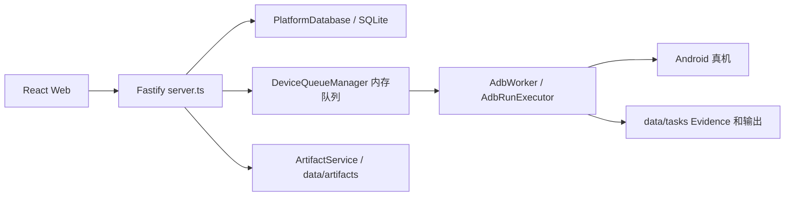
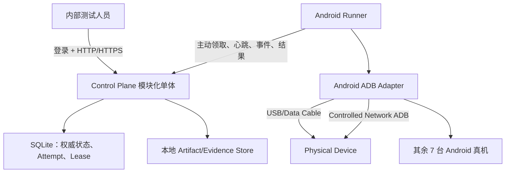
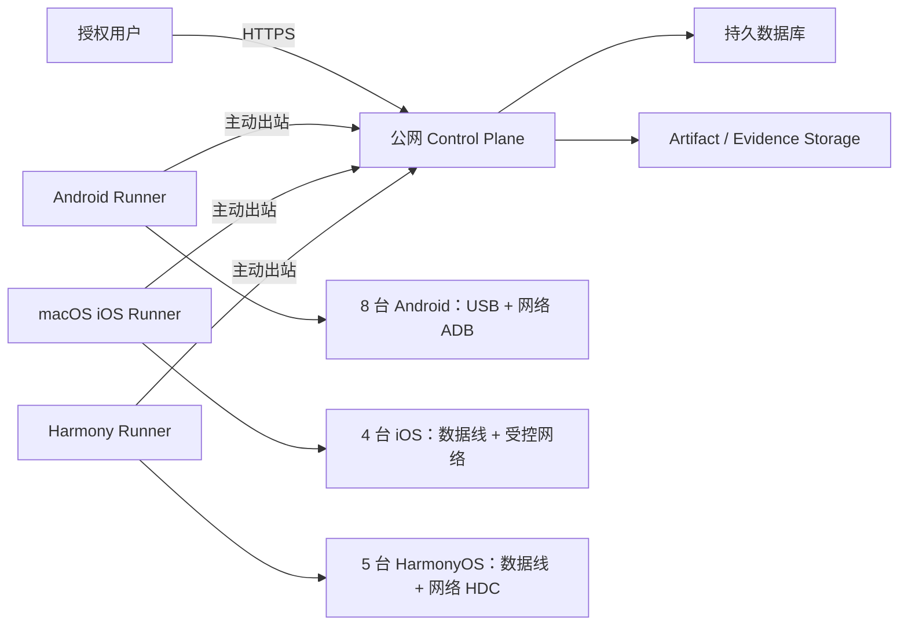
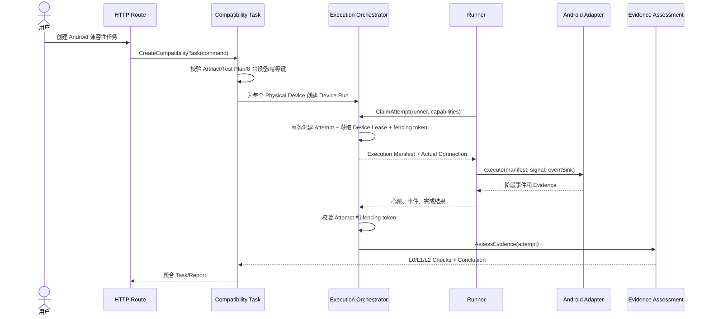

# SDK 视频兼容性测试平台：整体框架设计与分期演进方案

> 版本：V1.0-Draft  
> 日期：2026-07-31  
> 适用范围：当前仓库、一期 Android 双连接闭环、二期 iOS/HarmonyOS 与公网试点、三期生产化建设  
> 关联需求：[《SDK 视频兼容性测试平台三期需求规划报告》](./SDK视频兼容性测试平台分期需求报告.md)  
> 风险输入：当前项目风险与隐患清单、实际代码结构及本地数据现状

---

## 0. 这份文档要解决什么问题

当前项目已经能完成少量 Android 真机的本地测试流程，但现有结构仍然接近“单机 MVP”：HTTP API、SQLite、内存队列和 ADB 执行都运行在同一个 Node.js 进程中。这个结构可以继续验证功能，却不能直接支撑一期要求的 8 台 Android 真机双连接完整闭环，也不能安全地平滑扩展到二期 iOS、HarmonyOS 和公网服务器。

本方案的目标不是推倒重写，而是回答五个问题：

1. **一期应把代码调整成什么结构，才能真正交付 Android 兼容性测试功能；**
2. **怎样保证同一台真机的数据线和网络连接都保留，并执行完全相同的测试流程；**
3. **二期增加 iOS、HarmonyOS 时，哪些模块可以直接复用，哪些只需要新增 Adapter；**
4. **三期生产化时，怎样增加权限、设备池、质量门禁和高可用，而不再次重构核心模型；**
5. **怎样让不熟悉 TypeScript/Node.js 的维护者也能看懂、定位和安全修改代码。**

---

# 1. 需要先对齐的架构结论

## 1.1 推荐的总体架构

推荐采用：

> **模块化单体 Control Plane + 独立 Runner 进程 + 显式注册的平台 Adapter。**

说明：

- **模块化单体**：控制面暂时仍是一个可部署服务，但内部按业务能力分成清晰 Module；
- **独立 Runner**：真机控制、ADB/HDC/XCTest、应用安装、进程执行和 Evidence 采集不再长期留在 HTTP API 进程内；
- **平台 Adapter**：Android、iOS、HarmonyOS 只实现统一执行契约，不把平台命令和平台判断写进 Core；
- **显式注册**：Adapter 在 `composition-root.ts` 中明确创建和注册，不采用动态扫描、装饰器魔法或第三方插件市场；
- **渐进迁移**：先保留现有可运行能力，再一批一批替换内部结构，每一批都必须可测试、可回滚。

## 1.2 为什么一期就需要 Runner

一期的“联网 Android 真机”不应理解为让公网服务器直接连接手机 ADB 端口。推荐定义为：

```text
浏览器/用户
    │ HTTPS
    ▼
Control Plane
    │ Runner 主动出站领取任务、上报心跳和结果
    ▼
Android Runner（位于受控实验室网络）
    ├── USB / 数据线 ADB
    └── 受控局域网 / VPN 内的网络 ADB
             ▼
         8 台 Android 真机
```

这样可以同时满足：

- 网络方式连接 Android 真机；
- 保留每台设备的数据线测试能力；
- 二期公网试点时不暴露 ADB、HDC 或 iOS 调试端口；
- 后续增加多台 Runner 主机，而不修改 Task、Report 和 Evidence 的核心语义。

## 1.3 一期不建议拆微服务

一期不建议引入以下复杂度：

- 不拆十几个微服务；
- 不为了“先进”立即引入 Kafka、RabbitMQ 或 Kubernetes；
- 不做运行时动态插件加载；
- 不做复杂多租户和企业级细粒度 RBAC；
- 不把每张数据库表都包装成一个 Repository Interface；
- 不先建设通用工作流引擎再实现 Android 流程。

一期真正需要解决的是：**设备身份、双连接、持久 Attempt、Device Lease、Runner 协议、执行可信度、Evidence、安全边界和可恢复性。**

## 1.4 三期目标建议

三期不再增加新的移动平台，而是将前三个平台升级为企业可持续使用的质量基础设施：

1. 公网生产化安全与运维；
2. 企业 SSO、组织、项目和 RBAC；
3. 设备池、预约、配额和公平调度；
4. L3 媒体质量规则；
5. CI/CD 自动触发和 Release Policy；
6. 高可用、备份、恢复、容灾和运营分析。

---

# 2. 当前代码架构审计结论

## 2.1 当前真实调用链



当前 API 进程同时承担：

- HTTP 路由；
- 请求校验；
- 设备发现；
- 数据库访问；
- 队列调度；
- ADB 执行；
- 子进程管理；
- Evidence 文件访问；
- 报告查询。

只要 API 服务重启，HTTP、调度和正在运行的 ADB 执行都会同时中断。

## 2.2 当前值得保留的设计

### 2.2.1 Android 应用准备已经形成较好的深 Module

`apps/api/src/execution/android-app-preparation/` 已经把以下复杂度隐藏在统一入口之后：

- 设备 readiness；
- 安装协调；
- 运行时权限；
- OEM 系统弹窗；
- UI XML 识别；
- 诊断 Evidence 保存。

这个方向应保留。新增厂商兼容规则继续放在该 Module 内，不应把厂商文案和弹窗判断重新写回 `adb.ts`。

### 2.2.2 设备发现已有初步 Provider Seam

`DeviceRegistryService` 通过 `DeviceDiscoveryProvider` 调用 Android ADB Provider，说明当前代码已经开始隔离“设备登记”和“平台发现命令”。二期可沿用这个思路，但需要升级为“Physical Device + Device Connection + Runner Observation”。

### 2.2.3 每台设备独立 Device Run

Task 下按设备创建 `device_runs`，这是后续多设备并发、矩阵报告和 Attempt 演进的正确基础。

### 2.2.4 删除服务具备较强的局部完整性

`TaskDeletionService` 将事务、文件隔离区、路径白名单、共享 Artifact 判断和审计集中处理，虽然文件较长，但职责具有内聚性。后续应把它归入 Data Lifecycle Module，而不是拆成大量细碎类。

## 2.3 当前主要结构问题

| 当前位置 | 当前问题 | 对分期目标的影响 | 目标调整 |
|---|---|---|---|
| `server.ts` | 组合依赖、业务校验和所有路由集中 | 新增平台时条件分支快速增长 | 保留薄 HTTP 层，业务动作进入 Use Case |
| `database.ts` | 同时负责 Artifact、Device、Task、Run、Report、状态聚合 | 状态规则和 SQL 难以独立测试、演进 | 按 Module 拆分 Store，实现仍可共用 SQLite |
| `queue.ts` | 设备 Lane 只在内存中，无原子 claim | 重启、多 Runner、重试时可能重复或丢失执行 | 持久 Attempt + Lease + fencing token |
| `adb.ts` | 编排、ADB、协议、文件、DB 更新、Evidence 混在一起 | iOS/Harmony 无法复用 Core；Android 也难维护 | 抽出 Android Platform Adapter 深 Module |
| `artifacts.ts` | 文件完成落盘后才执行部分业务限制；DB 写失败可能遗留最终目录 | 大文件和并发上传有磁盘耗尽、孤儿风险 | 隔离区、流式配额、验证、提交、回收器 |
| `process.ts` | stdout/stderr 无上限，仅发送 SIGTERM | OOM、子进程残留、设备占用 | Execution Supervisor + 有界输出 + 分级终止 |
| `types.ts` | 公共 API DTO、内部领域状态、Android Event 混放 | 平台增加后形成全局类型杂物间 | 类型跟随 Module，跨进程协议单独放 contracts |
| `schema.ts` | `CREATE TABLE IF NOT EXISTS` + 补列，无正式版本迁移 | 二期数据结构变更难审计、难回滚 | `schema_migrations` + 顺序迁移文件 |
| `config.ts` | 依赖 `process.cwd()`，默认设备 Serial 硬编码 | 部署目录变化、设备变化会导致隐式错误 | 启动配置校验、绝对数据目录、取消默认设备 |
| Device ID | 当前主要由 ADB Serial 形成 | USB Serial 与网络 `IP:Port` 可能把同一手机登记两次 | Physical Device 与 Connection 分离 |
| 启动恢复 | 运行中 Task 在服务启动时直接标记失败 | 无法区分 Runner 仍在执行、Lease 过期或结果晚到 | 心跳、Lease 到期、Attempt 恢复策略 |

## 2.4 风险到架构措施的映射

| 风险/隐患 | 一期必须落地的架构措施 |
|---|---|
| API 无认证、网络入口不清晰 | 最小登录/身份、默认拒绝、授权中间件、明确监听地址和反向代理边界 |
| APK 只校验包名 | APK 解析、SHA-256、签名证书指纹 allowlist、协议版本和来源审计 |
| `passed` 不能证明视频有效 | L0/L1/L2 分层结论；使用媒体探测和完整解码验证 |
| `data/` 已约 3.5 GB | 内容寻址、去重、保留期、配额、垃圾回收和容量告警 |
| 上传大小限制执行过晚 | 入口层和流读取层双重限制；隔离区容量限制；失败自动清理 |
| 上传失败孤儿、创建任务不幂等 | Artifact 提交状态、清理器、Task `idempotency_key` 唯一约束 |
| 无 Attempt、Lease、原子领取 | 新增 Attempt、Device Lease、fencing token 和 CAS 状态更新 |
| 缺少 Execution Manifest | Attempt 启动前冻结不可变 Manifest，并随报告长期保存 |
| 日志/截图/UI XML 泄露 | Evidence 分级、访问授权、脱敏、保留期、下载审计 |
| stdout/logcat 无上限 | 有界缓冲、滚动文件、最大字节数、截断标记 |
| 取消和超时不彻底 | Abort → 软终止 → 超时后强杀进程树 → 平台清理 → Lease 释放 |
| 只有备份、没有恢复证明 | 版本化备份、restore 脚本、定期恢复演练和恢复报告 |
| SQLite 迁移弱 | 正式迁移版本、checksum、启动前检查和备份 |
| 缺少故障场景 E2E | Runner 断线、服务重启、设备离线、重复事件和旧 token 故障测试 |
| 默认 Serial、cwd 配置 | 移除隐式默认值，启动时输出可读的配置错误 |
| 公网运行链路不完整 | 二期仅暴露 HTTPS 控制面，Runner 主动出站，不暴露设备调试端口 |

---

# 3. 设计原则：高内聚、低耦合、可插拔但不过度抽象

## 3.1 Module 的判断标准

一个 Module 应同时满足：

1. 对外只有少量稳定入口；
2. 内部隐藏一组相关复杂度；
3. 修改某个业务规则时，主要改动集中在该目录；
4. 调用方不需要知道内部 SQL、ADB 命令、文件路径或平台细节；
5. 测试和生产调用同一个入口，而不是专门为测试开放后门。

这就是“深 Module”：**Interface 小，内部能力深，调用方认知负担低。**

## 3.2 什么叫可插拔

本项目中的可插拔定义为：

> 在 `composition-root.ts` 中注册一个受信任 Adapter，实现稳定合同后，Core 不需要增加平台专属命令或大面积 `if (platform === ...)`。

不等于：

- 用户可以上传任意插件代码；
- 运行时自动扫描目录加载未知实现；
- 每个函数都必须先定义一个 Interface；
- 一期先实现空壳 iOS/Harmony 类。

一个 Adapter 只有 Android 一个实现时，先保持简单；当 iOS/Harmony 第二个实现出现时，再冻结真正共同的 Seam。Runner 协议、Artifact Store 等一期已经明确存在本地/远程演进需求的边界，可以提前稳定合同。

## 3.3 面向不熟悉 TypeScript 的可读性规则

1. 目录按业务能力命名，不按 `controllers/services/repositories/utils` 技术分层堆放；
2. 每个 Module 有一个 `index.ts` 作为公开入口；
3. 每个 Module 有一个短 `README.md`；
4. Use Case 使用业务动作命名，例如 `CreateCompatibilityTask`、`ClaimAttempt`；
5. 避免复杂泛型、装饰器、反射、自动依赖注入和隐式全局状态；
6. `composition-root.ts` 明确写出“谁依赖谁”；
7. 错误使用稳定业务码和中文说明，不把底层异常直接抛给 UI；
8. 重要状态转换写成纯函数并用表格测试；
9. 一个文件优先只表达一个核心概念；
10. 注释解释“为什么有这个约束”，不逐行翻译代码。

---

# 4. 分期目标拓扑

## 4.1 一期目标拓扑：Android 双连接闭环



一期允许 Control Plane、Runner、SQLite 和本地存储仍部署在同一台机器，但必须是**逻辑和进程边界清晰**的结构，确保二期可以把 Control Plane 移到服务器，而 Runner 留在实验室。

## 4.2 二期目标拓扑：三平台与公网试点



公网入口只开放控制面 HTTPS。以下端口或能力不得直接暴露到公网：

- ADB；
- HDC；
- Xcode / XCTest 调试端口；
- Runner 管理端口；
- 未授权 Evidence 文件目录。

## 4.3 三期目标拓扑：生产运营

三期在二期基础上增加：

- SSO / RBAC；
- 多项目数据隔离；
- 多 Runner 和设备池调度；
- 对象存储和数据库生产化；
- CI/CD Trigger 和 Release Policy；
- 监控、审计、容量、备份和恢复；
- 按实际容量目标决定是否横向扩展 Control Plane。

三期仍不要求把每个 Module 拆成独立微服务。只有当某个 Module 出现独立扩缩容、故障隔离、数据所有权或团队所有权需求时再拆。

---

# 5. Control Plane 的 Module 设计

## 5.1 Module 总览

| Module | 主要职责 | 明确不负责 |
|---|---|---|
| Identity Access | 登录、用户身份、角色、API/CI 凭证 | 不执行设备命令 |
| Artifact Catalog | 上传会话、隔离验证、内容身份、引用、保留策略 | 不判断最终测试结论 |
| Device Lab | Runner、Physical Device、Connection、readiness 快照 | 不创建 Task，不直接执行测试 |
| Test Planning | Test Plan、Platform Protocol、规则版本 | 不管理设备占用 |
| Compatibility Task | 创建 Task、展开 Device Run、取消意图、幂等 | 不直接调用 ADB/HDC/XCTest |
| Execution Orchestrator | Attempt、Lease、claim、heartbeat、重试、超时、fencing | 不包含平台命令 |
| Evidence Assessment | Evidence 登记、L0/L1/L2 检查和结论计算 | 不负责设备调度 |
| Report Center | 面向 UI/CI 的只读报告、矩阵、失败解释 | 不修改执行状态 |
| Data Lifecycle | 删除、归档、垃圾回收、备份与恢复审计 | 不决定测试是否通过 |
| Runner Gateway | Runner 注册、领取、事件和结果传输 | 不理解 ADB/HDC 细节 |

## 5.2 依赖规则

```text
HTTP Routes
    ↓
Application Use Cases
    ↓
Domain Rules / State Machines
    ↓
Module-owned Store / Gateway

Infrastructure Implementations
    ├── SQLite
    ├── Local File Store
    ├── HTTP Runner Transport
    └── Object Storage / PostgreSQL（未来）
```

硬性约束：

1. Route 不能直接写 SQL；
2. Route 不能直接运行 ADB/HDC/xcodebuild；
3. Core 不能引用 Fastify Request/Reply；
4. Control Plane Core 不能引用 ADB Serial、HDC target 或 Xcode 路径；
5. Platform Adapter 不能绕过 Attempt、Lease、Manifest、Evidence 和审计；
6. Report 只能读取已持久化事实，不通过读取临时文件猜测状态；
7. 模块之间优先通过业务命令和明确 DTO 交互，不共享可变内部对象。

## 5.3 一个任务的完整调用流程



---

# 6. 核心领域模型

## 6.1 必须稳定的术语

| 概念 | 含义 |
|---|---|
| Physical Device | 一台真实手机。USB 与网络端点不能变成两台设备 |
| Device Connection | Runner 到 Physical Device 的一个端点，如 USB 或网络 ADB |
| Connection Policy | 本次 Device Run 对连接的要求 |
| Actual Connection | Attempt 实际使用的连接，必须写入 Manifest |
| Task | 一个平台的一次兼容性测试意图 |
| Device Run | Task 针对一台 Physical Device 的逻辑目标 |
| Attempt | Device Run 的一次物理执行；重试必须新建 |
| Device Lease | Attempt 对 Physical Device 的限时独占权 |
| Fencing Token | 防止旧 Runner/旧 Attempt 覆盖新结果的单调令牌 |
| Execution Manifest | Attempt 开始前冻结的不可变执行输入和版本快照 |
| Evidence | 支撑 Check 和 Conclusion 的文件或结构化记录 |
| Check | 可解释、可版本化的一项检查 |
| Conclusion | 根据规则计算出的业务结论，与生命周期状态分离 |

## 6.2 关键不变量

1. 同一 Physical Device 同一时刻最多只有一个有效 Lease；
2. 同一 Device Run 同一时刻最多只有一个非终态 Attempt；
3. 重试创建新 Attempt，绝不覆盖旧 Attempt 的状态和 Evidence；
4. USB 和网络端点共享同一个 Physical Device ID 和 Lease；
5. Actual Connection 在 Attempt 开始后不能静默切换；
6. 需要切换连接时，当前 Attempt 先结束，再根据策略创建新 Attempt；
7. 旧 fencing token 的事件和结果只能审计，不能更新当前状态；
8. Manifest 创建后不可修改，只能创建新版本/新 Attempt；
9. Task 结论由 Device Run 聚合，Device Run 结论由选定 Attempt 和版本化规则计算；
10. `online` 不等于 `ready`；readiness 必须匹配当前 Test Plan 和 Platform Protocol。

## 6.3 生命周期和结论分离

建议不要再让一个 `status` 同时表达“执行到哪”和“业务是否通过”。

### Attempt 生命周期

```text
queued → claimed → running → finalizing → finished
                         ├→ cancelled
                         ├→ timed_out
                         └→ interrupted
```

### Attempt/Run 结论

```text
passed | failed | blocked | cancelled | infrastructure_error | not_evaluated
```

示例：

- 设备安全锁未解除：生命周期结束，结论为 `blocked`；
- SDK 返回错误：生命周期结束，结论为 `failed`；
- Runner 断线且 Lease 超时：生命周期结束，结论为 `infrastructure_error`；
- 用户取消：生命周期为 `cancelled`，不再伪装成 `blocked`。


---

# 7. SDK 业务测试模式与场景框架

兼容性、稳定性和健壮性测试都需要控制真机，但它们的**业务工作负载、观测指标和通过条件不同**。如果继续把这些逻辑直接写进 Android ADB 执行流程，二期接入 iOS/HarmonyOS、三期增加稳定性和健壮性时会再次复制代码。

因此框架需要把“设备怎么控制”和“SDK 业务怎么测试”拆成两个容易理解的层次：

```text
Control Plane
└── Test Plan / Task / Attempt / Report

Runner
├── Platform Adapter
│   └── 负责安装、启动、前后台切换、进程控制、文件收发和平台日志采集
│
└── SDK Scenario Adapter
    └── 负责具体 SDK 的输入准备、业务调用、结果解析和业务字段提取

Scenario Framework
├── Workload / Dataset
├── Lifecycle Actions
├── Metrics Collector
├── Outcome Oracle
└── Evidence Collector
```

## 7.1 两类 Adapter 的边界

### Platform Adapter

Platform Adapter 只回答“怎样在这个平台控制设备”：

- Android：ADB、Activity/Service、前后台、logcat、ANR/crash、文件推送和拉取；
- iOS：Xcode/XCTest、安装签名应用、启动、生命周期控制、xcresult 和系统日志；
- HarmonyOS：HDC、应用安装、Ability 生命周期、hilog 和文件收发；
- 不理解 Morpho 的具体错误码、active mask、fallback 规则或算法名称。

### SDK Scenario Adapter

SDK Scenario Adapter 只回答“怎样测试这个 SDK 业务”：

- 选择并校验 SDK、Bridge、模型、参数和校准文件；
- 根据图片后处理、视频后处理等业务准备输入；
- 解析 `init`、`process`、`getFailureCode`、active mask、输出路径等结果；
- 识别 SDK 是否真正执行、是否跳过算法、是否发生 fallback；
- 输出结构化业务结果，交给 Outcome Oracle 判定；
- 不直接申请设备、不直接修改 Task 状态、不绕过 Lease/Attempt/Manifest/Evidence。

一期不建设动态第三方插件市场。受信实现由 `composition-root.ts` 显式注册，例如：

```text
MorphoVideoPostProcessorScenarioV2
MorphoImagePostProcessorScenarioV2
```

这样维护者查问题时路径清楚：设备连接问题看 Platform Adapter，Morpho 业务问题看 SDK Scenario Adapter，判定规则问题看 Outcome Oracle。

## 7.2 统一 Test Plan，不为每种测试新建一套任务系统

推荐的 Test Plan 结构：

```text
TestPlan
├── id / version
├── test_mode
├── platform_protocol_version
├── sdk_scenario_id / version
├── sdk_and_model_artifacts
├── workload_definition
├── dataset
├── execution_policy
├── observation_policy
└── oracle_rules / version
```

`test_mode` 首批支持：

- `compatibility`：兼容性；
- `stability`：稳定性；
- `robustness`：健壮性。

后续可在不改变 Task/Attempt 主干语义的前提下增加：

- `performance`：性能；
- `stress`：压力；
- `recovery`：恢复性；
- `upgrade_regression`：版本升级回归。

一期正式交付 `compatibility`，但数据模型和接口必须允许后续增加其他模式。不要为稳定性、健壮性分别复制一套 Task 表、调度器和报告系统。

## 7.3 ScenarioRun 与 CaseExecution

一次 Attempt 不一定只处理一个视频。推荐层级：

```text
Task
└── DeviceRun
    └── Attempt
        └── ScenarioRun
            └── CaseExecution[]
                ├── InputVariant
                ├── ExpectedOutcome
                ├── ObservedOutcome
                ├── MetricsSummary
                └── Evidence[]
```

- `ScenarioRun`：一个稳定性 Session、一个健壮性异常矩阵，或一组兼容性 Feature Matrix；
- `CaseExecution`：一个具体素材、一次循环、一个异常变体或一个功能组合的执行事实；
- `InputVariant`：正常输入或按照 Recipe 生成的异常输入；
- `ExpectedOutcome`：测试前冻结的预期；
- `ObservedOutcome`：实际错误码、输出、fallback、crash 和业务字段；
- `MetricsSummary`：该 Case 的耗时与资源摘要；
- `Evidence`：日志、输出、截图、指标文件和结构化结果。

必须增加这一层的原因：

1. 兼容性可能一次覆盖多个 Video/Photo、HDR、LLHDR、Motion、MFNR、EIS、H265 等 Case；
2. 稳定性可能执行“20 个 MP4 × 10 轮 + 前后台切换 20 次 + 连续 2 小时”；
3. 健壮性可能从一个正常数据集生成几十个缺失、损坏、截断和时序异常变体；
4. 若 Attempt 只保存一个最终 output，无法定位哪一轮、哪个输入和哪个异常规则失败。

## 7.4 兼容性测试模式

兼容性模式关注“同一 SDK 功能在设备矩阵上是否按约定完成”。Workload 至少可以描述：

- Media Dataset：Video、Photo、pack 文件、模型、参数和校准文件；
- Feature Matrix：HDR、LLHDR、Motion、MFNR、EIS、地平线矫正/防抖、人脸条件、H265 等；
- Device Capability：系统、芯片、编解码器和设备能力标签；
- Repeat Policy：单次或少量重复；
- Expected Output：应产生的输出类型、数量和基础元数据。

数据线和网络连接只改变 Attempt 的 `Actual Connection`，不能改变 Scenario、Dataset、Oracle 和 Evidence 要求。双连接验收必须执行同一个版本的 Test Plan。

## 7.5 稳定性测试模式

Morpho 报告中的 800/600 张图像 pack、2GB MP4、前后台切换 20 次、前台连续处理约 2 小时、20 个 MP4 循环 10 次，说明稳定性测试应建模为一个**长时间 Stability Session**，而不是把 API 超时改大后重复兼容性任务。

### Stability Workload

至少支持：

- 按次数循环、按时长运行或两者结合；
- 单素材、多素材集合和固定/随机顺序；
- 冷启动、热启动、杀进程后重启；
- 前台、后台、前后台切换和锁屏/解锁等生命周期动作；
- 大文件、大批量图片和连续多 Case；
- Case 间隔、失败后继续/停止策略和设备冷却策略；
- Session 中断后的恢复策略，但不得把中断前后的事实合并成同一 Attempt。

### Stability Observation

建议采集：

- crash、ANR、进程异常退出和系统杀进程；
- PSS/RSS、Java/Native Heap、CPU、温度、电量、磁盘和网络；
- 单次处理耗时、吞吐量、P50/P95/P99；
- 连续运行后的内存增长趋势、资源未释放和输出增长；
- 每轮成功率、首次失败位置、连续失败数；
- 设备是否在 Case 后恢复到可继续测试的状态。

高频指标不能无限逐点写入 SQLite。推荐 Runner 先写有上限的时序 Evidence 文件，并周期上报摘要；Control Plane 保存 Session/Case 摘要、索引和告警，原始采样按保留策略归档。

### Stability Oracle

稳定性结论不能只看“最后一次成功”。规则应可配置：

- 允许的最大 crash/ANR 次数；
- 成功率阈值；
- 最大连续失败次数；
- 内存增长斜率和峰值；
- P95/P99 耗时阈值；
- 是否允许出现设备过热、低电量或存储不足导致的 `blocked`；
- Session 未完成时是 `failed`、`blocked` 还是 `infrastructure_error`。

## 7.6 健壮性测试模式

健壮性测试关注的不是“所有异常输入都处理成功”，而是：

> **面对已定义的异常输入，SDK 的实际错误码、fallback、降级行为、输出和进程稳定性，是否与预期一致。**

### Input Mutation / Fault Injection Recipe

Recipe 必须声明基准数据集、变异动作、目标文件/区间、随机种子和生成器版本。首批可支持：

- 删除文件、空文件、截断文件、损坏文件；
- 缺少或损坏 XML、JPEG、MP4、sensor info、device/model/calibration 文件；
- JPEG 数量少于 `input_num`；
- 音频全部缺失、头部/尾部缺失；
- IMU/Meta 完全缺失、中间缺失或交错错乱；
- 音视频 PTS 偏差；
- IMU/Meta 时序错乱；
- 参数、模型或校准文件版本不匹配。

异常输入应从只读基准 Artifact 派生到 Attempt 专属工作目录，不能修改公共金样本。相同 Recipe + 相同随机种子必须可复现相同 InputVariant。

### ExpectedOutcome 与 Outcome Oracle

推荐表达以下预期类型：

```ts
type ExpectedOutcome =
  | { kind: 'success'; requiredChecks: string[] }
  | { kind: 'expected_failure'; failureCodes: string[]; mustNotCrash: boolean }
  | { kind: 'expected_fallback'; output: 'input_copy'; failureCodes?: string[]; mustNotCrash: boolean }
  | { kind: 'expected_degraded'; conditions: string[]; mustNotCrash: boolean }
```

这段类型用于解释领域含义，不要求一期机械照抄。核心原则是：

- SDK 返回错误码不一定代表 Case 失败；返回**预期错误码且不 crash**，应记录为 `expected_failure_matched`；
- 约定复制输入 MP4 作为 fallback 时，应验证输出确实与输入一致，并记录 `expected_fallback_matched`；
- 约定跳过某算法时，应验证 active mask/执行阶段符合预期；
- 返回错误码不匹配、发生 crash、产生不应有的输出或错误地执行算法，才是健壮性失败；
- 兼容性正常用例中出现 fallback，不能因为“有输出文件”而算成功。

建议 Case 结论至少区分：

```text
passed
failed
blocked
expected_failure_matched
expected_fallback_matched
degraded_as_expected
infrastructure_error
not_evaluated
```

## 7.7 SDK 与规则版本化

为了让报告可复现，以下版本进入 Execution Manifest：

- SDK/Bridge 版本和哈希；
- SDK Scenario Adapter ID 和版本；
- Platform Protocol 版本；
- 测试应用、模型、参数、校准文件 Artifact 哈希；
- Dataset 和 Input Mutation Recipe 版本；
- Test Plan、ExpectedOutcome 和 Outcome Oracle 版本；
- Metrics Collector 版本；
- 连接方式、设备快照和 Runner 工具链版本。

SDK API 变化，例如新增模式、`setModelAndParamFile`、`getProgress`、`setDebugInfo`、`getFailureCode` 或参数字段变化，应通过新的 Scenario Adapter/Protocol 版本表达，不在旧规则里静默改变含义。

## 7.8 分期落地边界

| 能力 | 一期 | 二期 | 三期 |
|---|---|---|---|
| 兼容性 | Android 正式交付 | Android/iOS/HarmonyOS 正式交付 | 持续回归和发布门禁 |
| ScenarioRun/CaseExecution | 建立最小模型并服务兼容性多素材 | 三平台统一 | 扩展为完整业务场景平台 |
| 稳定性 | 预留 Workload、Metrics、Oracle seam；允许 Android 技术 Spike | Android 或指定平台试点 | 正式交付三平台稳定性能力 |
| 健壮性 | 预留 Recipe、ExpectedOutcome、Oracle seam | 指定 SDK/平台试点 | 正式交付和版本发布回归 |
| 性能/压力/恢复 | 不正式交付 | 预研 | 按业务目标正式建设 |
| 升级回归 | 保存 SDK/规则版本 | 建立三平台版本矩阵 | 纳入 CI/CD 发布门禁 |

一期的目标是把扩展点放对，并让兼容性真实使用这套模型；不是一期同时交付全部稳定性和健壮性功能。

# 8. 每台真机的数据线与网络连接设计

## 8.1 数据结构

```text
PhysicalDevice
├── id
├── platform
├── displayName
├── enrollmentFingerprint
├── enabled
└── DeviceConnections[]
    ├── wired endpoint
    └── network endpoint
```

`DeviceConnection` 至少记录：

- `id`；
- `physical_device_id`；
- `runner_id`；
- `transport`：`wired` / `network`；
- `provider`：`adb` / `hdc` / `xctest`；
- `endpoint_ref`：由 Runner 理解，Control Plane 不直接运行；
- `status`；
- `last_seen_at`；
- `last_ready_at`；
- `readiness_snapshot`；
- 网络连接的受控网络标记和配置版本。

## 8.2 四种 Connection Policy

| Policy | 规则 |
|---|---|
| `wired_only` | 必须使用数据线，否则阻塞 |
| `network_only` | 必须使用受控网络连接，否则阻塞 |
| `prefer_wired` | 分配前优先数据线；数据线不可用时可选网络 |
| `network_allowed` | 调度器可按当前健康度选择，但必须记录实际连接 |

一期发布 Gate 必须对 8 台 Android 真机分别执行：

- 8 条 `wired_only` 完整闭环；
- 8 条 `network_only` 完整闭环。

最低形成 **16 条设备—连接验收基线**。`prefer_wired` 和 `network_allowed` 不能替代这 16 条强制验收。

## 8.3 设备去重策略

不能继续简单使用 ADB 列表中的 Serial 作为 Physical Device 身份，因为：

- USB 通常表现为设备 Serial；
- 网络 ADB 常表现为 `IP:Port`；
- IP 可能变化；
- 同一设备可能被登记为两个“设备”。

推荐采用“受控登记”而不是完全自动猜测：

1. Runner 发现 Endpoint；
2. 读取允许范围内的硬件/系统指纹；
3. 管理员首次登记 Physical Device；
4. 将 USB 与网络 Endpoint 显式绑定到该 Physical Device；
5. 后续发现只更新 Endpoint 状态，不自动创建第二台 Physical Device；
6. 指纹不一致或冲突时进入待确认状态，不静默合并。

## 8.4 连接失败和回退规则

- 在 Attempt 创建前，调度器可以按 Policy 选择健康连接；
- Attempt 开始后，连接中断应结束当前 Attempt；
- 允许重试时创建新 Attempt，并重新选择连接；
- 报告要能比较同一设备有线与网络执行的耗时、失败分类和 Evidence；
- 网络 ADB 只允许在受控局域网/VPN 中使用，不允许直接暴露到公网。

---

# 9. Runner 与 Platform Adapter 设计

## 9.1 Runner 的职责

Runner 负责：

- 向 Control Plane 注册身份和能力；
- 上报可管理的设备 Endpoint 与 readiness；
- 主动领取 Attempt；
- 下载或读取本次 Manifest 指定的 Artifact；
- 选择已被 Control Plane 批准的 Actual Connection；
- 调用 Platform Adapter；
- 上报心跳、结构化事件、Evidence 和最终结果；
- 取消、超时和异常时清理进程、应用和设备临时文件；
- 使用 fencing token 防止旧任务回写。

Runner 不负责：

- 自己创建 Task；
- 自己决定最终报告是否通过；
- 绕过 Control Plane 私自重试；
- 把原始 ADB/HDC/Xcode 端口暴露给用户；
- 修改 Test Plan 或 Manifest。

## 9.2 推荐的 Platform Adapter Seam

以下为表达职责的示意，不要求一期机械照抄每个字段：

```ts
interface PlatformAdapter {
  readonly platform: 'android' | 'ios' | 'harmonyos'

  observeConnections(): Promise<ConnectionObservation[]>

  probeReadiness(
    connection: SelectedConnection,
    protocol: PlatformProtocolSnapshot,
  ): Promise<ReadinessResult>

  execute(
    request: PlatformExecutionRequest,
    context: ExecutionContext,
  ): Promise<PlatformExecutionResult>
}

interface ExecutionContext {
  signal: AbortSignal
  emit(event: RunnerEvent): Promise<void>
  publishEvidence(evidence: LocalEvidence): Promise<EvidenceReceipt>
}
```

对外 Interface 保持小。Android 安装、权限、弹窗、文件推送、启动、轮询、logcat 和清理都留在 Android Adapter 内部，不把每一步都变成 Control Plane 的远程调用。

## 9.3 Android Adapter 内部建议结构

```text
platforms/android/
├── index.ts                       # 对 Runner 的唯一公开入口
├── android-platform-adapter.ts    # 组织 Android 完整执行
├── connection-observer.ts         # USB / 网络 ADB Endpoint 发现
├── readiness.ts                   # 当前 Test Plan 所需 readiness
├── adb-client.ts                  # 目标设备命令，所有命令强制 -s
├── execution-supervisor.ts        # 超时、取消、进程树和输出上限
├── protocol-runner.ts             # 输入、启动、完成、输出契约
├── evidence-collector.ts          # logcat、截图、result、设备快照
├── cleanup.ts                     # force-stop、临时文件、连接清理
└── app-preparation/               # 保留现有深 Module
```

现有 `android-app-preparation` 应整体迁移或被 Adapter 调用，不要重新实现。

## 9.4 二期新增 Adapter 的方式

二期新增：

```text
platforms/ios/
└── ios-platform-adapter.ts

platforms/harmonyos/
└── harmony-platform-adapter.ts
```

二者复用：

- Task / Device Run / Attempt；
- Lease 和 fencing；
- Runner 心跳和事件协议；
- Manifest；
- Artifact 下载；
- Evidence 登记；
- L0/L1/L2 Validator；
- Report 聚合。

二者自行实现：

- 设备发现和连接；
- readiness；
- 签名/信任/Developer Mode；
- 安装、启动、停止；
- 日志和截图；
- 平台临时路径；
- 清理和错误分类。

---

# 10. 持久调度、Attempt、Lease 与防重复执行

## 10.1 一期不需要消息中间件，但必须有数据库事实源

推荐先使用 SQLite 实现可靠调度：

1. 在事务中选择可领取 Device Run；
2. 创建 Attempt；
3. 对 Physical Device 获取唯一 Lease；
4. 生成递增 fencing token；
5. 将 Attempt 分配给 Runner；
6. Runner 确认后进入 running；
7. Runner 定期 heartbeat；
8. Lease 到期后由恢复器处理；
9. 所有事件按 `attempt_id + fencing_token + event_seq` 幂等写入；
10. 重试创建新 Attempt。

## 10.2 推荐表结构演进

```text
runners
physical_devices
device_connections
device_observations
artifacts
artifact_uploads
test_plans
platform_protocols
tasks
device_runs
run_attempts
device_leases
execution_events
execution_manifests
evidence
check_results
task_outputs
task_deletion_audits
schema_migrations
```

关键字段：

### `run_attempts`

- `id`；
- `device_run_id`；
- `attempt_no`；
- `runner_id`；
- `actual_connection_id`；
- `status`；
- `conclusion`；
- `lease_id`；
- `fencing_token`；
- `heartbeat_at`；
- `started_at` / `finished_at`；
- `failure_category` / `failure_code` / `failure_message`；
- `manifest_id`。

### `device_leases`

- `physical_device_id`；
- `attempt_id`；
- `owner_runner_id`；
- `fencing_token`；
- `acquired_at`；
- `expires_at`；
- `released_at`。

### `execution_events`

- `attempt_id`；
- `sequence_no`；
- `event_type`；
- `phase`；
- `payload_json`；
- `occurred_at`；
- 唯一约束 `(attempt_id, sequence_no)`。

## 10.3 服务重启恢复语义

不再在启动时把所有 `running` 记录直接改成失败。推荐流程：

1. Control Plane 重启后读取未终态 Attempt；
2. 若 Runner 已重连且 fencing token 仍有效，继续接收心跳和事件；
3. 若 Lease 已过期，标记当前 Attempt `interrupted/infrastructure_error`；
4. 根据重试策略创建新 Attempt；
5. 晚到的旧结果因 token 过期被拒绝；
6. 整个恢复过程写入审计事件。

---

# 11. Execution Manifest、Evidence 和可信结论

## 11.1 Execution Manifest 至少冻结的内容

- Task、Device Run、Attempt ID；
- Artifact ID、SHA-256、大小和类型；
- APK package、version、签名证书指纹；
- 真实 SDK/Bridge 版本；
- Test Plan ID、版本和规则哈希；
- Platform Protocol ID、版本和哈希；
- Physical Device ID；
- Device Snapshot；
- Connection Policy 和 Actual Connection；
- Runner ID、Runner 版本、Platform Adapter 版本；
- 超时、权限、安装模式和清理策略；
- L0/L1/L2 Validator 版本；
- Control Plane 构建版本。

## 11.2 一期结论分层

### L0：协议合规

证明：

- APK 被允许；
- 包名和签名符合 allowlist；
- Protocol 已注册；
- 输入和输出契约完整；
- Manifest 可生成。

### L1：执行链路通过

证明：

- 设备 readiness 通过；
- 安装、权限、启动成功；
- 真实 SDK 被调用；
- 完成信号有效；
- 输出文件被回收；
- 取消、超时和清理符合协议。

### L2：媒体完整通过

至少包括：

- 容器可被媒体探测工具识别；
- 存在预期视频流；
- 按规则检查音频流；
- 完整解码无致命错误；
- 时长、分辨率、帧率等关键元数据处于允许范围；
- 输出大小和 SHA-256 被记录；
- Validator 版本和规则进入 Manifest。

L3 黑帧、绿帧、冻结、音画同步和内容相似度只在一期预留 Seam，三期正式建设。

## 11.3 Evidence 分类

| 级别 | 示例 | 建议策略 |
|---|---|---|
| 普通结果 | 结构化 Check、媒体元数据、哈希 | 报告授权用户可见 |
| 诊断信息 | logcat、hilog、xcodebuild 日志 | 限制大小、脱敏、短保留期 |
| 敏感图像 | 截图、UI XML | 默认受限访问和更短保留期 |
| 原始/输出媒体 | 输入、处理后视频 | 项目授权、下载审计、保留策略 |

测试设备不得登录真实个人或生产账号；日志和截图不能成为长期无限增长的默认数据。

---

# 12. 推荐代码目录：让维护者容易找代码

一期迁移完成后的推荐结构：

```text
apps/
├── api/                              # Control Plane，先保留现有目录名
│   └── src/
│       ├── index.ts                  # 只负责启动
│       ├── composition-root.ts       # 明确创建数据库、Module 和 Route
│       ├── server.ts                 # Fastify 基础配置和路由注册
│       ├── shared/
│       │   ├── config/
│       │   ├── errors/
│       │   └── http/
│       └── modules/
│           ├── identity-access/
│           ├── artifacts/
│           ├── device-lab/
│           ├── test-planning/
│           ├── compatibility-tasks/
│           ├── execution/
│           ├── evidence-assessment/
│           ├── reports/
│           ├── data-lifecycle/
│           └── runner-gateway/
│
├── runner/
│   └── src/
│       ├── index.ts
│       ├── composition-root.ts
│       ├── runner-agent.ts
│       ├── execution-supervisor/
│       └── platforms/
│           └── android/
│               ├── index.ts
│               ├── android-platform-adapter.ts
│               ├── adb-client.ts
│               ├── protocol-runner.ts
│               ├── evidence-collector.ts
│               └── app-preparation/
│
└── web/

packages/
└── contracts/
    └── src/
        ├── runner-protocol.ts
        ├── execution-manifest.ts
        ├── runner-events.ts
        └── public-api.ts

android/                                # Android 测试载体与真实 SDK Bridge
```

## 12.1 每个 Module 的 README 模板

每个 Module 的 `README.md` 只需回答：

```text
# Module 名称

## 负责什么
## 不负责什么
## 对外入口
## 依赖谁
## 谁依赖它
## 核心状态/不变量
## 常见修改从哪里开始
## 必须运行哪些测试
```

## 12.2 当前文件到目标目录的迁移映射

| 当前文件 | 目标位置/处理 |
|---|---|
| `server.ts` | 留下 HTTP 壳；路由逐步迁入各 Module |
| `database.ts` | 按 Module 拆 Store；先共用一个 SQLite Connection |
| `queue.ts` | 被 Execution Orchestrator 的持久调度替代 |
| `adb.ts` | 拆入 `apps/runner/src/platforms/android/` |
| `devices/*` | 升级为 Device Lab + Runner 侧 Android Connection Observer |
| `artifacts.ts` | 迁入 Artifact Catalog，补上传生命周期和验证 Pipeline |
| `task-deletion.ts` | 迁入 Data Lifecycle，保留统一入口 |
| `process.ts` | 迁入 Runner Execution Supervisor |
| `types.ts` | 按 Module 拆分；跨进程类型迁入 `packages/contracts` |
| `apk-protocols.ts` | 迁入 Test Planning / Platform Protocol Registry |
| `android-app-preparation/` | 保持深 Module，迁入 Android Adapter 内部 |

---

# 13. 渐进迁移计划：不推倒重写

以下顺序以依赖关系为准，不建议把所有批次合并成一次大重构。

## 第 0 批：冻结当前可运行基线

### 目标

确保后续每次重构都能比较、回滚和追责。

### 工作

- 建立可识别的 Git 初始基线和分支策略；
- 将 `data/`、构建产物、真实 APK/视频和敏感 Evidence 排除出版本控制；
- 固化当前测试、构建和一台金样本设备 E2E；
- 修复 HTTP Range 后缀范围问题；
- 移除硬编码默认 Serial；
- 将数据目录改为显式绝对配置；
- 记录当前数据库和数据目录备份。

### 验收

- 工作区可以从干净检出启动；
- 当前功能行为不变；
- 所有测试和构建通过；
- 失败可恢复到迁移前版本。

## 第 1 批：建立 Composition Root 和 Module 外壳

### 目标

先让代码“容易找”，不立即改变业务行为。

### 工作

- 新增 `composition-root.ts`；
- 将 Fastify 路由按 Artifact、Device、Task、Report 拆分注册；
- Route 只做 HTTP 解析和错误映射；
- 为主要 Module 增加 README；
- 拆分全局 `types.ts`。

### 验收

- API 路径和响应兼容；
- `server.ts` 不再包含创建任务的完整业务流程；
- 新维护者可以从 Module README 找到入口。

## 第 2 批：正式数据库迁移与 Store 边界

### 目标

为新领域模型提供可审计的数据演进机制。

### 工作

- 增加 `schema_migrations`；
- 把当前建表逻辑转成版本化迁移；
- 为 Artifact、Device、Task、Execution、Report 建立 Module-owned Store；
- Store 内部仍使用同一个 SQLite 数据库，避免过早引入多数据库；
- 增加迁移前备份和失败停止机制。

### 验收

- 空数据库和现有数据库都能升级；
- 重复启动不会重复应用迁移；
- migration checksum 和版本可查询；
- 可从备份恢复并重新运行。

## 第 3 批：Physical Device 与双 Connection

### 目标

先正确表达“一台手机、两个连接”，再做网络 ADB 全量执行。

### 工作

- 新增 Physical Device、Device Connection、Runner 表；
- USB 与网络 Endpoint 分离登记；
- 显式绑定同一 Physical Device；
- 实现四种 Connection Policy；
- 在 UI 中展示设备、Endpoint、连接状态和 readiness；
- 取消以 ADB Serial 直接作为设备主身份。

### 验收

- 同一手机 USB 与网络只显示为一台 Physical Device；
- 任一 Endpoint 离线不导致另一 Endpoint 丢失；
- `wired_only` 和 `network_only` 可被强制执行；
- 同一设备不能被两个连接并发占用。

## 第 4 批：Attempt、Lease、fencing 和持久调度

### 目标

消除内存队列作为权威状态的风险。

### 工作

- 新增 `run_attempts`、`device_leases`、`execution_events`；
- 原子 claim 和唯一 Lease；
- heartbeat、过期恢复、重试策略；
- fencing token 校验；
- Task 创建增加 idempotency key；
- 取消状态与 blocked 分离。

### 验收

- 服务重启后 queued 任务仍可继续；
- 同一设备不会双重执行；
- 重复 claim、重复事件和旧 token 不改变正确状态；
- 重试保留前一次 Attempt 和 Evidence。

## 第 5 批：拆出独立 Android Runner

### 目标

建立一期和二期共同需要的网络执行边界。

### 工作

- 建立 `packages/contracts`；
- 实现 Runner 注册、能力、claim、heartbeat、event、result 协议；
- Runner 主动连接 Control Plane；
- 初期可保留 `InProcessRunnerAdapter` 作为迁移/测试实现；
- 将本地执行逐步切换到独立 Runner 进程。

### 验收

- 关闭 Runner 不影响 Control Plane 查询和创建任务；
- Runner 恢复后可继续领取任务；
- Control Plane 不直接调用 ADB；
- 网络断开、重复上报和晚到结果均有确定语义。

## 第 6 批：把现有 ADB Worker 深化为 Android Adapter

### 目标

保留当前已验证逻辑，同时降低 `adb.ts` 的认知负担。

### 工作

- 迁移 `AdbDeviceClient`、`AdbStreams`、应用准备 Module；
- 分离 Protocol Runner、Evidence Collector、Cleanup；
- 引入 Execution Supervisor；
- stdout/stderr/logcat 使用有界输出；
- 取消使用软终止、强终止和设备清理的分级策略；
- 所有命令必须显式绑定选定 Endpoint。

### 验收

- 现有 Android 金样本流程行为不回退；
- 任何命令不能误操作其他设备；
- 取消/超时后无残留平台进程和有效 Lease；
- 未知 OEM 弹窗仍安全失败并保存诊断。

## 第 7 批：Artifact、Evidence 与 L2 可信度

### 目标

让“通过”具备可解释、可复现的证据。

### 工作

- 上传隔离区、流量限制和磁盘配额；
- APK 签名 allowlist；
- MP4 真实格式探测；
- 内容寻址和去重；
- Execution Manifest；
- Evidence 元数据、大小上限、脱敏和保留策略；
- L0/L1/L2 Validator；
- 孤儿文件清理器和容量告警。

### 验收

- 不允许签名的 APK 不能进入可执行状态；
- 伪 MP4、损坏输出和不可完整解码输出不能通过 L2；
- 任一结论可追溯到规则版本和 Evidence；
- 上传失败、DB 失败和进程异常不长期遗留孤儿文件。

## 第 8 批：一期网络访问与运维边界

### 目标

让一期能在受控网络中被内部人员安全使用。

### 工作

- 最小用户登录和角色；
- API 授权；
- Evidence 下载鉴权；
- 反向代理/HTTPS 或受控内网入口；
- 审计日志；
- 依赖安全扫描；
- backup + restore + 恢复演练；
- 服务守护、日志轮换、容量和 Runner 告警。

### 验收

- 未登录用户不能创建任务、查看 Evidence 或控制设备；
- ADB 端口不对非 Runner 网络开放；
- 备份可在独立目录恢复并通过完整性检查；
- 服务和 Runner 异常有明确告警。

## 第 9 批：8 台 Android、16 条连接基线发布验收

### 目标

完成一期产品 Gate，而不是只完成代码重构。

### 工作

- 固定 8 台 Android Physical Device；
- 每台登记 USB 和网络 ADB Connection；
- 每台分别运行 `wired_only` 和 `network_only`；
- 覆盖成功、取消、超时、离线、Runner 重启和服务重启；
- 固化金样本 Artifact、Test Plan、Protocol、Validator 版本和报告模板。

### 验收

- 16 条完整闭环全部通过；
- 有线和网络使用相同 Test Plan、Protocol、真实 SDK 和 L0/L1/L2；
- 任一失败都能定位为设备、连接、安装、SDK、媒体或基础设施问题；
- 一期发布 Gate 清单全部关闭或书面豁免。

---

# 14. 二期扩展方式

## 14.1 二期不是重写 Core

如果一期边界正确，二期主要工作应是：

1. 实现 iOS Platform Adapter 和 macOS Runner；
2. 实现 HarmonyOS Platform Adapter 和对应 Runner；
3. 为两平台实现 Physical Device 双连接和 readiness；
4. 增加跨平台 Campaign 与统一报告；
5. 将 Control Plane 部署到公网服务器试点；
6. 视数据量和并发决定是否从 SQLite/本地文件迁移到 PostgreSQL/对象存储。

只有实测容量或部署拓扑证明 SQLite/本地存储不足时才迁移，不因“二期”名称自动引入复杂基础设施。

## 14.2 二期必须保持的回归约束

- Android 8 台、16 条双连接基线持续通过；
- iOS 4 台分别完成数据线和受控网络完整流程；
- HarmonyOS 5 台分别完成数据线和网络 HDC 完整流程；
- 三平台使用同一 Task/Run/Attempt/Lease/Manifest/Evidence/Report 语义；
- 公网只暴露 HTTPS Control Plane；
- 任一 Adapter 崩溃不影响其他平台 Runner；
- Core 不新增平台命令和大面积平台条件分支。

---

# 15. 三期目标与架构演进

## 15.1 三期建议目标

> 将二期公网试点升级为支持稳定性、健壮性和 SDK 升级回归的企业级共享测试与发布质量门禁平台。

### A. 企业治理

- 企业 SSO；
- 组织、项目、成员和角色；
- 项目级 Artifact、Evidence 和报告权限；
- 操作审计和高风险操作二次确认。

### B. 设备池运营

- 预约、配额、优先级和公平调度；
- 设备维护、禁用、健康评分和能力标签；
- Runner 容量、队列等待时间和设备利用率；
- 设备异常趋势和自动隔离。

### C. SDK 多模式测试与业务回归

- 兼容性、稳定性和健壮性使用统一 Test Plan/ScenarioRun/CaseExecution；
- 稳定性支持长时间 Session、循环、多素材、前后台切换和资源趋势；
- 健壮性支持可复现异常输入、预期错误码、fallback、降级和 must-not-crash；
- SDK/Bridge/模型/参数/Scenario/Oracle 形成版本矩阵；
- 性能、压力、恢复性和升级回归按业务目标逐步纳入。

### D. L3 媒体质量与发布策略

- 黑帧、绿帧、冻结、花屏；
- 音画同步和时长偏差；
- 输入输出内容一致性；
- 规则版本、阈值、基线和豁免；
- Release Policy 按平台、设备矩阵和严重级别决定阻断/警告/放行。

### E. CI/CD

- 稳定 API/CLI；
- Webhook 和流水线状态回传；
- 幂等触发；
- 机器可读报告；
- 发布 Gate 和人工豁免审计。

### F. 生产可靠性

- Control Plane 灰度和回滚；
- 数据库备份、PITR 或明确恢复方案；
- 对象存储生命周期；
- 高可用和故障演练；
- SLO、监控、告警、值班和应急预案。

## 15.2 三期何时考虑拆服务

满足以下至少一项再拆：

- Runner Gateway 与报告查询需要完全不同的扩缩容；
- 媒体质量分析需要独立的 CPU/GPU 计算集群；
- Artifact/Evidence 数据规模需要独立生命周期和访问服务；
- 单一部署的故障域已经不能满足明确 SLO；
- 团队边界和发布节奏要求独立部署。

即使拆服务，领域模型和合同仍沿用一期/二期稳定语义。

---

# 16. 测试策略与架构 Gate

## 16.1 测试金字塔

### 纯规则测试

- 状态转换；
- Connection Policy；
- Lease/fencing；
- 结论聚合；
- 重试规则；
- L0/L1/L2 规则。

### Module 测试

- Use Case + SQLite 临时库；
- Artifact 提交/回滚；
- Device 去重；
- Attempt claim；
- Report 投影。

### Adapter 合同测试

每个平台 Adapter 都必须通过统一合同：

- readiness；
- 安装/启动/处理/输出；
- 事件序列；
- Evidence；
- 取消；
- 超时；
- 清理；
- 错误分类。

### 真机 E2E

- 一期：8 台 Android × 2 种连接；
- 二期：4 台 iOS × 2 种连接；
- 二期：5 台 HarmonyOS × 2 种连接；
- 每个平台保留至少一个稳定金样本输入和一个确定失败样本。

### 故障注入

- Control Plane 重启；
- Runner 重启和断网；
- 设备离线；
- Endpoint 切换；
- 上传中断；
- 存储空间不足；
- 重复事件；
- 旧 fencing token；
- 取消与完成同时到达；
- Adapter 进程卡死。

## 16.2 架构合规检查

每次重要变更至少检查：

- Route 是否直接写 SQL；
- Core 是否出现 ADB/HDC/Xcode 命令；
- 新平台是否通过 Adapter 接入；
- 重试是否新建 Attempt；
- Evidence 是否有关联 Attempt 和 Manifest；
- Actual Connection 是否可追溯；
- 旧 token 是否可能覆盖新结果；
- 日志和文件是否有大小/保留限制；
- Module README 和测试是否同步更新。

---

# 17. 本方案明确不做什么

一期不做：

- 全面微服务化；
- 公有云商业化；
- 动态第三方插件市场；
- 复杂多租户计费；
- iOS/HarmonyOS 正式实现；
- L3 质量门禁；
- 多地域容灾；
- 用 Redis/Kafka 替代尚未验证的 SQLite 需求；
- 一次性重写所有前后端代码。

二期公网试点不等于三期生产承诺。公网试点需要认证和安全边界，但企业治理、规模化设备调度、HA 和正式 SLA 属于三期。

---

# 18. 本轮对齐结果与待确认事项

## 18.1 已确认

1. Control Plane 与 Android Runner 是独立进程和稳定协议；一期允许部署在同一台机器；
2. 网络 ADB 只在受控局域网或 VPN 中使用，不直接暴露公网；
3. 一期采用简单账号体系，只区分管理员和测试人员，企业 SSO 放到三期；
4. 8 台 Android 由管理员登记；每台手机的 USB、网络 Endpoint 显式绑定到同一个 Physical Device；
5. 一期必须完成 8 台设备 × `wired_only`/`network_only` 共 16 条独立完整基线。

## 18.2 APK 签名证书 allowlist 是什么

Android APK 发布前必须使用签名证书签名。平台读取 APK 中证书的 SHA-256 指纹，并与管理员维护的 allowlist 比较，主要用途是：

- 确认上传的 APK 来自认可的研发/发布链路；
- 即使有人伪造相同包名，也不能仅靠包名绕过限制；
- 防止内部联网平台被误用来安装和运行任意 APK；
- 报告能够追溯“本次测试的 APK 是由哪一套证书签名的”。

它不是给 APK 加密，也不是判断 SDK 功能是否正确。推荐由 Android 构建/发布负责人或 CI 管理员提供合法测试 APK 的证书 SHA-256 指纹，平台管理员维护版本化清单。调试证书、测试证书和正式发布证书应分别登记，不要把任意未知证书自动加入 allowlist。

## 18.3 L2 媒体规则对齐结果

已确认：**808 指标准 MP4 的视频总帧数 808 帧，不是帧率 808 fps。**

同时，以下候选规则本轮明确不接受，因此一期不得把它们写成默认通过条件、黄色警告或失败 Gate：

- 不要求输出分辨率默认与输入一致；
- 不要求输入有音频时输出必须保留音频；
- 不设置“fps 允许误差后续再单独确定”的默认规则；
- 不采用“总帧数 808、±5 以内黄色警告、超过 ±5 失败”的判定规则。

一期可以从输入和输出中采集并展示 `frame_count`、分辨率、fps、时长和音频流信息，但这些字段当前只作为**可追溯媒体元数据**，不能在没有正式业务规则的情况下影响通过结论。L2 正式阻断范围暂时保持为已经确认的容器/流可探测、指定流完整解码、输出存在且未截断损坏等基础完整性检查。

如果以后业务需要对总帧数、分辨率、fps、音频或时长设门槛，必须新增经过产品/SDK 负责人确认的版本化 Test Plan/Check，不能通过修改默认代码静默改变历史报告。

## 18.4 数据保留已确认

一期采用以下分层保留规则：

- 普通任务的输入副本、输出视频、logcat、截图、UI XML：Task 完成后保留 7 天；
- Task、Attempt、Manifest、Check、结论和 Evidence 索引：保留 30 天；
- 安全与关键操作审计：保留 180 天；
- 金样本、标准 Test Plan 正在引用的输入、SDK/模型/参数 Artifact：引用期间不自动删除，必须先解除引用或由管理员归档；
- 失败 Case 如需排障，可以由管理员标记“延长保留”。

## 18.5 “不能使用自动回退结果代替 16 条基线”的含义

这里有两种容易造成“假通过”的自动回退：

1. **连接回退**：要求执行 `network_only` 时网络 ADB 失败，执行器偷偷改用 USB 并把结果算成网络基线通过；反过来也一样。16 条验收必须分别真实使用指定连接，不能静默切换。
2. **业务 fallback**：SDK 失败后应用把输入 MP4 原样复制为输出。虽然产生了输出文件，但这不能证明 SDK 正常处理。在普通兼容性 Case 中应判失败；只有健壮性 Test Plan 预先声明“期望 fallback”时，才可记录为 `expected_fallback_matched`。

允许的做法是：当前 Attempt 明确结束并保留原因，然后创建新 Attempt 使用另一种连接重试；新 Attempt 的结果不能替代原连接基线。

## 18.6 尚待最终拍板

1. APK 合法签名证书 SHA-256 指纹由哪位 Android/发布负责人提供；
2. 一期 Runner 主机数量和 8 台 Android 的具体分配；
3. 三期是否按“稳定性/健壮性 + 公网生产化 + 企业共享 + L3 质量 + CI/CD 发布门禁”正式立项。

---

# 19. 最终结论

当前代码不需要推倒重写，也不适合继续在 `server.ts + database.ts + queue.ts + adb.ts` 的结构上直接叠加 iOS、HarmonyOS 和公网能力。

最稳妥的路线是：

1. 保留已有 Android 执行和应用准备的有效实现；
2. 先把控制面整理为容易理解的模块化单体；
3. 用 Physical Device + Device Connection 正确表达双连接；
4. 用 Attempt + Lease + fencing 建立可靠执行语义；
5. 把 Android 执行迁入独立 Runner 和 Android Adapter；
6. 补齐 Artifact、Manifest、Evidence 和 L0/L1/L2；
7. 用 8 台设备、16 条完整闭环完成一期验收；
8. 二期新增 iOS/Harmony Adapter、公网部署试点，并验证统一 Scenario/Case 模型，不重写 Core；
9. 三期正式交付稳定性、健壮性和 SDK 升级回归；
10. 同期建设企业治理、设备池、L3 质量门禁、CI/CD 和高可用。

这套设计的核心不是“文件拆得更多”，而是让每个复杂问题只在一个清晰位置被解决，并让后续平台扩展不破坏已经验证的一期能力。
