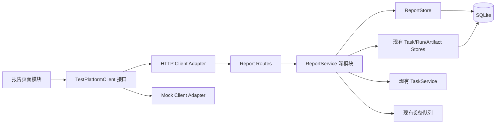
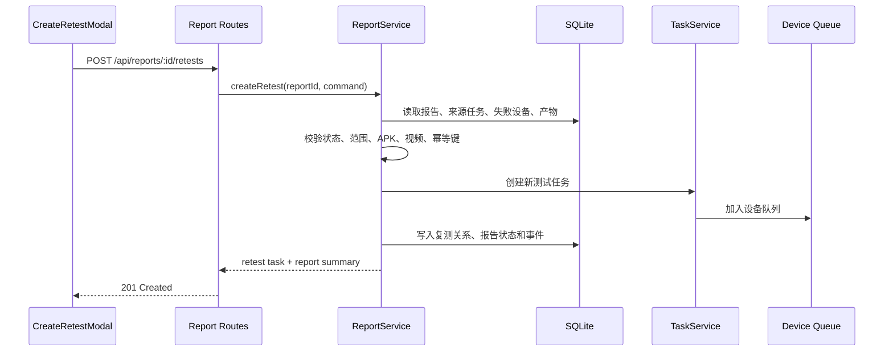

# 测试报告问题收件箱技术设计文档（方案 C）

- 文档类型：技术设计文档
- 文档状态：草案，待技术评审
- 版本：v0.1
- 日期：2026-08-14
- 适用代码库：`cloud-test-platform`
- 配套需求：[测试报告问题收件箱需求文档](./测试报告问题收件箱-需求文档.md)

## 1. 设计目标

本文给出“报告问题收件箱、独立报告详情、设备详情抽屉、创建复测和结果对比”的建议技术方案。

设计目标：

1. 在不复制设备运行、检查项、日志和输出文件的前提下，为报告增加独立工作流；
2. 把报告状态流转、复测创建和结果对比集中到一个深模块中，避免规则散落在页面与路由；
3. 保持现有任务执行链路和真实 ADB 执行逻辑不变；
4. 同时支持真实 HTTP 客户端和 Mock 客户端；
5. 允许按里程碑增量交付，避免一次性重写现有报告页。

## 2. 当前实现评估

### 2.1 已确认的前端现状

- `web/src/App.tsx` 已存在 `/reports/:id`，但没有 `/reports`；
- `web/src/layouts/AppLayout.tsx` 的 `NavigationKey` 不包含 `reports`；
- `taskRoutes` 包含 `/reports`，导致报告页高亮“测试任务”；
- “测试报告”菜单当前执行 `navigate('/tasks')`；
- `web/src/pages/ReportPage.tsx` 通过 `platformClient.getReport(id)` 加载报告；
- `ReportPage` 返回按钮进入 `/execution/${report.id}`；
- `DeviceResultMatrix` 和 `DeviceRunDetailDrawer` 已具备可复用基础；
- `TestPlatformClient` 当前只有 `getReport(taskId)`，没有报告列表、报告处理和创建复测接口。

### 2.2 已确认的后端现状

- Fastify 目前提供 `GET /api/tasks/:id/report`；
- `TaskService.report(taskId)` 直接调用 `database.getReport(taskId)`；
- `TestReportView extends TestTaskView`，报告本质上是任务视图的扩展；
- SQLite 已有 `tasks`、`device_runs`、`check_results`、`task_logs`、`task_outputs` 和 `artifacts`；
- 后端尚无报告工作流、负责人、时间线、复测关系和结果对比表；
- 创建任务已使用 `apkArtifactId`、`videoArtifactId`、`deviceIds`、`connectionMode` 和 `testPlan`，可以被复测创建流程复用；
- 任务删除会清理任务、运行记录和关联文件，报告长期保留策略尚未定义。

### 2.3 关键判断

“独立报告中心”首先是独立的产品入口和处理工作流，不代表首期必须复制全部执行数据。

建议：

- 任务和设备执行记录继续作为**执行事实源**；
- 新增报告实体保存**处理事实和关联关系**；
- 报告详情由报告实体与来源任务数据组合生成；
- 不复制检查项、日志和输出文件，避免双写和一致性问题。

## 3. 目标架构



### 3.1 模块与接口

建议新增 `ReportService` 深模块，外部调用者只需要理解少量接口：

```ts
interface ReportService {
  list(query: ReportListQuery): ReportListResult
  get(reportId: string): ReportDetail | undefined
  execute(reportId: string, command: ReportCommand): ReportDetail
  createRetest(reportId: string, input: CreateRetestCommand): Promise<RetestCreationResult>
  reconcileTask(taskId: string): void
}
```

该接口后面隐藏以下实现复杂度：

- 报告是否需要创建或回填；
- 处理状态合法转换；
- 负责人和时间线写入；
- 失败摘要、通过率和建议动作计算；
- 复测范围解析；
- 原始产物复用；
- 幂等创建；
- 复测状态同步；
- 新旧检查项比较；
- 自动关闭或重新进入待处理。

路由、页面和测试都通过同一模块接口，不直接修改报告状态表。

## 4. 领域模型

### 4.1 报告实体

建议新增独立 `ReportRecord`：

```ts
type ReportProcessingStatus = 'pending' | 'confirmed' | 'retesting' | 'closed'
type ReportSeverity = 'blocker' | 'high' | 'none'

interface ReportRecord {
  id: string
  sourceTaskId: string
  processingStatus: ReportProcessingStatus
  severity: ReportSeverity
  assignee?: string
  confirmedAt?: string
  closedAt?: string
  createdAt: string
  updatedAt: string
  version: number
}
```

说明：

- `id` 是报告编号，可采用 `rpt-*` 或现有 ID 生成器；
- `sourceTaskId` 与来源任务一对一；
- `conclusion` 不存为可编辑字段，由来源任务计算；
- `severity` 首期建议在报告创建时计算并持久化，以便稳定筛选；
- `version` 用于乐观并发控制，首期即使是单用户也可防止重复提交或旧页面覆盖新状态。

### 4.2 复测关系

```ts
type RetestScope =
  | { type: 'failed_devices' }
  | { type: 'all_source_devices' }
  | { type: 'custom'; deviceIds: string[] }

type RetestLinkStatus = 'created' | 'running' | 'passed' | 'failed' | 'cancelled'

interface ReportRetestLink {
  id: string
  reportId: string
  taskId: string
  scope: RetestScope
  apkArtifactId: string
  videoArtifactId: string
  statusBeforeRetest: ReportProcessingStatus
  status: RetestLinkStatus
  comparison?: ReportComparison
  idempotencyKey: string
  createdAt: string
  finishedAt?: string
}
```

### 4.3 结果对比

```ts
interface ReportComparison {
  baselineTaskId: string
  retestTaskId: string
  comparedAt: string
  comparable: boolean
  resolved: boolean
  deviceResults: Array<{
    deviceId: string
    previousStatus: DeviceRunStatus
    currentStatus?: DeviceRunStatus
    checkResults: Array<{
      key: string
      previousStatus: CheckStatus
      currentStatus?: CheckStatus
      resolved: boolean
    }>
  }>
  unresolvedReasons: string[]
}
```

`resolved` 只能由比较规则计算，不能由客户端直接传入。

### 4.4 报告事件

```ts
type ReportEventType =
  | 'report_created'
  | 'assignee_changed'
  | 'confirmed'
  | 'retest_created'
  | 'retest_started'
  | 'retest_completed'
  | 'retest_failed'
  | 'closed'
  | 'reopened'

interface ReportEvent {
  id: string
  reportId: string
  type: ReportEventType
  actor: string
  payload: Record<string, unknown>
  createdAt: string
}
```

事件只用于时间线和审计，不作为状态重建的唯一来源；当前阶段不引入事件溯源。

## 5. 数据库设计

建议新增迁移 `008-report-workflow.ts`。

### 5.1 `reports`

```sql
CREATE TABLE reports (
  id TEXT PRIMARY KEY,
  source_task_id TEXT NOT NULL UNIQUE REFERENCES tasks(id),
  processing_status TEXT NOT NULL,
  severity TEXT NOT NULL,
  assignee TEXT,
  confirmed_at TEXT,
  closed_at TEXT,
  created_at TEXT NOT NULL,
  updated_at TEXT NOT NULL,
  version INTEGER NOT NULL DEFAULT 1
);

CREATE INDEX reports_status_updated_idx
ON reports(processing_status, updated_at DESC);

CREATE INDEX reports_severity_status_idx
ON reports(severity, processing_status);

CREATE INDEX reports_assignee_status_idx
ON reports(assignee, processing_status);
```

### 5.2 `report_events`

```sql
CREATE TABLE report_events (
  id TEXT PRIMARY KEY,
  report_id TEXT NOT NULL REFERENCES reports(id) ON DELETE CASCADE,
  event_type TEXT NOT NULL,
  actor TEXT NOT NULL,
  payload_json TEXT NOT NULL,
  created_at TEXT NOT NULL
);

CREATE INDEX report_events_report_time_idx
ON report_events(report_id, created_at);
```

### 5.3 `report_retests`

```sql
CREATE TABLE report_retests (
  id TEXT PRIMARY KEY,
  report_id TEXT NOT NULL REFERENCES reports(id) ON DELETE CASCADE,
  task_id TEXT NOT NULL UNIQUE REFERENCES tasks(id),
  scope_json TEXT NOT NULL,
  apk_artifact_id TEXT NOT NULL REFERENCES artifacts(id),
  video_artifact_id TEXT NOT NULL REFERENCES artifacts(id),
  status_before_retest TEXT NOT NULL,
  status TEXT NOT NULL,
  comparison_json TEXT,
  idempotency_key TEXT NOT NULL,
  created_at TEXT NOT NULL,
  finished_at TEXT,
  UNIQUE(report_id, idempotency_key)
);

CREATE INDEX report_retests_report_time_idx
ON report_retests(report_id, created_at DESC);
```

### 5.4 活动复测约束

产品需求建议同一报告首期只允许一个活动复测。SQLite 可以使用部分唯一索引：

```sql
CREATE UNIQUE INDEX report_one_active_retest_idx
ON report_retests(report_id)
WHERE status IN ('created', 'running');
```

如果评审决定允许并行复测，则不创建该索引，并修改状态聚合规则。

### 5.5 来源任务删除策略

这是当前最大的未决技术约束。

推荐首期策略：**存在报告时禁止单独删除来源任务**，原因是报告详情依赖来源任务、设备运行、检查项和证据文件。

建议错误：

```json
{
  "code": "REPORT_RETENTION_BLOCKS_TASK_DELETE",
  "message": "该任务已生成测试报告，请先按报告保留策略处理报告"
}
```

如果产品决定保持现有删除行为，则需要在删除任务时级联删除报告和复测关系，并在界面明确提示“报告与证据也将删除”。在该决策确认前，不应默认实现任一行为。

## 6. 报告生成与历史回填

### 6.1 新任务

当任务进入终态时调用：

```ts
reportService.reconcileTask(taskId)
```

该方法应幂等：

1. 判断任务是否已经有报告；
2. 没有则创建报告并记录 `report_created`；
3. 已有则只同步复测状态，不覆盖人工处理字段；
4. 如果该任务是复测任务，则执行结果对比并更新来源报告。

### 6.2 历史任务

迁移不直接依赖 TypeScript 业务规则批量生成复杂数据。建议服务启动后执行一次幂等回填：

- 扫描已有终态任务；
- 为未生成报告的任务创建报告；
- 通过任务默认 `closed + none`；
- 失败任务默认 `pending + high`；
- 阻塞任务默认 `pending + blocker`；
- 已取消和未执行的默认状态需要产品确认，建议先归入 `pending`，避免静默隐藏。

回填应记录数量和错误，但单条异常不阻止服务启动。

## 7. 状态规则

### 7.1 合法转换

```ts
const transitions = {
  pending: ['confirmed', 'retesting', 'closed'],
  confirmed: ['pending', 'retesting', 'closed'],
  retesting: ['pending', 'confirmed', 'closed'],
  closed: ['pending'],
} satisfies Record<ReportProcessingStatus, ReportProcessingStatus[]>
```

建议通过命令而不是任意状态赋值驱动转换：

```ts
type ReportCommand =
  | { type: 'assign'; assignee?: string; expectedVersion: number }
  | { type: 'confirm'; expectedVersion: number }
  | { type: 'close'; reason: string; expectedVersion: number }
  | { type: 'reopen'; reason: string; expectedVersion: number }
```

创建复测由 `createRetest` 独立处理，并在同一数据库事务中把状态更新为 `retesting`。

### 7.2 状态不变量

- 处理状态不能修改任务结论；
- 没有已创建复测关系时不得进入 `retesting`；
- 活动复测存在时不得再次创建活动复测，除非产品允许并行；
- 自动关闭必须有可比较且已解决的比较结果；
- 复测取消或不可比较时不得自动关闭；
- 关闭和重新打开必须产生事件。

## 8. 复测创建事务

### 8.1 请求流程



### 8.2 原子性问题

当前 `TaskService.create` 会创建任务并立即入队，报告关系写入发生在其后会存在短暂不一致风险。

推荐调整：

- 抽取任务创建的内部接口，使“创建任务记录、创建复测关系、更新报告状态”位于同一 SQLite 事务；
- 事务提交后再入队；
- 入队失败时由现有队列接受状态检查提前拦截，或把新任务标记为失败并记录明确事件。

建议内部接口：

```ts
interface TaskCreationModule {
  validate(command: CreateTaskCommand): Promise<ValidatedTaskInput>
  persist(input: ValidatedTaskInput, transaction: DatabaseTransaction): TestTaskView
  enqueue(taskId: string): void
}
```

该接口仅作为 `TaskService` 与 `ReportService` 的内部 seam，不暴露给前端。

### 8.3 幂等

客户端为每次提交生成 `idempotencyKey`：

- 同一报告和相同 key 重试时返回第一次创建结果；
- 不得创建第二个任务；
- 数据库唯一约束作为最终保护；
- 按钮 loading 和禁用只是体验优化，不能替代后端幂等。

### 8.4 复用规则

- `videoArtifactId` 默认使用来源任务的视频文件；
- APK 可使用来源任务 APK，也可使用新上传 APK；
- 设备范围从来源任务及其运行结果计算；
- `connectionMode` 复用来源任务，但实际 endpoint 仍由现有逻辑在执行前重新解析；
- 测试计划类型和超时复用来源任务数据库值；
- 前端当前 `TestTask` 未暴露 `timeoutSeconds`，应由报告详情的 `retestDefaults` 返回，不要求页面自行推导。

## 9. 结果对比算法

### 9.1 基线

基线只包含来源任务中的失败或阻塞事实：

- 失败/阻塞设备；
- 这些设备中的失败/阻塞检查项；
- 设备级失败代码；
- 媒体完整性失败代码。

### 9.2 可比较条件

复测结果可驱动自动关闭必须同时满足：

1. 复测任务已经进入终态；
2. 所有基线失败设备都在复测范围内；
3. 使用相同测试计划类型；
4. 每个基线失败检查项都能通过稳定的 `check.key` 找到对应项；
5. 对应设备没有新的任务级阻塞或取消；
6. 证据数据完整，不存在缺失运行记录。

### 9.3 解决规则

```ts
resolved = baselineFailures.every((baseline) => {
  const current = findSameDeviceAndCheck(baseline)
  return current?.status === 'passed'
})
```

设备名称、检查项展示名称和文案不参与比较，避免名称变化导致误判。

### 9.4 新失败

如果原失败项已通过，但复测出现新的失败项：

- `resolved` 仍应为 `false`；
- 对比结果标记“原问题已修复，但出现新失败”；
- 报告返回 `pending` 或保持 `confirmed`；
- 不自动关闭。

### 9.5 自定义设备

如果自定义设备未包含原失败设备，对比结果为 `comparable=false`，只能作为补充验证，不驱动自动关闭。

## 10. 后端接口设计

### 10.1 报告列表

```http
GET /api/reports?status=pending&severity=high&assignee=%E9%9F%A9%E9%9C%87&cursor=...
```

响应：

```ts
interface ReportListResult {
  items: ReportListItem[]
  counts: {
    byStatus: Record<ReportProcessingStatus, number>
    bySeverity: Record<ReportSeverity, number>
  }
  nextCursor?: string
}
```

首期数据量较小时可不做游标分页，但接口类型建议预留；前端不得通过 `listTasks()` 自行聚合报告。

### 10.2 报告详情

```http
GET /api/reports/:reportId
```

建议响应：

```ts
interface ReportDetail {
  id: string
  sourceTask: { id: string; name: string; createdAt: string }
  conclusion: TestReport['conclusion']
  processingStatus: ReportProcessingStatus
  severity: ReportSeverity
  assignee?: string
  generatedAt: string
  updatedAt: string
  version: number
  summary: {
    totalDevices: number
    passedDevices: number
    failedDevices: number
    totalChecks: number
    passedChecks: number
    failedChecks: number
    devicePassRate: number
    checkPassRate: number
    primaryFailure?: ReportFailureSummary
    recommendedAction?: string
  }
  runs: DeviceRunResult[]
  apk: Artifact
  asset: Artifact
  retestDefaults: {
    failedDeviceIds: string[]
    allDeviceIds: string[]
    apkArtifactId: string
    videoArtifactId: string
    connectionMode: TaskConnectionMode
    timeoutSeconds: number
    protocol?: ApkExecutionProtocol
  }
  events: ReportEvent[]
  retests: ReportRetestSummary[]
}
```

### 10.3 更新处理信息

```http
POST /api/reports/:reportId/actions
Content-Type: application/json
```

请求示例：

```json
{
  "type": "confirm",
  "expectedVersion": 3
}
```

分配负责人：

```json
{
  "type": "assign",
  "assignee": "韩震",
  "expectedVersion": 3
}
```

### 10.4 创建复测

```http
POST /api/reports/:reportId/retests
Content-Type: application/json
```

```json
{
  "scope": { "type": "failed_devices" },
  "apk": { "type": "artifact", "artifactId": "artifact-apk-fix" },
  "idempotencyKey": "6e035da7-37b7-4f77-a3e0-1dc88d58a57a"
}
```

响应状态：`201 Created`；幂等重试返回 `200 OK` 或同一 `201` 结果，两种方式需在实现时统一。

### 10.5 错误码

| 错误码 | HTTP | 场景 |
| --- | --- | --- |
| `REPORT_NOT_FOUND` | 404 | 报告不存在 |
| `INVALID_REPORT_TRANSITION` | 409 | 非法状态转换 |
| `REPORT_VERSION_CONFLICT` | 409 | 页面版本过旧 |
| `ACTIVE_RETEST_EXISTS` | 409 | 已有活动复测 |
| `RETEST_DEVICE_REQUIRED` | 400 | 没有选择设备 |
| `RETEST_BASELINE_DEVICE_MISSING` | 409 | 自动复测范围不包含必要设备 |
| `RETEST_APK_REQUIRED` | 400 | APK 无效或不存在 |
| `RETEST_VIDEO_UNAVAILABLE` | 409 | 原视频不可复用 |
| `RETEST_DEVICE_UNAVAILABLE` | 409 | 设备当前不可用于创建任务 |
| `REPORT_RETENTION_BLOCKS_TASK_DELETE` | 409 | 报告保留策略阻止删除任务 |

## 11. 前端设计

### 11.1 路由与导航

修改 `web/src/App.tsx`：

```tsx
<Route path="/reports" element={<ReportInboxPage />} />
<Route path="/reports/:id" element={<ReportPage />} />
```

修改 `web/src/layouts/AppLayout.tsx`：

- `NavigationKey` 增加 `reports`；
- `/reports` 不再属于 `taskRoutes`；
- 报告菜单进入 `/reports`；
- 报告页标题和面包屑返回“测试报告”。

建议将路由判断改为明确映射，避免继续扩展 `taskRoutes` 数组：

```ts
function getSelectedNavigation(pathname: string): NavigationKey {
  if (pathname.startsWith('/reports')) return 'reports'
  if (pathname.startsWith('/tasks') || pathname.startsWith('/create') || pathname.startsWith('/execution')) return 'tasks'
  if (pathname.startsWith('/devices')) return 'devices'
  return 'overview'
}
```

### 11.2 页面和模块拆分

建议新增或调整：

```text
web/src/
├── pages/
│   ├── ReportInboxPage.tsx
│   └── ReportPage.tsx
├── components/report/
│   ├── ReportInboxFilters.tsx
│   ├── ReportInboxList.tsx
│   ├── ReportSummaryPanel.tsx
│   ├── ReportFailureSummary.tsx
│   ├── ReportTimeline.tsx
│   ├── DeviceResultMatrix.tsx
│   ├── DeviceRunDetailDrawer.tsx
│   └── CreateRetestModal.tsx
└── features/reports/
    ├── reportRules.ts
    ├── reportSelectors.ts
    └── retestFormModel.ts
```

页面负责组合和路由；纯规则放入 `features/reports`；平台请求只通过 `TestPlatformClient`。

### 11.3 客户端接口

扩展 `TestPlatformClient`：

```ts
interface TestPlatformClient {
  listReports(query?: ReportListQuery): Promise<ReportListResult>
  getReport(reportId: string): Promise<ReportDetail | undefined>
  executeReportAction(reportId: string, command: ReportCommand): Promise<ReportDetail>
  createRetest(reportId: string, input: CreateRetestInput): Promise<RetestCreationResult>
}
```

兼容策略：

- HTTP adapter 调用新 `/api/reports` 接口；
- Mock adapter 必须维护相同状态转换和复测关系；
- 旧 `GET /api/tasks/:id/report` 可保留一个版本周期，内部转调或返回兼容视图；
- 页面切换到新接口后，再评估删除旧接口。

### 11.4 数据加载与筛选

- 报告列表筛选由后端完成；
- URL 查询参数保存筛选，例如 `/reports?status=pending&severity=high`；
- 返回详情时天然恢复筛选，不依赖组件内临时状态；
- 列表请求应有 loading、空状态、错误和重试；
- 更新负责人、确认报告后局部刷新详情及列表计数。

### 11.5 设备详情抽屉

现有 `DeviceRunDetailDrawer` 可增量改造：

- 使用 Tabs 组织检查摘要、日志与附件、运行信息；
- 继续复用 `ExecutionFailureDetails`；
- 增加 `onCreateRetest(run)`；
- 仅在失败/阻塞运行中突出复测操作；
- 保留现有 output 视频预览、Logcat 和最终截图；
- 不在抽屉内部重新请求整份报告，避免重复数据源。

### 11.6 创建复测表单

建议使用 reducer 或纯模型函数维护状态，避免多个相互依赖的 `useState`：

```ts
interface RetestFormState {
  scope: RetestScope
  apkChoice: 'source' | 'new'
  uploadedApk?: Artifact
  submitting: boolean
  idempotencyKey: string
}
```

提交条件由单一 selector 计算：

```ts
function getRetestValidation(state: RetestFormState, report: ReportDetail): RetestValidation
```

上传新 APK继续调用现有 `uploadArtifact(file, 'apk')`，不得在弹窗内实现第二套上传校验。

## 12. 设备历史快照

当前报告通过 `deviceId` 关联当前设备档案。设备名称、系统版本或连接信息后续变化时，历史报告可能发生展示漂移。

建议在后续迁移中为 `device_runs` 保存执行时快照：

```sql
ALTER TABLE device_runs ADD COLUMN device_name_snapshot TEXT;
ALTER TABLE device_runs ADD COLUMN manufacturer_snapshot TEXT;
ALTER TABLE device_runs ADD COLUMN model_snapshot TEXT;
ALTER TABLE device_runs ADD COLUMN os_version_snapshot TEXT;
ALTER TABLE device_runs ADD COLUMN resolution_snapshot TEXT;
```

首期如果不加入快照，文档和验收中必须明确报告展示的是“当前设备档案 + 执行连接快照”，不是完整历史快照。

## 13. 安全与数据完整性

当前为本机单用户系统，本期不新增完整权限系统，但仍需满足：

- 所有文件下载继续通过受控 `/api` 路由，不暴露任意文件系统路径；
- 复测请求只能引用数据库中存在且类型正确的 artifact；
- 自定义设备 ID 必须去重并重新执行可用性校验；
- `assignee`、时间线 payload 和筛选参数必须限制长度；
- JSON 字段读取时进行 schema 校验，无法解析时返回可诊断错误；
- 报告状态和复测关系写入必须使用事务；
- 客户端不得决定比较是否通过、报告是否自动关闭。

## 14. 性能与查询

### 14.1 列表

不要对列表中的每个报告分别加载完整任务和设备运行，避免 N+1。

建议 `ReportStore.listProjection()` 一次查询获取：

- 报告工作流字段；
- 来源任务名称与时间；
- 任务结论和通过率；
- 设备总数、失败数；
- 第一条主要失败；
- 最近更新时间。

日志、全部检查项和输出文件只在详情加载。

### 14.2 详情

报告详情可以复用现有 `database.getReport(taskId)` 的聚合逻辑，再叠加工作流、事件和复测信息。后续如数据量增大，再拆分按需加载日志和证据。

### 14.3 轮询

- 报告列表不需要 1 秒轮询；建议手动刷新或 10–30 秒低频刷新；
- 处于 `retesting` 的报告详情可复用任务订阅/轮询；
- 复测进入终态后停止轮询并刷新报告详情；
- 不新增 WebSocket，除非后续任务执行整体改为推送。

## 15. 测试策略

### 15.1 后端单元测试

- 报告默认状态与严重程度计算；
- 所有合法与非法状态转换；
- 负责人更新和版本冲突；
- 失败设备与检查项基线提取；
- 可比较、已解决、新失败和不可比较场景；
- 复测取消和重复提交；
- 建议动作计算不改变执行事实。

### 15.2 Store 与迁移测试

- 迁移 008 创建表、索引和约束；
- 旧数据库升级后历史任务可回填；
- `source_task_id` 唯一；
- 同一幂等 key 不创建重复记录；
- 活动复测唯一约束；
- 报告事件按时间排序；
- 删除策略符合最终产品决策。

### 15.3 路由集成测试

- 列表筛选与计数；
- 报告不存在；
- 确认、分配、关闭和重开；
- 创建复测成功；
- 设备不可用、APK 无效、视频缺失；
- 幂等重试；
- 复测完成后自动更新报告。

### 15.4 前端测试

- 报告导航选中规则；
- URL 筛选参数；
- 列表 loading、空状态和错误；
- 设备行打开正确抽屉；
- 抽屉页签和附件操作；
- 复测范围、APK 选择和校验；
- 提交 loading 与重复点击；
- 创建成功状态；
- HTTP 与 Mock adapter 接口契约一致。

### 15.5 回归门禁

至少执行：

```bash
npm test
npm run build
```

并人工验证：

1. 创建普通任务；
2. 查看执行详情；
3. 生成报告；
4. 进入报告中心；
5. 查看失败设备证据；
6. 创建复测；
7. 观察新旧结果和状态流转；
8. 验证现有取消与删除行为。

## 16. 可观测性

建议增加结构化日志：

- `report.created`；
- `report.action.executed`；
- `report.retest.created`；
- `report.retest.reconciled`；
- `report.comparison.completed`；
- `report.auto_closed`；
- `report.retest.idempotent_replay`。

日志字段至少包括 `reportId`、`sourceTaskId`、`retestTaskId`、`processingStatus` 和错误码，不记录文件内容或完整用户输入。

## 17. 实施顺序

### 阶段 A：路由与只读报告中心

- 新增 `/reports`；
- 修正导航和面包屑；
- 新增报告列表接口与页面；
- 报告详情切换到报告 ID；
- 重组设备抽屉；
- 不改变任务执行。

### 阶段 B：报告工作流

- 新增数据库迁移；
- 新增 `ReportService`、Store、事件；
- 支持负责人、确认、关闭和重开；
- 历史报告回填。

### 阶段 C：复测与对比

- 抽取任务创建内部 seam；
- 新增创建复测接口和弹窗；
- 加入幂等和活动复测约束；
- 对比检查项；
- 自动关闭或回到待处理。

### 阶段 D：策略收口

- 确认来源任务删除策略；
- 完善设备历史快照；
- 清理或兼容旧 `/api/tasks/:id/report`；
- 补齐性能查询与低频刷新。

## 18. 风险与缓解

| 风险 | 影响 | 缓解 |
| --- | --- | --- |
| 报告和任务形成双写 | 状态不一致 | 执行事实不复制，所有工作流通过 `ReportService` |
| 复测任务创建后关系写入失败 | 孤儿任务 | 同一事务持久化，提交后入队 |
| 重复提交 | 多个重复任务 | 客户端 loading + 后端幂等键 + 唯一约束 |
| 检查项名称变化 | 错误比较 | 使用稳定 `check.key`，不使用显示名称 |
| 自定义设备误触发关闭 | 错误结论 | 基线设备缺失时 `comparable=false` |
| 删除来源任务导致报告失效 | 页面和证据丢失 | 实现前明确保留策略，推荐首期阻止删除 |
| Mock 与真实客户端行为分叉 | 测试与生产不一致 | 共用类型、状态规则和契约测试 |
| 页面直接拼装领域规则 | 难以维护和测试 | 把规则集中在深模块和纯函数中 |

## 19. 技术待确认项

1. 是否采用独立 `RPT-*` ID；本文建议采用独立 ID；
2. 来源任务删除是否被报告保留策略阻止；本文建议首期阻止；
3. 通过报告是否直接进入 `closed`，还是增加 `archived`；本文建议首期直接 `closed`；
4. 是否允许人工修改严重程度；本文建议首期不允许；
5. 是否允许并行活动复测；本文建议首期不允许；
6. 失败设备离线时是否允许创建排队任务；本文沿用现有 `TaskService` 校验，即创建时需要可用连接；
7. 负责人是否只保存显示名；本文建议首期使用字符串，接入用户系统时迁移为稳定用户 ID；
8. 是否在本期加入设备历史快照；本文建议至少在阶段 D 完成；
9. 旧 `/api/tasks/:id/report` 保留时长；建议至少保留一个前端迁移周期；
10. 自动关闭是否必须要求相同 APK 包名和更高版本；本文不建议依赖版本字符串，只校验执行协议和基线结果。

## 20. 完成定义

只有同时满足以下条件，技术实现才可视为完成：

- 需求文档 P0 验收项全部通过；
- 报告导航和路由完全独立；
- 报告工作流数据持久化且可回填；
- 复测创建具备事务或等价一致性保障；
- 重复提交不会创建重复任务；
- 新旧结果比较通过稳定 ID 完成；
- 任务执行链路无回归；
- HTTP 和 Mock adapter 契约一致；
- 测试与构建通过；
- 来源任务删除策略已由产品和技术共同确认并实现。
