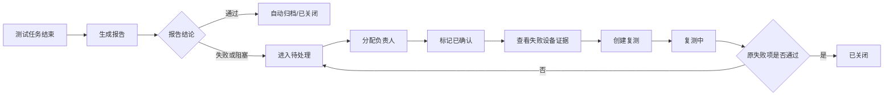
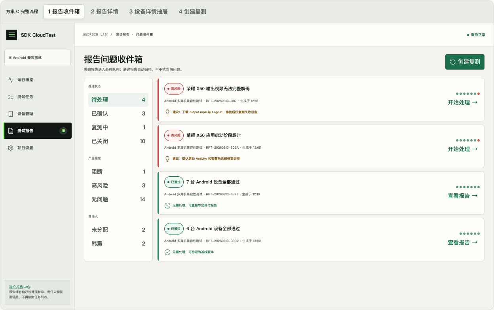
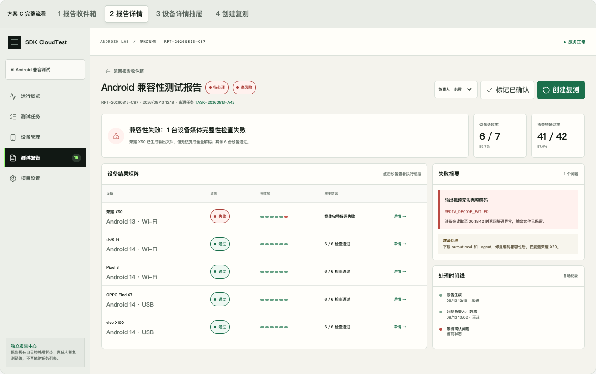
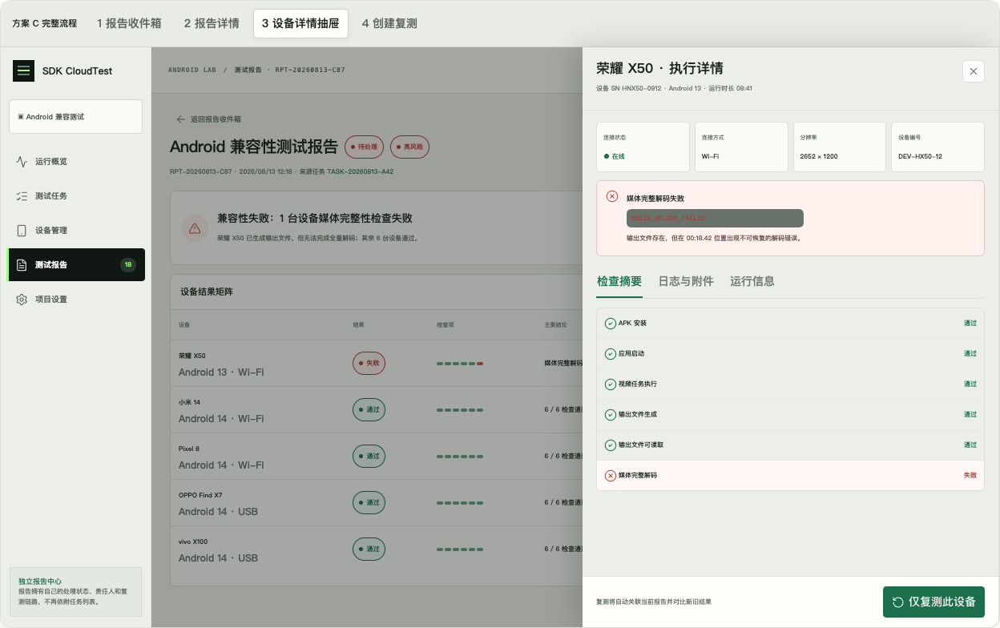
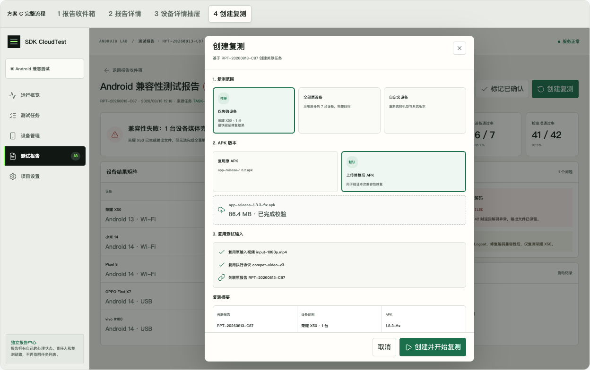

# 测试报告问题收件箱需求文档（方案 C）

- 文档类型：产品需求文档（PRD）
- 文档状态：草案，待评审
- 版本：v0.1
- 日期：2026-08-14
- 适用范围：Android SDK 视频兼容性测试平台
- 配套文档：[测试报告问题收件箱技术设计文档](./测试报告问题收件箱-技术设计文档.md)

## 1. 文档目的

本文定义“测试报告问题收件箱”的产品目标、信息架构、页面功能、状态流转、异常处理和验收标准，为后续技术设计、开发、测试和评审提供共同基线。

本文明确区分三类信息：

1. **当前事实**：已经由现有代码确认的行为；
2. **目标需求**：方案 C 希望实现的产品行为；
3. **待确认项**：尚未由产品或业务明确，不在本文中假定为事实。

## 2. 背景与问题

### 2.1 当前事实

截至 2026-08-14，当前实现存在以下行为：

- 左侧“测试报告”菜单点击后进入 `/tasks`；
- `/reports/:id` 被归类为测试任务路由，因此侧边栏高亮和面包屑均显示“测试任务”；
- 报告详情的返回动作指向 `/execution/:id`；
- 当前没有独立的 `/reports` 报告列表页；
- 当前报告是基于测试任务生成的结果视图，尚未具备独立的处理状态、负责人、复测关系和处理时间线。

### 2.2 用户问题

用户希望查看和处理测试报告，但每次点击“测试报告”都会被带回测试任务，导致：

- 报告与任务的产品定位混在一起；
- 用户无法从“待处理问题”的角度组织报告；
- 排查失败设备时需要在任务、执行详情和报告之间反复跳转；
- 修复后缺少从原报告直接创建复测、关联新旧结果的闭环。

### 2.3 隐含目标

本需求不只是新增一个报告列表页，而是把报告从“任务执行后的静态结果”提升为“可被确认、分配、复测和关闭的问题处理对象”。

## 3. 产品定位

“测试报告问题收件箱”是兼容性测试平台中的独立报告中心：

- **测试任务**回答“测试如何创建、排队和执行”；
- **测试报告**回答“结果是否可接受、失败问题由谁处理、是否已复测并关闭”；
- **设备执行结果**回答“某台设备具体在哪个阶段失败，以及有哪些可验证证据”。

## 4. 目标与非目标

### 4.1 本期目标

1. “测试报告”拥有独立导航、列表和详情路由，不再默认跳转测试任务；
2. 失败报告进入可处理队列，通过报告自动归入低干扰区域；
3. 报告详情集中呈现结论、失败设备、失败证据、负责人和处理进度；
4. 在报告上下文内通过抽屉查看设备执行详情；
5. 从报告或失败设备直接创建复测，并关联原报告；
6. 复测完成后可比较新旧结果，并驱动报告处理状态更新；
7. 保留来源任务入口，但将其降级为辅助信息。

### 4.2 本期非目标

以下能力不纳入首期，除非评审时另行确认：

- 多项目、多租户和复杂权限审批；
- 缺陷管理系统双向同步；
- 报告评论、@提醒和消息中心；
- 自定义报告模板和品牌化 PDF；
- 跨多个原始报告合并创建一次复测；
- 手工编辑测试检查项或执行结果；
- iOS、HarmonyOS 报告处理流程。

## 5. 用户与典型场景

### 5.1 主要用户

| 用户 | 主要任务 | 核心诉求 |
| --- | --- | --- |
| 测试工程师 | 查看失败、下载证据、创建复测 | 快速定位失败并完成验证闭环 |
| SDK 开发者 | 理解失败原因、获取日志和产物 | 不必理解完整任务流程即可拿到证据 |
| 测试负责人 | 分配负责人、确认风险、查看处理进度 | 知道哪些报告尚未处理以及由谁负责 |

当前平台处于本机单用户阶段，因此首期无需实现复杂权限，但信息结构应避免阻碍后续多人协作。

### 5.2 典型场景

1. 测试任务结束，7 台设备中 1 台失败；
2. 系统生成报告并放入“待处理”；
3. 测试负责人将报告分配给处理人；
4. 处理人进入报告详情，打开失败设备抽屉；
5. 处理人下载 `output.mp4` 和 Logcat，确认失败代码；
6. 修复 APK 后，选择“仅失败设备”创建复测；
7. 系统复用原输入视频与执行协议；
8. 复测完成后，系统比较新旧结果；
9. 如果原失败检查项通过，报告进入“已关闭”；若仍失败，报告回到待处理状态并记录复测结果。

## 6. 领域术语

| 术语 | 定义 |
| --- | --- |
| 来源任务 | 首次生成当前报告的测试任务。负责执行事实、设备运行和原始产物。 |
| 报告 | 对来源任务结果的可阅读视图，以及围绕该结果形成的处理状态、负责人和复测关系。 |
| 报告结论 | 由执行事实产生的结果，例如通过、失败、阻塞、已取消、未执行。不可由处理人直接改写。 |
| 处理状态 | 围绕报告问题处理过程产生的状态，例如待处理、已确认、复测中、已关闭。 |
| 严重程度 | 用于排序和提醒的风险标签，例如阻断、高风险、无问题。 |
| 设备执行结果 | 一台设备在一次任务中的独立运行结果，包括检查项、日志、输出文件和失败信息。 |
| 复测任务 | 从报告创建、用于验证修复结果的新测试任务。 |
| 结果对比 | 原失败设备/检查项与复测设备/检查项之间的差异结果。 |

> 关键约束：报告结论与处理状态是不同维度。报告可以保持“兼容性失败”的历史结论，同时处理状态已经“已关闭”。

## 7. 信息架构与导航

### 7.1 一级导航

左侧导航包含独立的“测试报告”入口：

- 运行概览：`/`
- 测试任务：`/tasks`
- 设备管理：`/devices`
- 测试报告：`/reports`
- 项目设置：`/settings`

### 7.2 页面路由

| 页面 | 路由 | 说明 |
| --- | --- | --- |
| 报告问题收件箱 | `/reports` | 报告列表、状态分组与筛选 |
| 报告详情 | `/reports/:reportId` | 独立报告详情 |
| 来源任务 | `/execution/:taskId` | 仅作为辅助跳转 |
| 复测任务执行 | `/execution/:retestTaskId` | 创建成功后可选择进入 |

### 7.3 导航规则

- `/reports` 和 `/reports/:reportId` 必须高亮“测试报告”；
- 面包屑必须显示“测试报告”，不得归类为“测试任务”；
- 报告详情返回按钮进入 `/reports`，并尽量保留用户原有筛选状态；
- “查看来源任务”作为次要链接，不作为报告页默认返回路径。

## 8. 核心流程



> 上图中的自动状态规则属于本方案的建议基线，最终规则见第 13 节待确认项。

## 9. 页面需求

## 9.1 报告问题收件箱



### 页面目标

让用户优先看到需要处理的失败报告，而不是从所有任务中寻找失败结果。

### 页面结构

1. 页面标题与创建复测入口；
2. 左侧筛选区；
3. 右侧报告卡片列表；
4. 每张报告卡片包含结论、风险、失败设备、建议动作和处理入口。

### 筛选维度

- 处理状态：待处理、已确认、复测中、已关闭；
- 严重程度：阻断、高风险、无问题；
- 负责人：未分配、当前处理人；
- 首期默认进入“待处理”；
- 首期不要求全文搜索和复杂组合查询。

### 报告卡片字段

- 报告名称或主要失败标题；
- 报告编号；
- 来源任务名称；
- 生成时间；
- 处理状态；
- 严重程度；
- 负责人；
- 设备通过/失败分布；
- 主要失败原因；
- 建议动作；
- “开始处理”或“查看报告”操作。

### 排序规则

建议默认排序：

1. 待处理且严重程度高的报告；
2. 已确认；
3. 复测中；
4. 已关闭或无问题报告；
5. 同组内按最近更新时间倒序。

## 9.2 独立报告详情页



### 页面目标

在一个页面内回答：结论是什么、哪台设备失败、为什么失败、谁在处理、下一步做什么。

### 顶部信息

- 报告标题与编号；
- 报告结论；
- 处理状态；
- 严重程度；
- 负责人；
- 生成时间；
- 来源任务次要链接；
- “标记已确认”；
- 主操作“创建复测”。

### 结果摘要

- 最终结论；
- 设备通过数量与通过率；
- 检查项通过数量与通过率；
- 失败设备数量；
- 主要失败描述。

### 设备结果矩阵

每台设备展示：

- 设备名称、系统版本和连接方式；
- 通过/失败状态；
- 检查项结果分布；
- 主要结论；
- 详情入口。

点击设备行打开设备详情抽屉，不进行整页跳转。

### 失败摘要

- 失败设备；
- 失败阶段；
- 失败代码；
- 用户可理解的失败信息；
- 系统建议动作；
- 关联证据入口。

### 处理时间线

至少记录：

- 报告生成；
- 负责人变化；
- 标记已确认；
- 创建复测；
- 复测开始、完成或失败；
- 报告关闭或重新打开。

## 9.3 设备详情抽屉



### 页面目标

用户不离开报告详情即可完成单设备诊断。

### 基础信息

- 设备名称、编号和序列号；
- Android 版本；
- 连接状态与连接方式；
- 分辨率；
- 开始时间、结束时间和运行时长；
- 执行协议。

### 页签

1. **检查摘要**：展示所有检查项及通过/失败状态；
2. **日志与附件**：下载输出视频、Logcat、查看最终截图、复制失败代码；
3. **运行信息**：展示输入文件、协议、连接快照和时间信息。

### 操作

- 对失败设备提供“仅复测此设备”；
- 对通过设备不突出复测操作；
- 下载或预览失败时必须给出明确错误提示；
- 抽屉关闭后保留报告页面滚动位置和状态。

## 9.4 创建复测



### 入口

- 报告详情页“创建复测”；
- 失败设备抽屉“仅复测此设备”；
- 收件箱顶部可保留创建入口，但进入后必须先选择关联报告；首期可只支持从具体报告发起。

### 第一步：复测范围

- 仅失败设备：默认推荐；
- 全部原设备：完整回归；
- 自定义设备：重新选择设备。

从设备抽屉进入时，默认锁定或预选当前失败设备。

### 第二步：APK 版本

- 复用原 APK；
- 上传修复后 APK：默认推荐；
- 上传必须复用现有 APK 校验流程；
- 未上传成功前不得创建复测任务。

### 第三步：复用测试输入

默认复用：

- 原输入 MP4；
- 原执行协议；
- 原测试计划与超时设置；
- 原连接模式，执行开始前仍需重新解析可用连接端点。

### 复测摘要

创建前必须确认：

- 关联报告；
- 设备范围；
- APK 版本；
- 输入视频；
- 执行协议。

### 创建成功

成功状态展示：

- 新复测任务编号；
- 设备数量；
- 关联报告；
- 报告新处理状态“复测中”；
- “查看报告详情”或“查看复测执行”的入口。

## 10. 状态模型

### 10.1 报告结论

报告结论来自执行事实，不允许人工修改：

- `passed`：兼容性通过；
- `failed`：兼容性失败；
- `blocked`：设备或环境阻塞；
- `cancelled`：任务已取消；
- `not_executed`：未执行。

### 10.2 处理状态

| 状态 | 含义 | 可进入方式 | 可执行操作 |
| --- | --- | --- | --- |
| 待处理 | 报告需要人工确认或修复 | 失败/阻塞报告生成；复测仍失败 | 分配负责人、确认、创建复测 |
| 已确认 | 问题已被确认并进入处理 | 人工标记 | 创建复测、调整负责人 |
| 复测中 | 已创建关联复测且尚未结束 | 创建复测成功 | 查看复测执行 |
| 已关闭 | 无需继续处理或复测通过 | 通过报告自动进入；复测通过后进入 | 查看历史、必要时重新打开 |

建议状态转换：

```text
待处理 → 已确认 → 复测中 → 已关闭
   ↑                    |
   └──── 复测仍失败 ────┘
```

### 10.3 严重程度

| 严重程度 | 建议定义 |
| --- | --- |
| 阻断 | 全部设备无法执行、核心流程不可用，或环境问题导致无法产生有效结果 |
| 高风险 | 至少一台设备出现真实兼容性失败，但仍存在有效执行结果 |
| 无问题 | 报告结论为通过 |

首期建议由系统根据结论和失败分布自动计算，不提供人工修改；该规则属于待评审设计决策。

## 11. 功能需求清单

| 编号 | 需求 | 优先级 |
| --- | --- | --- |
| FR-01 | “测试报告”导航进入独立 `/reports` 页面 | P0 |
| FR-02 | 报告路由正确高亮测试报告导航并显示报告面包屑 | P0 |
| FR-03 | 报告列表支持按处理状态、严重程度和负责人筛选 | P0 |
| FR-04 | 报告卡片展示失败设备、主要原因和建议动作 | P0 |
| FR-05 | 报告详情展示结论、处理状态、负责人和通过率 | P0 |
| FR-06 | 报告详情展示设备结果矩阵 | P0 |
| FR-07 | 点击设备打开详情抽屉 | P0 |
| FR-08 | 抽屉支持检查项、日志、输出视频和截图查看 | P0 |
| FR-09 | 支持分配负责人和标记已确认 | P0 |
| FR-10 | 支持从报告创建关联复测 | P0 |
| FR-11 | 支持仅失败设备、全部设备和自定义设备范围 | P0 |
| FR-12 | 支持复用原 APK或上传修复后的 APK | P0 |
| FR-13 | 自动复用原 MP4、执行协议和测试计划 | P0 |
| FR-14 | 创建复测后报告进入复测中并记录时间线 | P0 |
| FR-15 | 复测结束后生成新旧结果对比 | P0 |
| FR-16 | 原失败项通过后自动关闭报告，仍失败则重新进入待处理 | P0 |
| FR-17 | 来源任务作为次要链接可访问 | P1 |
| FR-18 | 报告筛选条件在详情返回后保持 | P1 |
| FR-19 | 支持将已关闭报告人工重新打开 | P1 |
| FR-20 | 收件箱显示各状态数量 | P1 |

## 12. 异常与边界场景

### 12.1 数据加载

- 报告不存在：显示明确的“报告不存在”，提供返回报告列表入口；
- 来源任务不存在：报告仍可访问的前提需要产品确认，页面至少不能无提示崩溃；
- 设备信息已更新或离线：报告展示执行时快照，复测创建时展示当前可用状态；
- 日志或附件已清理：展示“证据不可用”以及清理时间/原因（如果后端可提供）。

### 12.2 创建复测

- 修复 APK 上传失败：保留用户已选设备范围，允许重试；
- 失败设备当前离线：禁止直接提交或允许排队需要评审确认；
- 原输入视频已删除：不得创建复测，提示重新上传；
- 重复点击提交：不得创建多个重复复测任务；
- 创建任务成功但页面响应中断：再次打开报告应能看到已创建的复测关系；
- 多个复测任务并存：首期建议只允许一个活动中的复测，历史复测可以保留。

### 12.3 状态一致性

- 报告处理状态不得改变原始执行结论；
- 复测任务取消后，报告不应自动关闭；
- 复测仍失败时，必须保留旧结果与新结果；
- 自定义设备复测未包含原失败设备时，不应自动判定原问题已解决。

## 13. 待确认事项

以下问题尚未被现有需求或代码明确，本文不将其视为既定事实：

1. 报告是否需要独立于来源任务长期保留；来源任务删除后报告和证据如何处理？
2. 通过报告的处理状态是否直接设为“已关闭”，还是增加单独的“已归档”？
3. 严重程度是否允许人工修改？
4. 报告负责人首期是固定本机用户，还是预留成员列表？
5. 失败设备离线时，复测任务应禁止创建、允许排队，还是允许先选替代设备？
6. 自动关闭的判断标准是“原失败设备全部通过”，还是“原失败检查项在相同设备上全部通过”？
7. 自定义设备复测是否可以驱动原报告关闭？
8. 是否允许同一报告同时存在多个运行中的复测任务？
9. “创建复测”是否必须上传新 APK，还是允许直接使用原 APK复现问题？
10. 报告编号是否使用独立 `RPT-*` 编号，还是继续沿用任务 ID？

技术文档会给出首期建议，但实现前仍应完成产品确认。

## 14. 验收标准

### 14.1 导航与列表

- 点击“测试报告”进入 `/reports`；
- 页面和详情均高亮“测试报告”；
- 默认展示待处理报告；
- 按状态、严重程度、负责人切换后列表与数量正确；
- 点击失败报告进入 `/reports/:reportId`，不进入任务页。

### 14.2 报告详情

- 报告结论、处理状态和负责人同时可见；
- 设备数、设备通过率、检查项数和检查项通过率计算正确；
- 失败摘要与设备执行结果一致；
- 来源任务入口存在但不是主操作；
- 标记已确认后，刷新页面状态仍然保留，并产生时间线记录。

### 14.3 设备抽屉

- 点击失败设备后抽屉打开，报告页面不跳转；
- 检查项、日志、输出视频、截图和失败代码来自对应设备执行；
- 下载失败时有错误反馈；
- 点击“仅复测此设备”时，复测范围默认包含当前设备。

### 14.4 创建复测

- 三种设备范围可正确切换；
- 原 APK与新 APK可选择；
- 原视频和执行协议正确复用；
- 未满足提交条件时不能创建；
- 重复提交不会产生重复任务；
- 创建成功后报告显示“复测中”，时间线出现复测任务；
- 复测完成后生成结果对比，并按规则更新报告状态。

### 14.5 兼容性与回归

- 现有任务创建、执行、取消、删除和报告查看能力不回归；
- Mock 和真实平台客户端均具备等价的报告中心接口；
- 桌面端完成主要流程；移动端至少保证页面可访问、抽屉和弹窗可操作；
- TypeScript 构建、前端测试、API 测试和全量构建通过。

## 15. 建议交付拆分

### 里程碑 1：独立报告中心

- 独立导航和路由；
- 报告列表；
- 报告详情重新组织；
- 设备详情抽屉复用与增强。

### 里程碑 2：报告处理工作流

- 处理状态；
- 负责人；
- 标记确认；
- 处理时间线。

### 里程碑 3：创建复测与结果对比

- 复测配置；
- 任务关联；
- 自动比较；
- 自动关闭或重新进入待处理。

该拆分用于降低一次性修改风险，不代表必须分三个独立发布版本。
