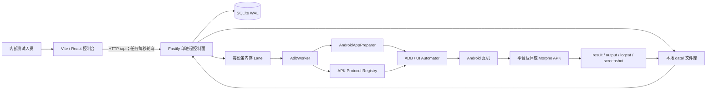
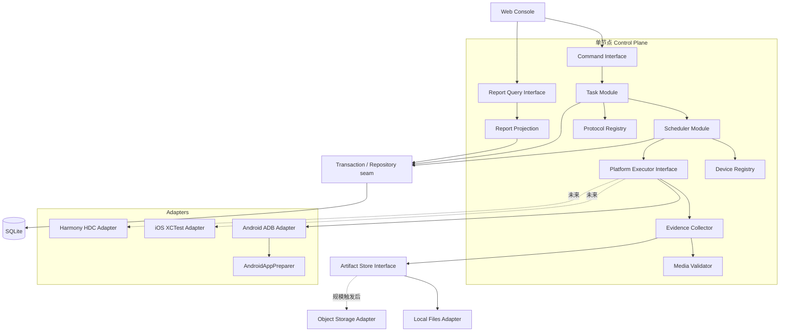
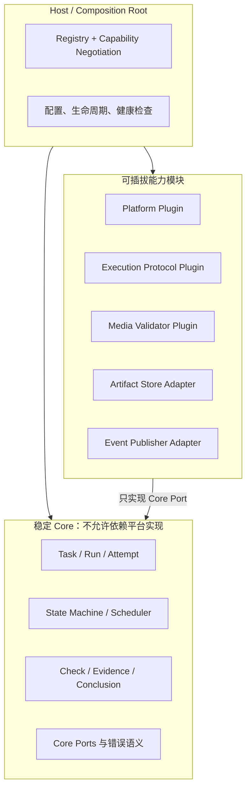
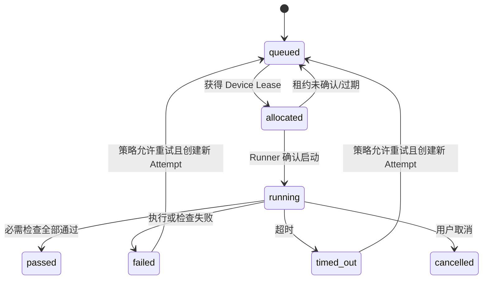

# SDK 视频兼容性测试平台：需求与架构重新对齐深度报告

> 核对日期：2026-07-31（Asia/Shanghai）  
> 证据范围：当前仓库源码、测试与构建结果、本地数据快照、项目既有文档，以及官方文档/标准。  
> 文档目的：明确“现在是什么、下一阶段要证明什么、架构应该先做什么、何时才需要扩展”。  
> 结论标记：**事实**表示代码或运行数据已经证明；**建议**表示本报告的架构决策；**待确认**表示产品负责人仍需拍板。

---

## 0. 执行摘要：本轮重新对齐后的核心结论

### 0.1 产品定位应收窄，而不是继续泛化

**建议定位：**

> 一个面向内部 SDK 集成与兼容性验证人员的、本地优先 Android 真机实验室控制器。它用可复现的 APK、视频、设备、执行协议和证据链，回答“指定 SDK 在指定 Android 设备与素材上是否完成了约定的视频处理链路”。

当前不应把它定义成通用公有云测试平台，也不应声称已经完成“视频质量验收”。原因是：

1. **事实：**真实开放的执行平台只有 Android；iOS/HarmonyOS 只是类型与页面入口预留。
2. **事实：**真实 SDK AAR/JAR/SO 与 `VendorSdkBridgeImpl` 尚未进入仓库，平台载体在缺少实现时会如实失败。
3. **事实：**当前输出验证主要是完成信号、文件存在、非空、SHA-256 与回收成功；没有解码、时长、流信息、黑/绿帧、画面相似度等质量判定。
4. **事实：**控制面、调度器和 Android Worker 在同一 Node 进程内；SQLite 与文件都在本机。
5. **事实：**没有认证、租户、配额、远程 Runner 或对象存储，尚不具备公有/企业共享云平台的安全与运维边界。

### 0.2 下一阶段的北极星不是“平台数量”，而是“结论可信度”

推荐按以下顺序定义成功：

1. **真实**：真实 SDK 被调用，不能复制输入伪造成功。
2. **可复现**：同一任务能还原 APK/SDK/视频/协议/设备/配置/平台版本。
3. **可解释**：失败属于稳定的错误分类，并带日志、截图、设备快照和媒体证据。
4. **可恢复**：服务重启不丢排队任务；运行中任务有明确恢复或失败语义；重试产生独立 Attempt。
5. **可治理**：上传、ADB 权限、数据保留、删除、备份和访问都在明确的信任边界内。
6. **可扩展**：只有上述语义稳定后，才把 Android Executor 的实现经验推广到 iOS/HarmonyOS。

### 0.3 推荐架构结论

**现在继续采用“模块化单体 + 可插拔 Adapter + 本地文件 + SQLite”是正确的，暂不拆微服务。**

架构硬约束是：**领域内高内聚、模块间低耦合、平台与基础设施可插拔**。这里的“可插拔”首先表示在组合根替换或新增 Adapter 时无需修改核心领域模块，而不是立即支持任意第三方二进制的运行时动态加载。

应把当前单体深化为几个清晰的深模块，并优先增加持久调度和证据验证：

```text
Control Plane
├── Task Module（命令、状态机、幂等）
├── Scheduler Module（持久 Run/Attempt + Device Lease）
├── Device Registry（登记、发现、在线快照）
├── Artifact Store（内容寻址、校验、保留策略）
├── Protocol Registry（APK 执行契约及版本）
├── Platform Executor
│   └── Android ADB Adapter（当前唯一真实 Adapter）
├── Evidence & Media Validator（日志、截图、ffprobe、质量规则）
└── Report Query（只读投影与结论解释）
```

只有出现下列触发条件，才拆出远程 Runner/队列/对象存储：

- 单台控制机无法物理承载目标设备数；
- 设备分布在多台主机或多个实验室；
- 多用户并发、租户隔离或跨网络访问成为真实需求；
- 数据量、吞吐或可用性目标超出本机磁盘与 SQLite 的已验证包络。

---

## 1. 本轮分析方法与事实基线

### 1.1 检查范围

本轮重新检查了：

- 产品与运行说明：`README.md`、`.github/*`；
- 前端：`web/src`；
- 控制面与数据：`apps/api/src/server.ts`、`database.ts`、schema、删除模块；
- 调度与执行：`queue.ts`、`adb.ts`、`apk-protocols.ts`；
- Android 载体：`android/app/src/main` 与 `SDK_INTEGRATION.md`；
- 当前 SQLite 记录和 `data/` 占用；
- 现有 19 个测试文件；
- 2026-07-31 实际执行的测试与构建；
- 官方文档与标准，整理见 [《官方文档架构证据》](./research/官方文档架构证据.md)。

### 1.2 代码与运行基线

| 项目 | 2026-07-31 实测结果 | 含义 |
|---|---:|---|
| Node.js | v24.18.0 | 满足项目当前 `node:sqlite` 使用条件 |
| pnpm | 11.17.0 | 与仓库工作流一致 |
| 测试 | 19 文件、78 项全部通过 | 单元/模块级回归基线健康 |
| Web 构建 | 成功 | 但 JS 约 1,322 kB，gzip 约 414 kB，并触发大 chunk 警告 |
| API 构建 | 成功 | TypeScript 编译通过 |
| 设备记录 | 7 | 全部为 Android |
| 任务记录 | 18 | 16 passed、2 failed |
| 设备运行 | 36 | 33 passed、3 failed |
| 输出 | 33 | 已有多设备真实运行产物 |
| 删除审计 | 15 | 删除深模块已在真实数据上使用 |
| `data/` | 约 2.8 GB | 生命周期治理已经不是未来问题 |
| artifacts/tasks/backups | 约 1.0 GB / 1.0 GB / 793 MB | 素材、输出和备份都会持续放大磁盘占用 |

注意：测试全部通过不等于端到端系统已经得到证明。现有测试主要覆盖队列、数据库多设备聚合、删除、HTTP Range、设备登记、协议解析和 Android 弹窗安全；尚未看到浏览器 → 上传 → 调度 → 真机 → 媒体验证 → 报告的自动化端到端验收，也没有 Android instrumentation 测试。

### 1.3 当前架构事实图



这是一个**本地模块化单体雏形**，不是分布式云平台。这个事实应成为需求和路线图的起点。

---

## 2. 需求重新对齐

### 2.1 角色与真正要完成的工作

| 角色 | 核心任务（Job） | 需要的可信证据 |
|---|---|---|
| SDK 集成工程师 | 验证 SDK 在指定设备与视频上是否被正确初始化、处理和释放 | SDK/Bridge 版本、结构化事件、输出、失败码 |
| 测试执行人员 | 批量选择设备，发起任务，发现阻塞并重跑 | 设备在线状态、队列位置、阶段、日志、重试记录 |
| 质量负责人 | 判断结果是否足以发布，不接受“有文件即通过” | 媒体完整性、质量规则、矩阵覆盖、结论口径 |
| 平台维护者 | 保证设备、ADB、磁盘、队列和数据处于可治理状态 | 健康检查、容量、租约、审计、备份/恢复验证 |
| 报告使用者 | 看懂哪些设备通过、为什么失败、能否复现 | 输入/输出哈希、环境快照、检查矩阵、证据下载 |

当前 UI 已覆盖“执行人员”和部分“报告使用者”，但“质量负责人”和“平台维护者”的需求还没有成为一等模型。

### 2.2 推荐的统一领域语言

| 术语 | 精确定义 | 当前代码映射/问题 |
|---|---|---|
| Artifact | 一份不可变的输入内容，如 APK、MP4；由哈希标识内容 | 已有 `artifacts`，但同哈希仍可重复存储 |
| Test Plan | 版本化的测试规则集合：输入约束、执行协议、检查项、超时、结论规则 | 当前只有固定字符串与 timeout，未版本化 |
| Task | 用户提交的一次测试意图：Artifact + Plan + Device Set | 已有 `tasks` |
| Device Run | Task 在一台设备上的逻辑运行目标 | 已有 `device_runs`，并对 `(task, device)` 唯一 |
| Attempt | Device Run 的一次物理执行尝试；重试应产生新的 Attempt | 当前缺失，因此无法表达重试历史 |
| Device Snapshot | 执行时刻的设备、OS、补丁、构建、连接与能力快照 | 设备表有部分信息，但不是每次运行的不可变快照 |
| APK Protocol | 平台如何安装、传入输入、启动、识别进度/完成、回收输出和取消的版本化契约 | 已有 `ApkExecutionProtocol`，这是成熟 seam |
| Check | 一条可独立解释的断言 | 已有 `check_results`，但规则版本与严重级别缺失 |
| Evidence | 支撑 Check 和结论的文件或结构化记录 | 当前分散在输出、日志、截图和目录约定中 |
| Conclusion | 根据版本化规则，从 Attempts/Checks 计算出的业务结论 | 当前与运行状态高度绑定，语义仍偏粗 |

必须避免继续混用：

- “任务成功”与“视频质量通过”；
- “设备在线”与“设备可分配”；
- “Run”与“Attempt”；
- “平台支持 iOS 类型”与“iOS Executor 已可用”；
- “本地控制器”与“云服务”。

### 2.3 “通过”的分层定义

这是当前最重要的需求缺口。建议把结果拆成五层，而不是用一个 `passed` 覆盖全部含义：

| 层级 | 问题 | 当前覆盖 |
|---|---|---|
| L0 协议合规 | APK 包名、启动、输入、完成与输出契约是否受支持 | 基本覆盖 |
| L1 执行成功 | 安装、权限、启动、SDK 处理、结果回收是否完成 | 基本覆盖 |
| L2 媒体完整 | 输出是否可探测、可解码，容器/流/时长是否合理 | 未覆盖；目前只验证存在/非空/哈希 |
| L3 质量符合 | 是否出现黑帧、绿帧、损坏帧、异常裁剪、音画问题或超阈值差异 | 未覆盖 |
| L4 矩阵结论 | 哪些设备/OS/芯片组合满足发布策略 | 只有简单设备通过率，规则未版本化 |

**建议：**在 L2/L3 实现以前，界面和报告把当前 `passed` 显示为“执行链路通过”，而不是“兼容性完全通过”或“质量验收通过”。

当前 `passRate` 是“通过的 Device Run 数 / Device Run 总数”，不是检查项通过率，也不是视频质量得分。该定义应在界面和接口中显式说明。

### 2.4 分阶段需求优先级

#### P0：形成可信 Android 闭环

1. 接入至少一个真实 SDK Bridge，并记录 SDK/Bridge 版本。
2. 引入基础媒体探测：容器、视频/音频流、时长、分辨率、帧率、解码错误。
3. 版本化 Test Plan、APK Protocol 和结论规则。
4. 保存 Task 创建时的输入哈希、设备快照、执行配置和平台构建标识。
5. 建立完整 E2E 验收：上传 → 多设备 → 执行 → 输出 → 报告。
6. 明确本地信任边界，修复开发服务器对局域网暴露控制 API 的风险。
7. 建立数据保留、容量告警、备份轮换和恢复演练。

#### P1：使单节点可靠可运维

1. 增加 `Attempt` 和 Device Lease，支持显式重试、超时回收与重启恢复。
2. 创建任务支持幂等键，避免浏览器重试产生重复任务。
3. 引入正式数据库迁移版本，而不是仅靠启动时 `ALTER TABLE`。
4. 将 `server.ts` 路由、`database.ts` 仓储职责、`adb.ts` 执行阶段进一步收进深模块。
5. 统一错误分类、阶段事件、日志字段和容量指标。
6. Artifact 按 SHA-256 去重或至少做引用复用；增加孤儿文件回收。

#### P2：在真实触发条件出现后扩展

1. 远程 Runner 与心跳/租约；
2. 持久消息队列或数据库调度器的多进程实现；
3. 对象存储；
4. 身份认证、RBAC、租户与配额；
5. iOS XCTest/Xcode Adapter；
6. HarmonyOS HDC Adapter；
7. SSE/WebSocket 实时事件流与规模化报告查询。

### 2.5 推荐的非功能验收指标

以下是建议基线，不是当前已达成事实：

| 维度 | 建议验收口径 |
|---|---|
| 正确性 | 任一“通过”结论都能追溯到版本化 Plan、Protocol、输入哈希、设备快照和全部必需 Check |
| 幂等性 | 同一幂等键重复提交不会创建第二个 Task |
| 恢复性 | 服务重启后 queued 不丢失；running Attempt 在租约到期后进入可解释终态或按策略重试 |
| 隔离性 | 同一物理设备同一时刻最多一个有效 Lease；不同设备可并行 |
| 安全性 | 未认证/未授权主体不能上传 APK、登记设备、执行 ADB、读取 Artifact 或删除任务 |
| 文件安全 | 扩展名/MIME 不作为唯一信任依据；上传进入隔离区，经校验后才可执行/发布 |
| 数据治理 | 可配置 Artifact/Evidence/Backup 保留策略；容量达到阈值时停止接收或告警 |
| 可观测性 | Task/Run/Attempt ID 贯穿日志、事件、文件路径与 API；失败码稳定可统计 |
| 性能 | 先定义目标设备数、并发数、最大 Artifact、任务/日，再用压测证明，不凭架构猜测 |

---

## 3. 当前架构评价

### 3.1 已经做对的设计

#### 1. 每设备独立 Lane

`DeviceQueueManager` 在同一设备串行、不同设备并行，接口只暴露 `execute` 与 `cancelTask`。这是一个小而有杠杆的 seam，适合作为未来 Platform Executor 的调度入口。

#### 2. Task 与 Device Run 分离

每台设备有独立状态、阶段、检查、日志和输出，任务状态由所有运行聚合，已经为多真机矩阵奠定了正确基础。

#### 3. APK Protocol 独立

安装、输入路径、启动参数、进度来源、完成信号、输出和取消规则没有散落到路由或页面。它应继续深化为版本化、可验证的协议模块，而不是改写成大量 `if packageName`。

#### 4. AndroidAppPreparer 是真正的深模块

它把设备唤醒、锁屏安全、安装协调、权限和严格白名单弹窗从 `AdbWorker` 中隔离。尤其是“未知弹窗宁可失败，不泛化点击”符合设备自动化的安全原则。

#### 5. 文件元数据与二进制分离

SQLite 保存事实和索引，APK/MP4/日志/截图保存在文件系统；输出支持 HTTP Range。对当前本地单节点包络是合适选择。

#### 6. 删除采用计划、隔离区、事务与审计

`TaskDeletionService` 比简单级联删除成熟得多：共享素材引用检查、白名单路径、`.trash`、事务失败恢复和审计都已经具备。

#### 7. 失败不伪造

真实 SDK 未接入时返回 `SDK_INITIALIZE_FAILED`，而不是复制输入伪造 output。这个产品原则应写进正式验收标准。

### 3.2 主要架构缺口与风险

| 优先级 | 缺口 | 当前证据 | 影响 | 建议 |
|---|---|---|---|---|
| P0 | “通过”语义过宽 | 输出只检查远端/本地非空与 SHA-256 | 可能把不可播放或质量异常视频判为兼容 | 增加 L2/L3 媒体验证并改报告文案 |
| P0 | 真实 SDK 缺失 | `VendorSdkBridgeImpl` 未提供 | 平台载体不能证明真实 SDK 闭环 | 先接入一个真实版本并固化 E2E |
| P0 | 信任边界不闭合 | API 无认证；`pnpm dev` 使用 `vite --host 0.0.0.0` 且代理 `/api` | 局域网访问者可能间接触发上传、ADB、删除 | 默认仅 loopback；共享模式必须认证、授权、TLS/可信反代 |
| P0 | APK 是高风险可执行输入 | 仅 AAPT/包名/协议校验，不验证来源或签名策略 | 可在连接设备上安装受支持包名的恶意 APK | 隔离、签名/证书 allowlist、操作者审计、专用测试设备 |
| P0 | multipart 类型限额过宽 | Fastify 全局 `fileSize` 取视频上限 4 GiB；APK 业务上限 1 GiB 只在落盘后检查；超限映射为 400 | 大 APK 可消耗约 4 GiB 传输/临时磁盘，错误语义也不准确 | 按 `kind` 设置请求级限额，收紧 parts/fields/headerPairs，超限返回 413 |
| P0 | 数据生命周期缺失 | `data/` 已约 2.8 GB；无自动保留/容量阈值 | 磁盘耗尽会破坏上传、运行和备份 | 容量指标、TTL、备份轮换、去重、低水位拒绝策略 |
| P1 | 队列调度在内存 | Lane/knownRunIds 不持久；重启把 running 标失败 | 不能表达租约、接管、恢复和可靠重试 | SQLite 中持久 Attempt + Lease，单进程先实现 |
| P1 | 无 Attempt | `(task_id, device_id)` 唯一 | 重试只能新建 Task，历史与统计失真 | Run 表示目标，Attempt 表示物理尝试 |
| P1 | 可复现元数据不足 | 缺 SDK 版本、Plan 版本、Protocol 版本、服务构建、运行配置快照 | 以后无法解释“昨天通过今天失败” | 创建时冻结 Execution Manifest |
| P1 | schema 迁移非正式 | `CREATE IF NOT EXISTS` + `ensureColumns` | 复杂变更、回滚、审计困难 | 引入 `schema_migrations` 与顺序迁移 |
| P1 | 同步数据库调用会占用事件循环 | 当前使用 `DatabaseSync`；Node 24 文档中 `node:sqlite` 仍为 Stability 1.2 | 锁等待、长查询或大事务可阻塞 Fastify；高并发包络不清楚 | 固定 Node 版本，保持短事务，监控 busy/WAL/checkpoint，并通过压测设定拆分触发条件 |
| P1 | 大模块集中 | `adb.ts` 549 行、`database.ts` 463 行、`server.ts` 301 行 | 变更局部性下降，测试 seam 不够稳定 | 深化 Executor、Repository/Transaction、Route Module |
| P1 | 创建不幂等 | 每次 POST 都生成新 UUID | 网络重试可重复上传和创建任务 | Artifact 内容复用 + Task idempotency key |
| P1 | 证据不是一等模型 | logcat/screenshot 依赖固定目录和专用路由 | 新证据类型会扩散路由与字段 | `evidence` 表 + Artifact Store 引用 |
| P1 | 测试金字塔缺顶 | 78 项通过但无全链路自动化与 Android instrumentation | 模块正确不保证系统闭环正确 | 增加合同、集成、真机冒烟和媒体金样本 |
| P2 | 前端固定 1 秒轮询 | 每个打开详情页独立 GET | 用户/任务增多后产生读放大 | 当前保留；达到规模触发后再上 SSE |
| P2 | iOS/Harmony 只有名义抽象 | 类型与页面已有，执行链仍 Android 特化 | 过早复制会固化错误模型 | 先稳定 Plan/Run/Attempt/Evidence，再新增 Adapter |

### 3.3 一个必须立即说明的安全事实

Fastify 自身绑定 `127.0.0.1`，但开发命令把 Vite 绑定到 `0.0.0.0`，而 Vite 又代理 `/api` 到 Fastify。也就是说，“后端只监听本机”不自动等于“控制 API 只允许本机用户访问”。

这套 API 可以：

- 上传并保存大文件；
- 登记 USB/ADB 设备；
- 安装受支持包名的 APK 并启动应用；
- 拉取日志、截图和输出；
- 取消或删除任务。

因此必须明确两种模式：

1. **本地模式（默认）**：Web 和 API 都只绑定 loopback，不提供远程访问；
2. **共享实验室模式**：经认证反向代理访问，强制身份、RBAC、审计、TLS、来源/大小/速率限制和专用设备隔离。

不能继续保留“页面对局域网开放、控制面默认无认证”的中间状态。

---

## 4. 推荐目标架构

### 4.1 保持模块化单体，但重新放置 seam



#### 外部 seam 应小且稳定

建议的外部接口形状：

```ts
interface Scheduler {
  submit(taskId: TaskId): void
  cancel(taskId: TaskId, actor: Actor): void
  recover(now: Instant): RecoverySummary
}

interface PlatformExecutor {
  execute(attempt: ExecutionManifest, signal: AbortSignal): Promise<ExecutionResult>
}

interface ArtifactStore {
  ingest(stream: Readable, policy: IngestPolicy): Promise<StoredArtifact>
  open(id: ArtifactId, range?: ByteRange): Promise<ReadableArtifact>
  quarantine(id: ArtifactId, reason: string): Promise<void>
  deleteIfUnreferenced(id: ArtifactId): Promise<DeletionResult>
}

interface MediaValidator {
  validate(input: MediaEvidence, rules: MediaRuleSet): Promise<CheckResult[]>
}
```

不要把 ADB 参数、SQLite Row、Fastify Request、文件绝对路径或厂商弹窗细节暴露到这些接口中。它们属于 Adapter 的实现知识。

### 4.2 高内聚、低耦合、可插拔的框架设计

#### 4.2.1 先定义什么必须稳定，什么允许替换

框架分为三圈：



**稳定 Core：**

- Task、Device Run、Attempt、Device Lease；
- 状态转移、不变量、幂等、重试策略；
- Check、Evidence、Conclusion 的通用语义；
- Artifact 引用和 Execution Manifest；
- 稳定错误分类与审计事件。

**允许插拔：**

- 设备发现与设备能力探测；
- Android ADB、iOS XCTest/Xcode、Harmony HDC 等平台执行；
- 不同 APK/应用的安装、输入、启动、完成和输出协议；
- ffprobe、黑/绿帧、画面相似度等媒体检查；
- 本地文件/对象存储；
- 内存/SQLite/远程事件投递；
- 本地身份/企业身份提供者（共享模式启用）。

**不应插件化：**

- Task 聚合规则；
- 一个设备同一时刻只能有一个有效 Lease；
- Attempt 终态不可回退；
- Evidence 的完整性要求；
- 结论规则的版本化要求；
- 审计与访问控制的强制执行点。

这些是产品一致性，不是平台差异。把它们交给插件会导致每个平台形成不同语义，表面低耦合、实际无法治理。

#### 4.2.2 依赖方向

必须执行一条硬规则：

```text
core  ←  ports  ←  adapters/plugins  ←  composition-root
```

- `core` 不导入 Fastify、SQLite、ADB、XCTest、HDC、文件绝对路径或厂商 SDK；
- Adapter 可以导入 Core Port 和平台 SDK；
- 只有 Composition Root 知道具体 Adapter，并负责注册；
- 插件不能绕过 Port 直接写数据库表、任务目录或 HTTP reply；
- Core 不能出现 `if (platform === 'android')` 或 `if (packageName === ...)`；选择由 Registry 完成。

这比“按技术层拆很多文件”更重要。高内聚以**共同变化原因**为准：Android 安装、权限、弹窗和 ADB 路径属于 Android 插件；Task 状态机、重试与结论属于 Core。

#### 4.2.3 插件分层，避免一个巨型 `PlatformPlugin`

不建议让一个插件实现几十个方法。推荐“插件包 + 多个小 Port”：

```ts
interface PluginManifest {
  id: string
  version: string
  coreContract: string
  capabilities: readonly Capability[]
}

interface CloudTestPlugin {
  readonly manifest: PluginManifest
  register(registrar: PluginRegistrar): void
}

interface DeviceProvider {
  readonly platform: PlatformId
  discover(signal: AbortSignal): Promise<DiscoveredDevice[]>
  inspect(device: DeviceRef, signal: AbortSignal): Promise<DeviceSnapshot>
}

interface ExecutorFactory {
  readonly platform: PlatformId
  canExecute(manifest: ExecutionManifest): CapabilityMatch
  create(context: ExecutorContext): PlatformExecutor
}

interface PlatformExecutor {
  execute(manifest: ExecutionManifest, signal: AbortSignal): Promise<ExecutionResult>
}

interface ProtocolProvider {
  resolve(artifact: InspectedArtifact): ExecutionProtocol | undefined
}

interface EvidenceValidator {
  supports(evidence: EvidenceDescriptor, rule: CheckRule): boolean
  validate(evidence: EvidenceRef, rule: CheckRule): Promise<CheckResult>
}
```

`CloudTestPlugin.register()` 只在启动期向 Registry 注册小接口实现；运行期 Core 只消费它真正需要的 Port。这样插件包有平台内聚性，而每个 Port 仍然保持小接口和高杠杆。

#### 4.2.4 三类插件不要混成一类

| 插件类型 | 变化原因 | 示例 | 不应负责 |
|---|---|---|---|
| Platform Plugin | 操作系统、设备工具链变化 | Android ADB、iOS XCTest、Harmony HDC | 业务结论、Task 聚合 |
| Protocol Plugin | 被测应用的执行契约变化 | `com.sdktest.platform`、Morpho batch | 设备登记、通用调度 |
| Validator Plugin | 质量规则或证据格式变化 | ffprobe、黑帧、VMAF/相似度 | 安装应用、分配设备 |
| Infrastructure Adapter | 部署环境变化 | SQLite/Postgres、本地文件/对象存储、SSE Publisher | 平台执行语义 |

Android 插件可以捆绑默认 Protocol，但 Registry 中仍以独立 ID/version 注册，避免“Android 等于某个 APK”。

#### 4.2.5 能力协商，而不是平台名判断

任务分配不应只判断 `platform === android`，而应匹配能力：

```json
{
  "platform": "android",
  "transport": "adb",
  "architectures": ["arm64-v8a"],
  "apiLevel": 36,
  "features": ["install-apk", "runtime-permissions", "structured-log"],
  "protocols": ["platform-carrier-v1", "morpho-batch-v2"]
}
```

Task/Plan 声明 required capabilities；Device Snapshot、Executor 与 Protocol 声明 provided capabilities。Scheduler 只处理匹配结果，不理解 ADB、Intent 或 OEM 品牌。

#### 4.2.6 插件生命周期与失败隔离

第一阶段采用编译期注册：

```text
进程启动
→ 读取配置
→ 注册内置插件
→ 校验 manifest/coreContract/重复 ID
→ initialize
→ health/capability snapshot
→ 开始调度
→ shutdown 时 dispose
```

运行时必须满足：

1. 插件初始化失败只让对应 capability unavailable，不应破坏已有终态数据；
2. 一个 Attempt 固定使用某个 plugin/protocol/version，不允许运行中热切换；
3. 取消统一使用 `AbortSignal`，插件仍要返回结构化结果；
4. 插件异常由 Host 转成 `INFRASTRUCTURE_FAILED`，不能把任意异常泄漏成 Core 状态；
5. 插件健康检查不能直接修改 Task；
6. 每个插件有超时、资源清理和日志字段约束。

#### 4.2.7 版本兼容与合同测试

每个插件 manifest 至少包含：

- `id`、`version`；
- 兼容的 `coreContract` 范围；
- capability 列表；
- 配置 schema 版本；
- Protocol/Validator 版本；
- 构建标识。

框架提供统一合同测试套件：

```text
DeviceProviderContract
PlatformExecutorContract
ProtocolProviderContract
ArtifactStoreContract
EvidenceValidatorContract
```

任何新 Adapter 必须通过相同合同：取消幂等、超时、终态不可覆盖、路径安全、证据完整、资源释放、晚到事件拒绝。平台专属测试只补充差异，不重复 Core 的状态机测试。

#### 4.2.8 推荐目录结构

```text
apps/api/src/
├── core/
│   ├── tasks/
│   ├── scheduling/
│   ├── execution/
│   ├── evidence/
│   └── conclusion/
├── ports/
│   ├── device-provider.ts
│   ├── executor.ts
│   ├── protocol-provider.ts
│   ├── artifact-store.ts
│   ├── evidence-validator.ts
│   └── event-publisher.ts
├── plugins/
│   ├── android/
│   │   ├── android-plugin.ts
│   │   ├── adb-device-provider.ts
│   │   ├── adb-executor.ts
│   │   ├── app-preparation/
│   │   └── protocols/
│   └── media-ffprobe/
├── adapters/
│   ├── persistence-sqlite/
│   ├── storage-local/
│   └── http-fastify/
└── host/
    ├── plugin-registry.ts
    ├── composition-root.ts
    └── lifecycle.ts
```

迁移时不要先移动全部文件。应先抽出 Port 和合同测试，再让现有实现成为第一个 Adapter，逐步替换调用点；否则容易得到“目录看起来插件化，但依赖仍然互相穿透”的假架构。

#### 4.2.9 “可插拔”验收标准

一个模块只有满足以下条件才算真的可插拔：

1. 新增第二个实现不修改 Core 源码；
2. 删除该实现后 Core 仍可编译、已有数据仍可读取；
3. 替换实现只发生在 Composition Root/Registry；
4. 两个实现通过同一合同测试；
5. Core 不知道实现的配置、异常类型和资源路径；
6. Execution Manifest 能记录这次实际使用的插件与版本；
7. 插件不可绕过权限、审计、状态机和证据完整性规则。

---

### 4.3 Task / Run / Attempt 状态模型

推荐区分控制面状态与物理执行尝试：



关键不变量：

1. 一个 Device Run 可以有多个 Attempt，但同一时刻最多一个非终态 Attempt；
2. 一个 Device 同一时刻最多有一个有效 Lease；
3. Attempt 终态不可被晚到事件覆盖；
4. Task 的结论只由 Run 的结论聚合，Run 的结论只由选定 Attempt 与规则计算；
5. 取消是独立终态，不再用 `blocked` 代替；
6. `blocked` 表示前置条件不满足且未执行，例如设备安全锁、设备离线、协议不支持；
7. 重试不会擦除上次失败，而是保留完整证据。

### 4.4 推荐数据模型演进

在现有表之上增量演进，不建议一次重写：

```text
tasks
├── test_plan_id / test_plan_version
├── idempotency_key
├── requested_by
├── execution_manifest_json
└── conclusion_rule_version

device_runs
├── selected_attempt_id
├── device_snapshot_json
└── conclusion

run_attempts (新增)
├── id, run_id, attempt_no
├── status, phase, progress
├── runner_id, lease_id
├── started_at, heartbeat_at, finished_at
├── failure_category, failure_code, failure_message
└── executor_version

device_leases (新增)
├── device_id, attempt_id
├── owner, acquired_at, expires_at
└── fencing_token

evidence (新增)
├── attempt_id, kind
├── artifact_id / storage_path
├── sha256, size, mime_type
└── metadata_json

test_plans / protocol_versions (新增或配置快照)
└── 不可变版本与规则哈希

schema_migrations (新增)
└── version, name, applied_at, checksum
```

其中 `execution_manifest_json` 至少冻结：

- APK、输入视频与规则文件哈希；
- APK package/version/signing certificate（允许范围内）；
- SDK/Bridge 版本；
- Protocol ID + version/hash；
- Test Plan ID + version/hash；
- Device Snapshot；
- 超时、权限、安装模式和媒体规则；
- 后端与 Android 载体构建版本。

### 4.5 调度策略：先持久化，再分布式化

当前每设备 FIFO 的策略是合理的。下一步不需要立即引入 Redis/Kafka/RabbitMQ；先让 SQLite 成为调度事实来源：

1. 事务中选择 queued Run；
2. 创建 Attempt；
3. 用唯一约束/条件更新获取 Device Lease；
4. 提交给本进程 Executor；
5. 定期更新 heartbeat；
6. 重启时回收过期 Lease；
7. 根据重试策略创建新 Attempt；
8. 所有状态转移执行 compare-and-set，拒绝晚到写入。

当多个 Runner 主机成为真实需求时，保留 Scheduler Interface，替换分配 Adapter，而不是改动 Task/Report 模型。

### 4.6 Artifact 与 Evidence 架构

建议把“用户上传素材”和“运行产生证据”统一经过 Artifact Store，但保留业务 kind：

```text
上传流
→ 临时隔离区
→ 大小/流量限制
→ 内容识别与格式解析
→ SHA-256
→ APK 包信息/签名策略 或 MP4 媒体探测
→ 内容寻址存储
→ 数据库引用提交
→ 异步/定期孤儿清理
```

当前上传实现存在几个需要补强的点：

- MP4 主要依赖扩展名/MIME，未解析真实容器；
- APK 检查包名与协议，但没有来源/签名 allowlist；
- 同一 SHA-256 会重复保存；
- 数据库写入失败后需要确保最终目录不会成为孤儿；
- 最大视频 4 GB、APK 1 GB，如果共享访问必须增加并发、速率、用户与磁盘配额。

### 4.7 事件与实时更新

当前 1 秒轮询对本地少量用户是合理的，不应为了“架构先进”立刻重写。

推荐演进原则：

- Task 详情读取仍用普通 HTTP；
- 进度变化记录为结构化 Run Event；
- 当并发浏览器或任务数导致轮询读放大时，增加 SSE 只推送“状态已变化/事件”，详情仍按需查询；
- 只有存在客户端双向低延迟控制需求时才考虑 WebSocket。

SSE/WebSocket 不解决持久状态、重启恢复或正确性，不能替代 Attempt/Lease/Event 的数据模型。

---

## 5. 安全、可靠性与可观测性设计

### 5.1 信任边界

APK 是代码，不是普通文档；ADB 连接的设备也是高权限资产。推荐：

1. 测试设备不得登录真实个人/生产账号；
2. 设备位于隔离网络，任务前后执行清理策略；
3. APK 来源、签名证书、包名和 Protocol 同时受控；
4. 未识别系统弹窗保持“失败并留证据”，禁止泛化点击；
5. 上传区与可执行区分离；
6. 报告/日志可能包含设备、路径和应用信息，需与操作权限一致；
7. 删除、取消、设备登记、Protocol 变更和重试都写审计；
8. 共享模式下必须有身份与角色，不能只记录固定 `local-user`。

### 5.2 错误分类

建议把目前散落的错误码收敛为稳定分类：

```text
REQUEST_INVALID       请求/测试计划错误，不应重试
ARTIFACT_INVALID      文件、包、签名、媒体格式错误，不应重试
DEVICE_UNAVAILABLE    离线/未授权/被占用，可延迟重试
DEVICE_UNSAFE         安全锁或未知弹窗，需人工处理
INSTALLATION_FAILED   安装失败，按原因决定是否重试
APP_LAUNCH_FAILED     启动/崩溃
SDK_FAILED            SDK 初始化/处理/释放失败
OUTPUT_INVALID        缺失、为空、不可解码或质量失败
INFRASTRUCTURE_FAILED ADB/进程/磁盘/服务故障，可重试
CANCELLED             用户取消
TIMED_OUT             超时
```

具体 `failureCode` 继续保留，但必须归属一个稳定 category，并声明 `retryable`。

### 5.3 可观测性最小集

建议最少提供：

- 指标：queued/running/terminal 数、队列等待时间、运行时长、设备在线率、失败分类、重试数、磁盘剩余、Artifact/Evidence/Backup 占用；
- 结构化日志：`task_id`、`run_id`、`attempt_id`、`device_id`、`protocol_version`、`phase`、`failure_code`；
- 事件：状态转移、Lease、取消、重试、证据生成、结论生成；
- 健康：进程存活不等于可运行，应区分数据库可写、磁盘水位、ADB 可用、设备在线；
- 审计：actor、动作、目标、前后状态、时间、结果。

---

## 6. 官方文档对架构决策的约束

完整事实、优先级与 39 个一手来源见 [《官方文档架构证据》](./research/官方文档架构证据.md)。这里仅保留影响决策的结论：

1. **Android app-specific external storage** 适合当前按包名保存任务输入/输出的方式，但卸载应用会移除应用专属目录；clean install、输入推送、结果回收和清理顺序必须进入 Protocol，每个 Attempt 应使用独立目录。
2. **ADB 首次授权与部分权限无法绝对无人值守。** 新主机首次连接要求设备解锁并人工确认 RSA；`install -g`/`pm grant`不覆盖特殊权限、受限设置和 OEM 确认。当前严格 allowlist 与诊断留存方向正确，但应把 `DeviceReadiness` 变成正式准入能力。
3. **SQLite WAL 提高读写并发，但仍然只有一个 writer，也不适合直接放在网络文件系统。** WAL、事务和备份不能替代应用级 Lease/幂等/状态机；长读还可能阻碍 checkpoint。当前规模可继续使用 SQLite，多 Runner 前必须压测并定义包络。
4. **Node `node:sqlite` 仍需成熟度防护。** Node 24 官方文档把它标为 Stability 1.2（Release candidate），而 `DatabaseSync` 同步执行。项目当前构建与测试通过，但应固定 Node 版本、保持短事务并监控 busy/WAL/checkpoint。
5. **Fastify multipart 的 limits 必须按 Artifact 类型收紧。** 当前流式消费是正确的，但全局上限取 4 GiB，APK 可能在业务层按 1 GiB 拒绝之前已大量落盘；超限应返回 413，并增加并发、速率和磁盘水位控制。
6. **文件上传安全不能只相信扩展名与 `Content-Type`。** MP4 要做真实容器/流探测；APK 要增加 `apksigner` 签名验证、证书摘要/allowlist、隔离和生命周期治理。
7. **共享访问必须做对象级授权。** UUID 不是授权；Task、Run、Attempt、Artifact、Evidence、Device、下载路径和队列消息都要绑定 owner/tenant，并记录不含密钥的审计事件。
8. **SSE 是服务器到浏览器的单向事件流；WebSocket 是双向。** 当前进度更适合“HTTP 权威快照 + SSE 增量事件 + event id 断线恢复”；规模触发前仍可保留轮询。
9. **iOS 与 HarmonyOS 的工具链和执行语义不同。** iOS 需要 macOS/Xcode、签名、注册设备和 Developer Mode；OpenHarmony hdc 支持指定设备、安装 HAP、文件收发、shell 与 hilog。平台化应复用 Task/Run/Attempt/Evidence/Report，而不是复用 ADB、APK、Intent 或 Android 权限语义。

---

## 7. 分阶段演进路线与验收门

### Gate A：可信 Android 闭环

**目标：**证明“真实 SDK + 真实设备 + 真实媒体结论”。

完成条件：

- 至少一个真实 SDK Bridge 进入可重复构建流程；
- 报告明确区分执行链路与媒体质量；
- 基础 ffprobe/解码检查进入必需 Check；
- 保存 Execution Manifest；
- 有一条自动化或稳定脚本化真机 E2E；
- 本地模式仅 loopback，或共享模式完成认证/授权；
- 真实金样本覆盖成功、SDK 失败、崩溃、超时、无输出、损坏输出。

**在 Gate A 完成前，不建议启动 iOS/HarmonyOS 实现。**

### Gate B：可靠单节点

**目标：**重启、重试、容量和迁移可控。

完成条件：

- Run/Attempt 分离；
- Device Lease 与心跳/超时回收；
- Task 创建幂等；
- 正式 schema migration；
- Artifact 去重/孤儿清理；
- 数据保留、备份轮换、恢复演练与磁盘低水位策略；
- 失败分类和结构化指标可统计。

### Gate C：多 Runner / 共享实验室

**触发条件：**设备跨主机、并发用户或远程实验室已经成为被批准需求。

完成条件：

- Runner 注册、能力、心跳和 Lease fencing；
- 控制面与 Runner 双向认证；
- Artifact Store 可被远程 Runner 安全读取/写回；
- 网络中断、重复投递、晚到结果和 Runner 崩溃测试；
- RBAC、审计、配额、TLS 和秘密管理。

### Gate D：多平台

**触发条件：**Android 的 Test Plan、Attempt、Evidence 与 Conclusion 已稳定，且有明确 iOS/Harmony 业务优先级与设备资源。

实现顺序：

1. 定义 `PlatformExecutor` 合同测试；
2. 为平台设计独立 Adapter；
3. 复用控制面模型，不复用 Android 实现细节；
4. 分平台定义 Artifact、安装、权限、完成信号、证据和清理策略；
5. 报告做统一矩阵 + 平台专属证据。

---

## 8. 推荐的决策记录（ADR）

以下决策满足“难逆转、有真实权衡、未来会问为什么”，值得正式 ADR：

1. **当前阶段采用本地模块化单体，而非微服务；**
2. **Task / Run / Attempt 三层模型；**
3. **SQLite 持久调度与 Device Lease，何时升级外部队列；**
4. **Artifact Store 内容寻址与保留策略；**
5. **兼容性结论分层与版本化规则；**
6. **本地模式与共享模式的信任边界；**
7. **多平台只共享控制面领域模型，不共享 Android 执行细节。**

路由拆文件、组件懒加载等容易回退的实现选择不必写 ADR。

---

## 9. 仍需产品负责人确认的关键问题

这些问题不阻止当前报告给出建议，但会改变优先级和架构包络：

1. **目标用户**：仅本人/单个开发团队，还是公司内部多团队共享？
2. **访问方式**：只在控制机本地使用，还是必须从局域网/远程访问？
3. **规模包络**：未来一个季度的设备数、并发任务数、日任务量、Artifact 最大值分别是多少？
4. **结论口径**：现在要证明“SDK 调用链路成功”，还是必须承担正式发布质量门禁？
5. **真实 SDK**：第一个要接入的 SDK、版本、License/初始化方式和成功标准是什么？
6. **媒体质量**：哪些指标是必须阻断发布的，哪些只告警？是否有基准输出/金样本？
7. **数据保留**：输入、输出、日志、截图、失败诊断和备份分别保留多久？
8. **重试语义**：哪些失败可以自动重试，最多几次，是否必须 clean install？
9. **安全模型**：APK 是否只来自可信构建流水线？能否拿到签名证书 allowlist？
10. **平台路线**：iOS/HarmonyOS 是已承诺交付，还是只做技术预留？哪个更优先？
11. **报告使用**：只供工程调试，还是要作为发布审计证据长期留存？
12. **设备状态**：任务之间是否需要恢复出厂、清理应用数据、重启或基线校验？
13. **插件形态**：需求是“在组合根替换实现即可”，还是必须支持第三方插件包运行时安装、卸载或热更新？后者需要额外的沙箱、签名、版本解析和进程隔离。

在这些问题未确认前，推荐默认采用最保守假设：**可信内部操作者、本地 loopback、单控制机、小规模 Android 设备池、报告仅代表执行链路，不承担完整质量放行。**

---

## 10. 最终建议

这个项目已经越过“纯前端演示”阶段：多设备模型、每设备队列、ADB 执行、Protocol seam、严格弹窗自动化、证据回收和安全删除都是真实资产。当前最需要避免的是两种误判：

1. 因为已有多平台类型，就认为下一步应该复制 iOS/HarmonyOS；
2. 因为有 output.mp4 和 `passed`，就认为已经完成兼容性质量验证。

正确的下一步是把 Android 链路做成**可信、可复现、可恢复、可治理**的产品基线：

```text
真实 SDK
→ 版本化执行清单
→ Run / Attempt / Lease
→ 媒体完整性与质量检查
→ 稳定失败分类与证据
→ 数据生命周期与安全边界
→ 端到端验收
```

完成这条主线后，现有 seam 才能真正产生杠杆：增加新平台时只新增 Adapter 和平台规则，而不是复制任务、调度、证据和报告系统。
