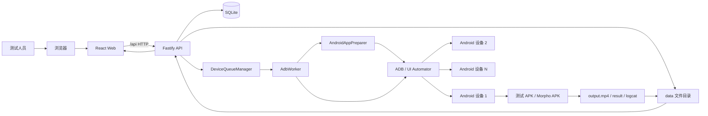
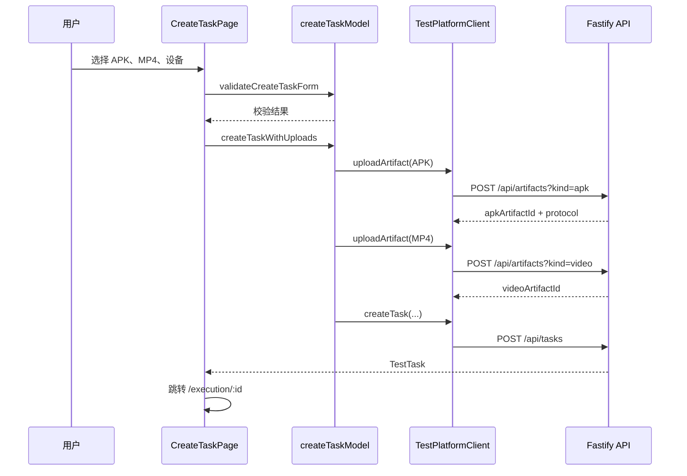
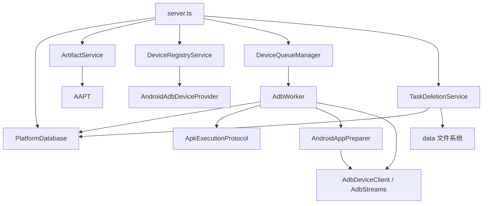
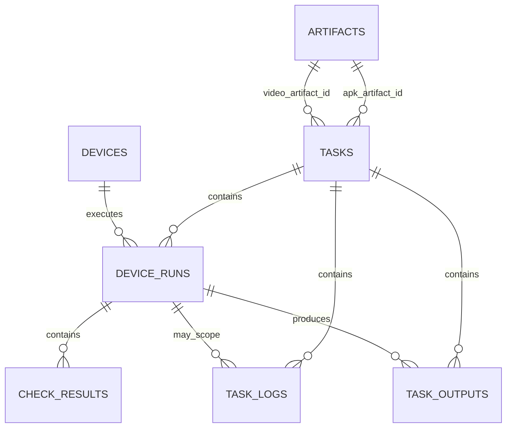
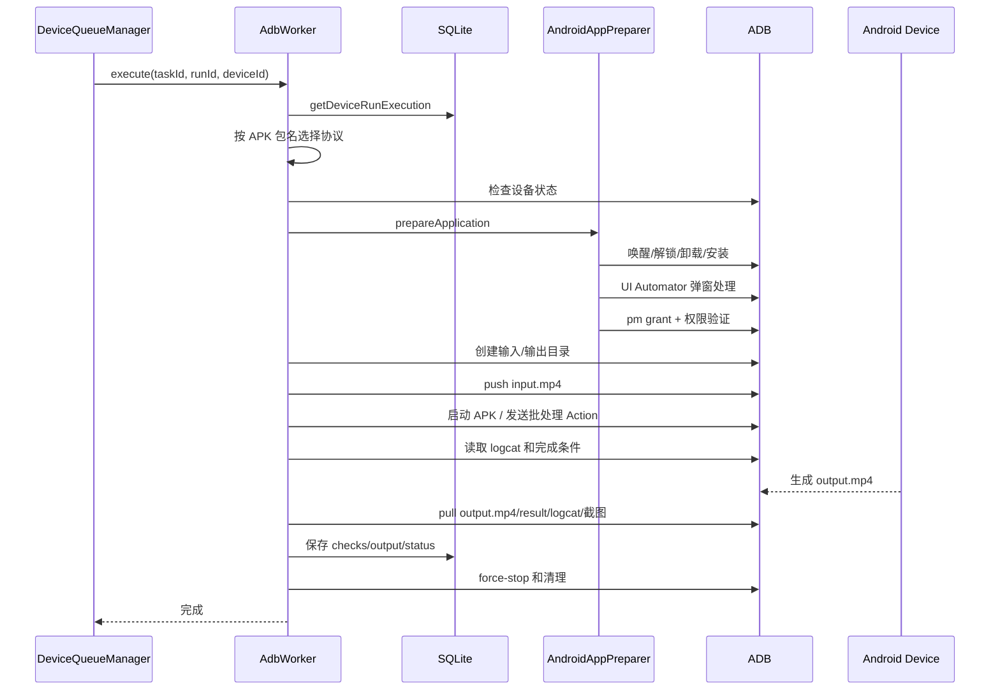

# SDK 云测试平台详细架构分析

> 文档依据：当前仓库真实代码，而不是仅依据早期计划。  
> 最后核对日期：2026-07-30。  
> 适用范围：当前本地 Android APK + MP4 多真机兼容性测试平台，以及后续 iOS / HarmonyOS 扩展设计。

---

## 1. 一句话理解整个项目

这个项目不是单独的前端页面，而是一个运行在开发者电脑上的本地云测试平台：

```text
浏览器中的 React 控制台
        ↓ HTTP /api
Fastify 本地后端
        ↓
SQLite 元数据 + data/ 文件存储
        ↓
多设备任务队列
        ↓
ADB Worker + Android 应用准备模块
        ↓
Android 真机上的测试 APK / Morpho APK
        ↓
处理 input.mp4，生成 output.mp4
        ↓
后端回收视频、日志、截图和结果
        ↓
前端报告页在线播放和下载
```

当前已经真正开放的是 **Android 模式**。iOS 和 HarmonyOS 已经出现在前端入口、平台类型和部分后端抽象中，但目前仍属于“规划入口”，没有真实执行器。

---

## 2. 系统上下文



### 2.1 当前系统的职责边界

| 模块 | 主要职责 | 不负责的事情 |
|---|---|---|
| React 前端 | 上传、选择设备、创建任务、查看进度和报告 | 不直接操作 ADB、SQLite 或电脑文件 |
| Fastify 后端 | HTTP 接口、校验、任务调度、结果查询 | 不在浏览器里保存真实任务事实 |
| SQLite | 保存设备、素材、任务、运行、检查、输出元数据 | 不保存 APK/MP4 二进制内容 |
| `data/` 文件系统 | 保存 APK、输入视频、输出视频、日志和截图 | 不负责状态聚合 |
| `DeviceQueueManager` | 同设备串行、不同设备并行 | 不理解 Morpho 或 Android 弹窗细节 |
| `AdbWorker` | 编排一次 Android `deviceRun` | 不负责页面展示和 HTTP 请求 |
| `AndroidAppPreparer` | 安装、权限、OEM 弹窗、设备就绪 | 不处理 MP4 输出回收和报告展示 |
| APK 执行协议 | 描述某种 APK 如何安装、输入、启动、完成和输出 | 不是直接发送给 APK 的 JSON 配置 |
| Android 测试载体 | 调用真实 SDK、生成结果、验证输出播放 | 不负责跨设备调度 |

---

## 3. 技术栈

### 3.1 前端

```text
React 19.1
TypeScript 5.8
Vite 7
Ant Design 5
React Router 7
ECharts 5
Vitest
```

说明：`zustand` 已安装在依赖中，但当前源码没有实际使用。当前页面状态主要由 React `useState`、`useEffect`、自定义 hooks 和客户端模块管理。因此不能把当前架构描述为“Zustand 全局状态管理”。

### 3.2 后端

```text
Node.js
Fastify 5
TypeScript
node:sqlite
@fastify/multipart
ADB / AAPT
Vitest
```

项目使用 Node 内置的 `node:sqlite`，不是 Sequelize、Prisma 或 TypeORM。

### 3.3 Android

```text
Java 17
Android Gradle Plugin 8.10.1
Gradle 8.11.1
compileSdk 36
targetSdk 36
minSdk 29
applicationId = com.sdktest.platform
```

### 3.4 包管理和统一命令

根目录使用 pnpm，`package.json` 中的主要命令为：

| 命令 | 作用 |
|---|---|
| `pnpm dev` | 同时启动真实模式前端和 Fastify 后端 |
| `pnpm dev:web` | 只启动前端，默认仍连接真实 `/api` |
| `pnpm dev:web:real` | `pnpm dev:web` 的兼容别名，仍为真实 API 模式 |
| `pnpm dev:web:mock` | 显式启动纯前端 Mock 演示，不连接数据库和真机 |
| `pnpm dev:api` | 读取可选 `.env.local`，使用 Node watch + tsx 启动后端 |
| `pnpm build` | 依次构建 Web 和 API |
| `pnpm test` | 运行全部 Vitest 测试 |
| `pnpm backup:data` | 安全备份 SQLite 和运行数据 |

---

## 4. 物理目录结构

```text
项目根目录/
├── index.html                     浏览器最先加载的 HTML 外壳
├── package.json                   根命令和依赖
├── vite.config.ts                 Vite、构建目录和 /api 代理
├── tsconfig*.json                 TypeScript 配置
├── web/                           React 前端源码
├── apps/api/                      Fastify 后端源码
├── android/                       平台 Android 测试载体
├── data/                          本地数据库和真实运行产物
├── scripts/                       备份与素材准备脚本
├── docs/                          项目文档
└── dist/                          Web 构建产物
```

### 4.1 数据目录

```text
data/
├── cloud-test.sqlite
├── cloud-test.sqlite-wal
├── cloud-test.sqlite-shm
├── artifacts/
├── tasks/
└── .trash/                        安全删除过程的隔离区
```

`sqlite-wal` 和 `sqlite-shm` 是 SQLite WAL 模式的配套文件，不应在服务运行时只复制主 `.sqlite` 文件作为备份。

---

## 5. 本地运行与访问过程

### 5.1 浏览器为什么能打开页面

```text
用户访问 http://localhost:5173
→ Vite 开发服务器返回根目录 index.html
→ index.html 中的脚本加载 web/src/main.tsx
→ main.tsx 把 React 挂载到 #root
→ App.tsx 根据 URL 选择页面
→ 页面通过 platformClient 请求数据
```

### 5.2 前后端如何连接

`vite.config.ts` 配置了：

```ts
proxy: {
  '/api': 'http://127.0.0.1:3000',
}
```

所以浏览器请求：

```text
http://localhost:5173/api/tasks
```

会由 Vite 转发为：

```text
http://127.0.0.1:3000/api/tasks
```

这让本地开发时不需要在前端代码中写完整后端地址，也避免常见跨域问题。

### 5.3 Mock 模式和真实模式

```text
VITE_API_BASE_URL=/api
→ HttpTestPlatformClient
→ 真实 Fastify + SQLite + ADB

没有 VITE_API_BASE_URL
→ MockTestPlatformClient
→ 浏览器 localStorage + 定时器模拟
```

真实任务的事实来源是 SQLite 和 `data/`，不是 localStorage。Mock 成功也不能解释成真实设备测试通过。

---

## 6. 前端架构

### 6.1 React 启动链

```text
index.html
→ web/src/main.tsx
→ Ant Design ConfigProvider
→ BrowserRouter
→ web/src/App.tsx
→ web/src/layouts/AppLayout.tsx
→ 具体页面
```

### 6.2 路由

| URL | 页面文件 | 作用 |
|---|---|---|
| `/` | `OverviewPage.tsx` | 平台概览 |
| `/tasks` | `TaskListPage.tsx` | 任务列表、筛选、删除入口 |
| `/create` | `CreateTaskPage.tsx` | 上传 APK/MP4、选择设备并创建任务 |
| `/execution/:id` | `ExecutionPage.tsx` | 查看运行阶段、设备状态和日志 |
| `/reports/:id` | `ReportPage.tsx` | 查看设备结果矩阵和输出视频 |
| `/devices` | `DevicesPage.tsx` | 扫描和录入 ADB 设备 |
| `/platform/:platform` | `PlannedPlatformPage.tsx` | iOS/HarmonyOS 规划页面 |
| `/settings` | `App.tsx` | 当前重定向到概览 |

### 6.3 前端代码分层

```text
web/src/
├── pages/           页面级编排：加载数据、处理路由、组合视图
├── components/      可复用视图模块
├── features/        任务、报告等领域规则
├── platform/        真实/Mock 数据访问 seam
├── runner/          Mock Runner 和 localStorage 实现
├── types/           前端领域类型
├── utils/           文件校验、格式化、常量
├── layouts/         控制台壳层
└── styles.css       全局样式和布局
```

可以口语化理解为：

```text
types/features/platform 负责“数据和规则是什么”
pages 负责“这个页面要做什么”
components 负责“页面分成哪些可复用块”
styles.css 负责“最后长什么样、怎么排列”
```

### 6.4 最重要的前端 seam：`TestPlatformClient`

位置：

```text
web/src/types/index.ts
web/src/platform/client.ts
```

核心 Interface：

```ts
interface TestPlatformClient {
  readonly mode: 'mock' | 'real'
  listDevices(): Promise<DeviceProfile[]>
  discoverDevices(): Promise<DeviceDiscoveryCandidate[]>
  registerDevice(serial: string): Promise<DeviceProfile>
  uploadArtifact(file: File, kind: 'apk' | 'video'): Promise<Artifact>
  createTask(input: CreateTaskInput): Promise<TestTask>
  listTasks(): Promise<TestTask[]>
  getTask(taskId: string): Promise<TestTask | undefined>
  subscribeTask(taskId: string, listener: TaskUpdateListener): () => void
  getReport(taskId: string): Promise<TestReport | undefined>
  cancelTask(taskId: string): Promise<void>
  deleteTask(taskId: string): Promise<TaskDeletionReceipt>
}
```

两个 Adapter：

```text
HttpTestPlatformClient   真实 HTTP 后端
MockTestPlatformClient   浏览器模拟数据
```

这是一个真实 seam，因为已经有两个可替换 Adapter。页面只依赖 Interface，不需要知道任务来自 HTTP 还是 localStorage。

### 6.5 创建任务页面的数据流

相关文件：

```text
web/src/pages/CreateTaskPage.tsx
web/src/features/tasks/createTaskModel.ts
web/src/components/task/ApkSelector.tsx
web/src/components/task/VideoSelector.tsx
web/src/components/task/DeviceMatrixSelector.tsx
web/src/components/task/SubmitProgress.tsx
web/src/utils/uploadValidation.ts
```

完整流程：



页面保存真实的 `File` 对象，而不是只保存文件名或 blob 地址。视频的 `URL.createObjectURL` 只用于浏览器本地预览。

### 6.6 执行详情页

`ExecutionPage.tsx` 主要做页面编排：

```text
加载任务和设备
→ 建立任务订阅
→ 选择当前设备
→ 组合 ExecutionOverview
→ 组合 DeviceRunList
→ 组合 PhaseCard
→ 组合 DeviceRunDetails
```

真实模式的 `subscribeTask()` 当前不是 WebSocket 或 SSE，而是每秒轮询 `/api/tasks/:id`。页面卸载或任务进入终态后会停止轮询。

执行阶段定义在：

```text
web/src/components/execution/executionDefinitions.ts
```

阶段包括设备校验、APK 安装、安装弹窗、权限、输入传输、启动、处理、输出验证、回收和报告生成。

### 6.7 报告页

报告页结构：

```text
ReportPage
├── 报告汇总结论
├── 统计信息
├── 输入 APK/MP4 信息
├── DeviceResultMatrix
└── DeviceRunDetailDrawer
```

`DeviceResultMatrix` 一台设备一行，检查项按列显示；详情抽屉只展示被点击设备对应的：

```text
设备信息
执行状态和阶段
检查项
日志
output.mp4
SHA-256
logcat
截图
```

这避免了早期“只读取第一台设备结果”的单设备限制。

### 6.8 任务删除前端

`TaskActions.tsx` 使用后端返回或前端补齐的 `task.capabilities`：

```text
canCancel
canDelete
deleteBlockedReason
```

前端按钮禁用只是用户体验，真正的状态检查仍由后端重新执行。

---

## 7. 后端总体架构

### 7.1 入口和总装配

```text
apps/api/src/index.ts
→ buildServer()
→ 监听 127.0.0.1:3000
```

`apps/api/src/server.ts` 是后端的 **composition root**，负责创建并连接：

```text
PlatformDatabase
AndroidAdbDeviceProvider
DeviceRegistryService
AdbWorker
DeviceQueueManager
ArtifactService
TaskDeletionService
Fastify routes
```

它的职责是“把模块接起来”，而不是承载所有领域实现。

### 7.2 后端模块依赖图



---

## 8. 后端文件职责索引

### 8.1 根模块

| 文件 | 功能 |
|---|---|
| `apps/api/src/index.ts` | 调用 `buildServer()`、监听端口并记录启动失败；数据库关闭钩子在 `server.ts` 注册 |
| `apps/api/src/server.ts` | 总装配、注册 HTTP 路由、连接数据库/设备/队列/Worker |
| `apps/api/src/config.ts` | 端口、数据目录、ADB、AAPT、大小限制和轮询间隔 |
| `apps/api/src/types.ts` | 后端领域类型：任务、设备运行、阶段、检查、输出、报告 |
| `apps/api/src/process.ts` | 使用 `spawn(command, args, {shell:false})` 安全执行外部命令 |
| `apps/api/src/artifacts.ts` | 流式保存 APK/MP4、大小/格式校验、AAPT 包名识别、SHA-256 |
| `apps/api/src/apk-protocols.ts` | APK 安装、输入、启动、进度、完成、输出、取消协议 |
| `apps/api/src/http-file.ts` | MP4 HTTP Range/206 流媒体和下载响应 |
| `apps/api/src/task-capabilities.ts` | 根据任务状态计算可取消、可删除能力 |

### 8.2 数据库模块

| 文件 | 功能 |
|---|---|
| `apps/api/src/database.ts` | SQLite 读写、任务创建、设备运行状态、聚合、报告和输出记录 |
| `apps/api/src/database/schema.ts` | 建表、兼容性加列、索引、默认设备种子和重启状态处理 |
| `apps/api/src/database/mappers.ts` | SQLite `snake_case` 行映射为 TypeScript `camelCase` 对象 |
| `apps/api/src/database-multi-device.test.ts` | 多设备任务创建、状态聚合和历史兼容测试 |

### 8.3 设备发现模块

| 文件 | 功能 |
|---|---|
| `devices/device-provider.ts` | 平台设备发现 Interface |
| `devices/android-adb-provider.ts` | 解析 `adb devices -l`，读取 Android `getprop` |
| `devices/device-registry.ts` | 扫描、注册、幂等更新和连接状态合并 |

设备注册的事实来源仍是 SQLite；在线状态在请求时结合当前 ADB 扫描结果计算。

### 8.4 调度和执行模块

| 文件 | 功能 |
|---|---|
| `queue.ts` | 每台物理设备一条 lane，同设备串行、不同设备并行 |
| `adb.ts` | 一次 Android `deviceRun` 的总编排 |
| `execution/adb-client.ts` | 面向单个 Serial 的 ADB 命令 Adapter |
| `execution/adb-streams.ts` | logcat 流、截图和持续子进程处理 |
| `execution/process-registry.ts` | 持有并取消单次任务的子进程和 AbortController |
| `execution/execution-errors.ts` | 带稳定失败代码的执行异常 |
| `execution/file-utils.ts` | 延时、Hash 等文件辅助函数 |
| `execution/check-names.ts` | 检查项 key 到中文名称的映射 |

### 8.5 Android 应用准备深模块

目录：

```text
apps/api/src/execution/android-app-preparation/
```

| 文件 | 功能 |
|---|---|
| `contracts.ts` | 模块 Interface 和内部协作类型 |
| `android-app-preparer.ts` | 对 Worker 暴露统一 `prepareApplication()` |
| `device-readiness.ts` | 点亮屏幕、尝试解除无密码锁屏、识别安全锁 |
| `apk-install-coordinator.ts` | 卸载/安装进程与 OEM 弹窗监控并行协调 |
| `runtime-permissions.ts` | `pm grant`、权限验证和厂商差异诊断 |
| `runtime-permission-dialog-coordinator.ts` | ADB 不能直接授权时的权限弹窗兜底 |
| `post-launch-dialog-coordinator.ts` | 启动后特定兼容提示处理 |
| `system-dialog-controller.ts` | dump UI XML、验证窗口、执行安全点击、保存诊断 |
| `dialog-profiles.ts` | vivo、荣耀、OPPO、Android 权限白名单 Profile |
| `ui-xml.ts` | UI Automator XML 节点和 bounds 解析 |
| `__fixtures__/` | 脱敏后的真实/模拟系统弹窗 XML 测试样本 |

这个 Module 具有较好的 **Depth**：调用者只学习一个准备 Interface，复杂 OEM 差异都留在 Implementation 内部，产生较高 Leverage 和 Locality。

### 8.6 删除模块

| 文件 | 功能 |
|---|---|
| `task-deletion.ts` | 删除计划、事务、路径白名单、`.trash` 暂存、回滚、孤立素材和审计 |
| `routes/task-deletion-route.ts` | 把 `DELETE /api/tasks/:id` 映射到删除 Module |

路由层不执行 SQL，也不直接调用 `rm()`。这也是当前项目中另一个典型深模块。

---

## 9. HTTP 接口

### 9.1 健康和协议

| 方法 | 路径 | 作用 |
|---|---|---|
| GET | `/api/health` | 返回服务状态、Android 可用性、设备数量 |
| GET | `/api/apk-protocols` | 返回全部公开 APK 执行协议 |
| GET | `/api/apk-protocols/:id` | 查询一个 APK 协议 |

### 9.2 设备

| 方法 | 路径 | 作用 |
|---|---|---|
| GET | `/api/devices` | 返回已录入设备和实时连接状态 |
| POST | `/api/devices/discover` | 扫描当前 ADB 设备 |
| POST | `/api/devices/register` | 按 Serial 重新验证并录入设备 |

录入时后端不会信任前端提供的品牌、型号和系统信息，而会重新通过 ADB 查询。

### 9.3 素材

| 方法 | 路径 | 作用 |
|---|---|---|
| POST | `/api/artifacts?kind=apk` | 上传并校验 APK |
| POST | `/api/artifacts?kind=video` | 上传 MP4 |
| GET | `/api/artifacts/:id` | 查询素材元数据 |
| GET | `/api/artifacts/:id/content` | 在线播放输入视频 |

APK 上传时使用 AAPT 读取包名，然后用包名查找已配置协议。AAPT 判断的不是“APK 好不好”，而是确定：

```text
这个 APK 是谁
→ 后端是否知道怎样安装它
→ 输入放哪里
→ 怎样启动
→ 输出去哪里
→ 怎样判断完成
```

### 9.4 任务

| 方法 | 路径 | 作用 |
|---|---|---|
| POST | `/api/tasks` | 验证素材和在线设备，创建任务及多个 `device_runs` |
| GET | `/api/tasks` | 任务列表 |
| GET | `/api/tasks/:id` | 任务、设备运行、检查、日志和输出聚合视图 |
| POST | `/api/tasks/:id/cancel` | 取消等待和运行中的设备执行 |
| DELETE | `/api/tasks/:id` | 安全删除终态任务 |
| GET | `/api/tasks/:id/report` | 返回报告结论和全部设备结果 |

创建任务当前只接受：

```ts
{
  platform: 'android',
  name: string,
  apkArtifactId: string,
  videoArtifactId: string,
  deviceIds: string[],
  testPlan: {
    type: 'sdk-video-processing-compatibility',
    timeoutSeconds: number
  }
}
```

超时会被后端限制到 30～1800 秒。

### 9.5 设备运行附件

| 方法 | 路径 | 作用 |
|---|---|---|
| GET | `/api/tasks/:taskId/device-runs/:runId/logcat` | 下载对应设备运行的 logcat |
| GET | `/api/tasks/:taskId/device-runs/:runId/screenshots/final` | 查看最终截图 |

### 9.6 输出视频

| 方法 | 路径 | 作用 |
|---|---|---|
| GET | `/api/outputs/:id/content` | 支持 HTTP Range/206 的在线播放 |
| GET | `/api/outputs/:id/download` | 以附件方式下载 output.mp4 |

浏览器 `<video>` 拖动进度条时会发送 Range 请求，因此 `/content` 不能只返回普通完整文件流。

---

## 10. SQLite 数据模型

### 10.1 表关系



`task_deletion_audits` 故意不对 `tasks` 建外键，因为任务删除后审计仍需保留。

### 10.2 每张表的职责

| 表 | 保存内容 |
|---|---|
| `devices` | 设备档案、Serial、型号、系统、ABI、最后在线时间 |
| `artifacts` | APK/MP4 元数据、存储路径、Hash、APK 包名 |
| `tasks` | 测试任务总体状态、进度、通过率、素材引用和超时 |
| `device_runs` | 每个任务在每台设备上的独立状态、阶段、失败原因 |
| `check_results` | 单设备检查项结果 |
| `task_logs` | 任务/设备运行日志 |
| `task_outputs` | output.mp4 元数据和磁盘路径 |
| `task_deletion_audits` | 删除摘要、数量、素材保留/删除和警告 |

### 10.3 为什么 SQLite 里不直接存 MP4

数据库只存：

```text
文件 ID
文件名
磁盘路径
大小
MIME
SHA-256
所属 taskId / deviceRunId
```

二进制放在 `data/`。这样播放视频时可以直接流式读取文件，不会让 SQLite 文件因为大视频迅速膨胀。

### 10.4 外键和 WAL

数据库初始化执行：

```sql
PRAGMA foreign_keys = ON;
PRAGMA journal_mode = WAL;
```

主要级联关系：

```text
删除 tasks
→ 删除该任务 device_runs
→ 删除对应 check_results
→ 删除该任务 task_logs
→ 删除该任务 task_outputs
```

`devices` 和仍被其他任务引用的 `artifacts` 不会沿任务级联删除。

### 10.5 任务状态聚合

设备运行是事实，任务状态是聚合结果：

```text
所有 run 都 queued                  → task queued
存在 queued/running，且不是全 queued → task running
所有 run passed                    → task passed
全部结束但存在 failed/blocked       → task failed
用户取消                           → task cancelled
```

任务进度：

```text
所有 device_run.progress 的平均值
```

通过率：

```text
passed 设备数量 / 本任务设备总数 × 100%
```

---

## 11. 多设备队列

### 11.1 队列 Interface

`queue.ts` 定义：

```ts
interface DeviceRunWorker {
  execute(job: DeviceRunJob): Promise<void>
  cancelTask(taskId: string): void
}
```

当前 Adapter 是 `AdbWorker`。

### 11.2 调度规则

内部结构：

```text
Map<deviceId, DeviceLane>
```

每个 `DeviceLane` 有：

```text
pending[]
knownRunIds
running
draining
```

因此：

```text
同一设备：任务一个接一个执行
不同设备：各自 lane 可同时执行
```

### 11.3 当前限制

队列运行态在内存中，因此当前适合本地单 API 实例：

- 多个后端实例会产生重复调度风险；
- 服务重启不能恢复某个 APK 正在处理的中间位置；
- 不适合直接扩成分布式设备农场；
- 当前的恢复策略是标记中断运行，再重新加载仍为 queued 的运行。

---

## 12. APK 执行协议

### 12.1 协议解决什么问题

位置：

```text
apps/api/src/apk-protocols.ts
```

它回答每种 APK 的八个问题：

```text
1. APK 包名是什么
2. 如何安装
3. 输入 MP4 放哪里
4. 如何启动
5. 如何观察进度
6. 输出 MP4 放哪里
7. 如何判断完成和失败
8. 如何取消
```

协议是后端内部操作说明。不是把整个协议对象发给手机，实际执行时由 `AdbWorker` 把协议转换为 ADB 命令、路径和监控逻辑。

### 12.2 平台测试载体协议

```text
包名：com.sdktest.platform
安装：adb install -r -t
输入：files/tasks/{taskId}/input/input.mp4
启动：MainActivity + task_id + auto_run=true
进度：SDK_COMPAT JSON 日志
输出：files/tasks/{taskId}/output/output.mp4
完成：files/tasks/{taskId}/result/result.json
取消：am force-stop
```

### 12.3 Morpho 协议

```text
包名：com.morphoinc.videopostprocessor
安装：clean，先卸载再安装
权限：CAMERA、RECORD_AUDIO
输入：VideoStabilizerDataPack/input.mp4
预热：先启动 MainActivity
批处理：发送 ACTION_BATCH_PROCESS
参数：material_path 指向输入目录
进度：MORPHO logcat 文本模式
输出：VideoStabilizerDataPack/stabilized/*_stabilized.mp4
完成：.batch_processing_complete 标记文件
result.json：APK 不生成，由后端根据实际结果合成
取消：am force-stop
```

### 12.4 当前协议 seam 的成熟度

优点：

- 包名不再写死成单一 APK；
- 两种 APK 可以共用同一任务创建和报告流程；
- APK 差异集中在一个文件，具有较好的 Locality；
- 前端可以显示协议名称和能力。

仍需改进：

- `buildLaunchArguments()` 对 Morpho 仍有按 `protocol.id` 的分支；
- 某些协议字段主要用于说明和前端展示，并没有完全驱动执行；
- 新增差异非常大的 APK 时，可能继续扩大 `apk-protocols.ts` 和 `adb.ts`。

因此它已经是有效 seam，但还不是完全通用的数据驱动协议引擎。

---

## 13. Android 单次设备执行链



### 13.1 电脑端输出目录

```text
data/tasks/{taskId}/device-runs/{runId}/
├── output.mp4
├── result.json
├── logcat.txt
├── screenshots/
│   └── final.png
└── diagnostics/
    ├── install-dialog-*.xml
    ├── install-dialog-*.png
    └── current-window-*.txt
```

每个 `runId` 独立目录，因此多台设备不会覆盖彼此的输出。

### 13.2 进度来源

`com.sdktest.platform`：

```text
SDK_COMPAT 日志中的 JSON
→ 校验 taskId
→ 更新 check_results
→ 将 progress 映射到 processing 阶段
```

Morpho：

```text
MORPHO logcat 文本
→ parseMorphoLogLine()
→ 识别开始、文件序号、输出路径、失败等信息
→ 更新日志和处理进度
```

### 13.3 完成判断

平台载体：等待 `result.json`，并校验其中 `taskId`。

Morpho：等待 `.batch_processing_complete`，然后检查本次输出文件存在且非空。

完成条件和进度日志是两个不同概念：看到“Processing”日志不代表任务完成，必须满足对应协议的最终完成条件。

### 13.4 取消

```text
前端 POST /api/tasks/:id/cancel
→ queue.cancel(taskId)
→ SQLite 把任务标记 cancelled
→ 移除各设备 lane 中等待的 job
→ AdbWorker.cancelTask(taskId)
→ AbortSignal 终止 ADB 子进程和监控
→ force-stop 对应 APK
→ 不允许晚到结果覆盖 cancelled
```

---

## 14. Android 无人值守应用准备

### 14.1 外部 Interface

核心 Interface 可以简化理解为：

```ts
prepareApplication(request): Promise<AndroidAppPreparationReceipt>
```

输入包含设备 Serial、厂商、APK 路径、执行协议、诊断目录、取消信号和事件回调。

调用者不需要知道 vivo、荣耀、OPPO 的按钮文案和窗口包名。

### 14.2 内部流程

```text
检查设备在线
→ 点亮屏幕
→ 尝试解除无密码锁屏
→ 检测安全锁屏
→ 按协议 clean/replace 安装
→ 安装期间并行监控 OEM 安装弹窗
→ 严格白名单识别
→ 点击坐标从 XML bounds 计算
→ 验证包已安装
→ pm grant 精确授权
→ 再次验证权限
→ 必要时启动 MainActivity 触发权限弹窗兜底
→ 处理登记过的启动后兼容提示
→ 返回准备结果
```

### 14.3 安全原则

自动点击不是“看到继续就点”，而是同时核对：

```text
当前窗口包名
设备厂商
目标 APK/应用名称
多个特征文案或 resource-id
目标节点与弹窗是否属于同一窗口
```

未知弹窗不会盲点，而会保存 XML、截图和当前窗口信息，然后让当前设备运行失败。

---

## 15. Android 测试载体架构

目录：

```text
android/app/src/main/java/com/sdktest/platform/
```

### 15.1 文件职责

| 文件 | 作用 |
|---|---|
| `MainActivity.java` | 接收 `task_id/auto_run`、组织处理和播放验收 |
| `VideoProcessorAdapter.java` | 测试载体与视频处理实现之间的 Interface |
| `RealSdkAdapter.java` | 通过反射加载真实厂商 Bridge |
| `DemoPlaybackAdapter.java` | 只保留为 Mock/演示标记，不生成伪造输出 |
| `VendorSdkBridge.java` | 厂商 SDK 集成需要实现的稳定 Interface |
| `TaskFiles.java` | 按 taskId 计算 input/output/result 文件位置 |
| `StructuredLogger.java` | 输出 `SDK_COMPAT` 结构化事件 |
| `TestResult.java` | 生成机器可读 `result.json` |

### 15.2 SDK 接入 seam

```text
MainActivity
→ VideoProcessorAdapter
→ RealSdkAdapter
→ VendorSdkBridge
→ com.sdktest.integration.VendorSdkBridgeImpl
→ 真实厂商 SDK
```

仓库当前没有 `VendorSdkBridgeImpl` 时，`RealSdkAdapter` 会返回 `SDK_INITIALIZE_FAILED`，不会复制输入文件冒充 SDK 处理成功。

### 15.3 平台载体文件位置

```text
应用专属 external files/tasks/{taskId}/
├── input/input.mp4
├── output/output.mp4
└── result/result.json
```

`MainActivity` 根据 `task_id` 构造路径，`auto_run=true` 时自动开始处理。

---

## 16. 安全删除架构

删除流程不是简单执行 `DELETE FROM tasks` 和 `rm -rf`。

```text
生成删除计划
→ BEGIN IMMEDIATE
→ 再次验证任务仍为终态
→ 统计附属记录和素材引用
→ 路径白名单验证
→ 文件移动到 data/.trash/{deletionId}
→ 精确删除目标 taskId
→ 外键级联删除附属记录
→ 仅删除确定孤立的 artifact
→ 写 task_deletion_audits
→ COMMIT
→ 清理隔离区
```

失败时：

```text
ROLLBACK
→ 把已移动文件恢复
```

如果数据库已提交但最终清理 `.trash` 失败，任务仍视为删除成功，并返回清理警告，避免重复删除数据库。

---

## 17. 状态、阶段、检查和失败代码

这四者不能混为一谈：

| 概念 | 示例 | 说明 |
|---|---|---|
| 任务状态 | `running`、`passed` | 整个任务的聚合结果 |
| 设备运行状态 | `queued`、`failed`、`blocked` | 某台设备的最终/当前结果 |
| 执行阶段 | `installing_apk`、`processing` | 当前正在做哪一步 |
| 检查项 | `output_exists`、`playback` | 对某个测试点的判定 |
| 失败代码 | `DEVICE_OFFLINE`、`OUTPUT_MISSING` | 稳定、机器可读的失败分类 |

重要阶段：

```text
validating_device
validating_apk
installing_apk
handling_install_dialog
granting_permissions
handling_app_dialog
transferring_input
launching_app
processing
validating_output
collecting_output
generating_report
completed
```

前端应优先显示后端提供的失败代码和失败消息，不能用“长时间没变化”代替真实失败原因。

---

## 18. 测试架构

当前自动化测试主要覆盖：

### 18.1 前端

```text
创建任务模型
上传校验
HTTP Client
Mock Client
删除行为
```

### 18.2 后端

```text
APK 协议
多设备数据库聚合
ADB 设备发现和注册
设备队列
ADB Client
HTTP Range
任务删除
AndroidAppPreparer
安装协调器
权限管理
UI XML 解析
厂商弹窗 Profile
系统弹窗控制器
```

Android 应用准备通过 Fake ADB 和 XML Fixture 测试，不需要自动化测试直接点击真实个人设备。

### 18.3 当前测试基线

2026-07-30 在当前仓库执行 `npm test`：

```text
Test Files  19 passed
Tests       78 passed
```

队列异常兜底测试会故意向 stderr 输出一次 `executor exploded`，这是测试构造的预期异常，不代表测试失败。

### 18.4 当前测试缺口

- 缺少覆盖完整 `AdbWorker.execute()` 的端到端 Fake ADB 测试；
- 缺少浏览器级 Playwright 测试；
- Android 工程目前未看到完整 instrumentation 测试；
- 多设备真机失败、断开、恢复仍需人工验收；
- SQLite schema 迁移没有独立版本号和迁移历史表。

---

## 19. 架构中的关键 seam 和深模块

### 19.1 已经较成熟的 seam

| Seam | Interface | Adapter / Implementation |
|---|---|---|
| 前端数据访问 | `TestPlatformClient` | HTTP、Mock |
| 设备发现 | `DeviceProvider` | Android ADB Provider |
| 运行执行器 | `DeviceRunWorker` | `AdbWorker` |
| APK/SDK 调用 | `VideoProcessorAdapter` / `VendorSdkBridge` | `RealSdkAdapter` / 厂商实现 |
| Android 应用准备 | `AndroidAppPreparer` | 默认 Android 实现 |
| 删除 | `TaskDeletionModule` | `TaskDeletionService` |

### 19.2 深模块评价

`AndroidAppPreparer` 和 `TaskDeletionService` 的 Interface 较小，Implementation 隐藏大量细节。删除这些模块后，复杂逻辑会重新散落到 Worker、路由和文件操作中，说明它们确实在提供 Depth，而不是简单转发。

### 19.3 仍偏浅或职责集中的位置

- `server.ts` 同时注册大量路由，随着功能增长会越来越难导航；
- `database.ts` 集中了设备、素材、任务、运行、报告等多个领域的数据操作；
- `adb.ts` 仍然同时负责路径、启动、监控、结果回收和最终清理；
- 前后端分别维护相似的领域类型，存在字段漂移风险；
- APK 协议与 Worker 之间仍存在特定协议分支。

---

## 20. 当前架构优点

1. **真实模式和 Mock 模式明确分离**，不会要求每次看页面都连接真机。
2. **文件与数据库职责清楚**，SQLite 不存大视频二进制。
3. **每台设备运行有独立 `runId` 和目录**，适合多真机并行。
4. **同设备串行、不同设备并行**，符合物理真机资源模型。
5. **APK 执行协议按包名识别**，不再把所有 APK 当成 `com.sdktest.platform`。
6. **OEM 弹窗处理集中在深模块**，没有继续堆到 `adb.ts`。
7. **未知弹窗默认拒绝点击**，安全优先。
8. **输出视频支持 Range**，报告页可以播放和拖动。
9. **删除有事务、路径白名单、隔离区和审计**。
10. **类型中已经包含 Android/iOS/HarmonyOS 平台维度**，为扩展提供起点。

---

## 21. 当前风险与技术债

### 21.1 `AdbWorker` 仍然偏大

`adb.ts` 是核心编排 Module，但 Implementation 已包含太多步骤。建议未来内部拆成：

```text
InputTransfer
ApplicationLauncher
CompletionMonitor
OutputCollector
RunFinalizer
```

外部仍保留 `DeviceRunWorker.execute(job)`，只深挖 Implementation，不扩大 Interface。

### 21.2 `PlatformDatabase` 职责过多

当前一个类同时负责：

```text
artifact
device
task
deviceRun
check
log
output
report
```

未来可在不改变 SQLite 连接管理的前提下，内部拆分 repository，例如：

```text
ArtifactRepository
DeviceRepository
TaskRepository
RunRepository
ReportQuery
```

但不要为了文件变小而创建大量只转发一行 SQL 的浅模块。

### 21.3 路由集中

`server.ts` 应保留 composition root 角色，但可逐步将路由拆成：

```text
routes/health-routes.ts
routes/device-routes.ts
routes/artifact-routes.ts
routes/task-routes.ts
routes/output-routes.ts
```

路由只做 HTTP 协议转换，不放业务 SQL 或 ADB 命令。

### 21.4 数据库迁移不够正式

当前迁移方式是“建表 + 检查缺列 + ALTER TABLE”。小型本地项目可用，但后续字段和平台增多后，建议增加：

```text
schema_migrations
版本号
顺序迁移脚本
启动前备份
回滚/恢复说明
```

### 21.5 队列只适合单机

如果未来要部署服务器或设备农场，需要把任务领取和设备锁转为数据库/队列系统中的原子租约，而不是只用内存 `Map`。

### 21.6 HTTP 轮询

每个执行详情页每秒轮询一次。当前规模足够简单可靠；设备和用户变多后可改 SSE，再考虑 WebSocket。SSE 更适合单向进度流。

### 21.7 没有认证和权限

后端仅监听 `127.0.0.1`，适合个人电脑本地使用。如果改成局域网或公网服务，必须先增加：

```text
登录和鉴权
任务/文件访问控制
上传限流
审计用户
HTTPS
敏感日志脱敏
```

---

## 22. iOS 和 HarmonyOS 扩展分析

### 22.1 当前已经预留的部分

```text
DevicePlatform = android | ios | harmonyos
executionMode = adb | xctest | hdc | simulated
/platform/:platform 前端规划路由
health 接口返回 planned 状态
DeviceRunWorker seam
```

### 22.2 当前仍然 Android 写死的部分

```text
POST /api/tasks 只接受 platform=android
DeviceRegistryService 当前只装配 AndroidAdbDeviceProvider
DeviceQueueManager 当前只有一个 AdbWorker Adapter
APK/MP4 的 ArtifactKind 和命名偏 Android
执行阶段包含 APK、ADB 和 Android 权限语义
报告部分文案仍以 APK 为主
```

### 22.3 推荐平台执行架构

不要让 iOS/HarmonyOS 继承 Android ADB 细节，而是在平台 seam 上并列：

```text
PlatformExecutionRouter
├── AndroidRunWorker
│   ├── AndroidAppPreparer
│   └── AdbDeviceClient
├── IosRunWorker
│   ├── IosAppPreparer
│   └── Xcode/ios-deploy/xctest Adapter
└── HarmonyRunWorker
    ├── HarmonyAppPreparer
    └── HDC Adapter
```

设备发现同理：

```text
DeviceProvider
├── AndroidAdbDeviceProvider
├── IosDeviceProvider
└── HarmonyHdcDeviceProvider
```

### 22.4 数据模型演进建议

现在 `tasks.platform` 和 `devices.platform` 已经存在，可以继续使用。未来建议把 Android 特有字段从通用任务请求中拆出：

```ts
CreateTaskInput =
  | AndroidCreateTaskInput
  | IosCreateTaskInput
  | HarmonyCreateTaskInput
```

素材类型也应从 `apk | video` 演进为：

```text
android_app
harmony_app
ios_app
video
```

或者保留通用 `kind=app`，另存 `platform/packageFormat`。选择前应先明确产品是否需要跨平台共享同一任务。

### 22.5 前端模式入口

短期正确做法是：

```text
Android 兼容测试       可用
iOS 兼容测试（规划）   不可用
HarmonyOS 兼容测试（规划）不可用
```

不要复制三套几乎相同的页面。应先提取共享的任务壳层和平台配置，再让不同平台提供设备选择、应用文件选择、执行阶段和报告检查定义。

---

## 23. 推荐演进顺序

### 第一阶段：稳定 Android 当前链路

1. 给完整 `AdbWorker` 增加 Fake ADB 集成测试；
2. 把最近多机失败沉淀成日志样本和回归测试；
3. 完善失败代码到前端中文解释；
4. 增加任务时间线和每阶段耗时；
5. 确认每台设备的 Morpho 输出定位规则稳定。

### 第二阶段：降低核心文件复杂度

1. 拆分 `server.ts` 路由；
2. 深挖 `AdbWorker` 内部模块；
3. 把协议启动和完成判断做成策略 Adapter；
4. 引入正式数据库迁移版本；
5. 共享或生成前后端契约类型，减少漂移。

### 第三阶段：平台化

1. 增加 `PlatformExecutionRouter`；
2. 把 Android 阶段定义改为平台提供；
3. 增加 iOS 设备发现和最小空执行器；
4. 增加 HarmonyOS HDC 发现和最小空执行器；
5. 最后再开放前端可选择模式。

### 第四阶段：服务化

1. SSE 实时事件；
2. 持久化任务领取和设备锁；
3. 多用户和权限；
4. 对象存储或受控文件服务；
5. 设备农场和远程 Agent。

---

## 24. 新开发者阅读顺序

如果对后端、数据库和 ADB 不熟悉，建议按以下顺序阅读：

```text
1. README.md
2. apps/api/src/server.ts
3. apps/api/src/types.ts
4. apps/api/src/database/schema.ts
5. apps/api/src/database.ts
6. apps/api/src/apk-protocols.ts
7. apps/api/src/queue.ts
8. apps/api/src/adb.ts
9. apps/api/src/execution/adb-client.ts
10. apps/api/src/execution/android-app-preparation/android-app-preparer.ts
11. android/app/src/main/java/com/sdktest/platform/MainActivity.java
12. web/src/platform/client.ts
13. web/src/pages/CreateTaskPage.tsx
14. web/src/pages/ExecutionPage.tsx
15. web/src/pages/ReportPage.tsx
```

学习时始终追踪四个 ID：

```text
artifactId
→ taskId
→ deviceRunId
→ outputId
```

这四个 ID 串起上传、任务、设备执行和输出播放的完整数据链。

---

## 25. 最终结论

当前项目已经形成一个可运行的本地 Android 多真机测试平台雏形，核心链路是：

```text
React 控制台
→ Fastify
→ SQLite + 本地文件
→ 每设备独立队列
→ AdbWorker
→ AndroidAppPreparer
→ APK 执行协议
→ 真机处理
→ output.mp4 回收
→ 报告矩阵与设备详情
```

架构最有价值的部分不是某一个页面，而是已经建立的几个 seam：

```text
TestPlatformClient
DeviceProvider
DeviceRunWorker
AndroidAppPreparer
ApkExecutionProtocol
VideoProcessorAdapter
TaskDeletionModule
```

当前最重要的工程任务不是立即复制 iOS/HarmonyOS 代码，而是继续稳定 Android 真机执行，把 `AdbWorker`、协议策略和数据库迁移做得更深、更清晰。这样后续增加 iOS 和 HarmonyOS 时，新增的是平台 Adapter，而不是复制整套任务系统。
