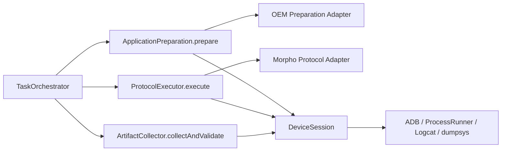
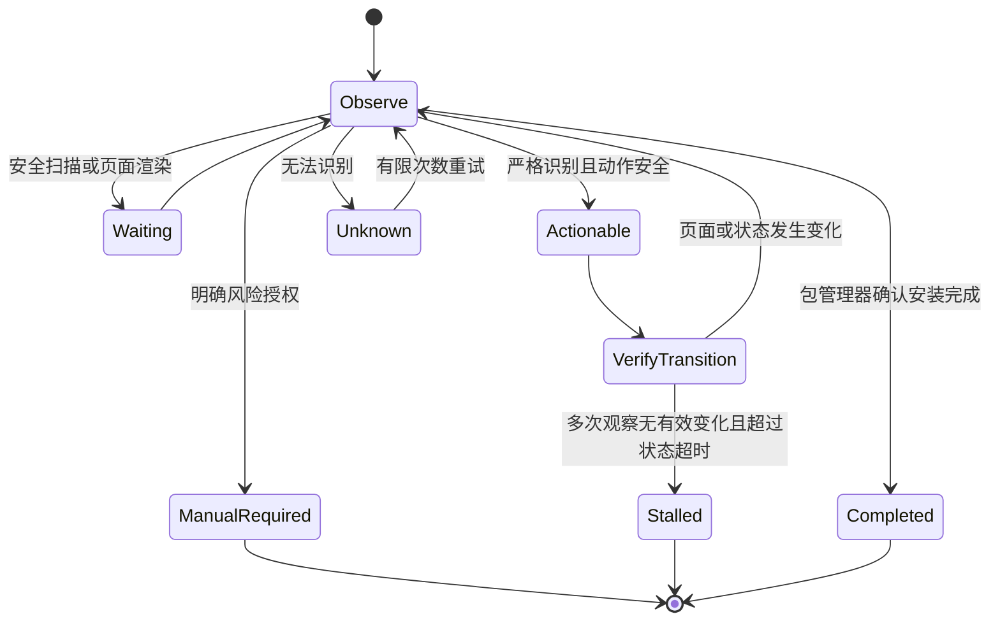

# SDK 视频兼容性测试平台：重新评审与稳定化路线图

> 评审日期：2026-08-07（Asia/Shanghai）
> 评审对象：当前 `main` 分支的完整工作树、Git 暂存区快照、现有测试/构建、SQLite 运行记录与真机诊断。
> 目标：先恢复可回溯、可验证的稳定开发基线，再修复 Morpho 与 OEM 安装链路，最后把浅模块收敛为少数稳定的业务深 Module。
> 结论口径：文中严格区分 **已确认事实**、**高概率判断**、**待验证假设** 和 **建议决策**。

---

## 0. 本轮评审要回答的问题

本轮不是简单判断“模块多不多”，而是回答以下问题：

1. 当前项目处于什么真实阶段，哪些能力已经可用，哪些仍不稳定；
2. 为什么追求高内聚、低耦合、扩展性和维护性后，主执行链反而变复杂；
3. 后续局部修改是否没有同步对齐 Interface、状态、错误语义、时序和测试；
4. 大量混合工作树应该如何安全处理，避免继续影响其他机型；
5. 后续怎样实现真正的高内聚、低耦合，并持续加固业务 Seam；
6. 下一阶段按什么顺序修改，每一步怎样验收、怎样回退。

---

## 1. 执行摘要

### 1.1 当前最准确的项目判断

项目已经具备真实的 Android 多设备执行基础，不是纯演示项目；但当前还不能称为“稳定的真机兼容性测试基线”。

当前状态可以概括为：

```text
基础治理和功能扩展已经大量实现
        +
完整工作树的单元测试、Web/API 构建、Android 构建可以通过
        -
代码已形成稳定化提交链，但其中 `794d9cf` 是尚未完成调用方迁移的中间节点；不能把四个提交都视为独立可交付节点
        -
Morpho 启动与 OEM 安装存在跨 Module 契约断裂
        -
缺少覆盖 AdbRunExecutor 整条真实 Seam 的测试
        =
功能可运行，但版本不可隔离、真机结论仍可能误判
```

### 1.2 对根因的修正结论

不是“高内聚、低耦合、扩展性和维护性”这些目标错误，而是目标在实现时出现了两类偏差：

1. **技术动作被过细拆分，但没有形成少数稳定的业务深 Module。**
2. **后续修改以局部文件或单个功能 Module 为单位，没有把完整契约链作为一个原子变更同步对齐。**

因此复杂度没有消失，而是通过以下 Interface 泄漏到主流程：

- 共享状态；
- 调用顺序；
- 多套超时；
- 错误覆盖优先级；
- 日志启动、flush 和停止时序；
- Probe 输出必须完整的隐式要求；
- Profile、Controller、Coordinator 对同一页面状态的不同解释。

### 1.3 下一阶段北极星

下一阶段不以“继续增加 Module 或机型 Profile 数量”为成功标准，而以以下结果为标准：

> **一次 Device Run 的代码版本、Platform Protocol、输入、设备状态、关键观察、决策依据、输出和失败分类都可追溯；新增机型适配默认不修改主流程。**

---

## 2. 当前事实基线

### 2.1 Git 与工作树

截至 2026-08-07，本仓库正式提交只有：

```text
bdf9003 chore: establish phase 0 baseline
```

当前工作树统计：

| 项目 | 当前事实 |
|---|---:|
| 暂存区涉及的 tracked 文件 | 112 |
| 未暂存涉及的 tracked 文件 | 40 |
| 同时存在 staged 与 unstaged 改动的文件 | 32 |
| 未跟踪文件 | 21 |
| 总受影响路径（去重） | 141 |

这 141 个路径横跨：

- 数据库迁移与 Store；
- Device Registry 与 Endpoint；
- Queue 与执行模块；
- Android 应用准备；
- Morpho 启动与 Logcat；
- OEM Profile、Controller、Coordinator；
- API Route；
- Web 页面和 Platform Client；
- 文档、脚本与 CI。

### 2.2 “完整工作树”和“暂存区快照”不是同一版本

这是本轮新增确认的关键事实。

#### 当前完整工作树

2026-08-07 实测：

| 验证 | 结果 |
|---|---|
| `pnpm test`（隔离稳定化 worktree，2026-08-07） | 45 个测试文件、281 项测试通过 |
| `pnpm build` | Web 与 API 构建通过 |
| `android/./gradlew assembleDebug` | 通过 |

Web 构建仍有约 1.39 MB JS chunk 的非阻塞警告，但不是当前真机故障根因。

#### 仅按 Git 暂存区导出的快照

2026-08-07 独立导出 index 后实测：

- Web TypeScript 构建失败，至少存在 2 个类型错误；
- 测试执行到 37 个文件、175 项通过后，出现 1 个未处理的 `ERR_STREAM_DESTROYED`；
- 未跟踪的 `morpho-startup.ts`、对应测试和多份真机 fixture 不在暂存区快照内。

因此：

> **当前暂存区不是一个可发布、可回退或可独立验证的版本。完整工作树通过，依赖于 unstaged 和 untracked 改动共同存在。**

这比单纯“工作树很乱”更严重，因为目前至少存在三个不同状态：

```text
HEAD 基线
Git index 暂存区快照
完整 working tree
```

三者行为不同，不能混用测试结论。


### 2.4 本轮主流程 Seam 验证（2026-08-07）

本轮没有直接宣称真机稳定，而是先为原本不可注入的 `AdbRunExecutor` 增加了最小测试 Seam：

- `AdbDeviceClient`、`AdbStreams` 和 `AndroidAppPreparer` 可以由测试 Fake 注入；
- 增加了 `apps/api/src/adb.test.ts`；
- 已验证 Morpho 启动探测某一段输出截断时，后续业务 Logcat 证据可以使启动握手通过；
- 已验证远端 `stat` 观察失败会映射为 `ADB_OBSERVATION_FAILED`，不会退化成普通 `OUTPUT_MISSING`；
- 当前测试总数为 281 项。

这证明跨模块契约至少有一个可回归的入口，但不证明所有执行分支都已覆盖，也不证明任何真实机型已经稳定。

### 2.3 当前运行数据

SQLite 当前记录：

| 对象 | 数量 |
|---|---:|
| Task | 32 |
| Device Run | 88 |
| Passed Run | 60 |
| Failed Run | 27 |
| Blocked Run | 1 |

各设备历史运行结果：

| 设备 | Passed | Failed | Blocked | Total |
|---|---:|---:|---:|---:|
| 荣耀 X50 | 12 | 8 | 0 | 20 |
| PJV110 | 10 | 2 | 0 | 12 |
| Xiaomi 15 Pro | 1 | 10 | 0 | 11 |
| V2324A | 9 | 2 | 0 | 11 |
| HUAWEI Pura 70 Pro | 10 | 1 | 0 | 11 |
| HUAWEI Mate 50 | 8 | 2 | 0 | 10 |
| HUAWEI Mate X5 典藏版 | 7 | 2 | 1 | 10 |
| 荣耀 Magic V3 | 3 | 0 | 0 | 3 |

这些是历史运行结果，不等于当前代码版本在各设备上的稳定率，因为历史运行跨越了多个未提交工作树状态。

2026-08-07 最近两个代表性失败：

- V2324A：`SDK_START_FAILED`，信息为“Morpho 启动状态探测输出不完整”；
- PJV110：`INSTALL_DIALOG_UNRECOGNIZED`。

历史上荣耀 X50 还出现过：

- `INSTALL_DIALOG_UNRECOGNIZED`；
- “同一个安装弹窗节点重复出现”；
- `INSTALL_USER_ACTION_REQUIRED`；
- 同机型成功案例。

这说明问题不是简单的“某个品牌永远不支持”，而是页面状态、时序和当前代码版本共同影响结果。

---

## 3. 当前架构评审

## 3.1 已经有价值、应该保留的设计

以下方向本身没有问题，不应因为当前故障而整体删除：

1. Task 与 Device Run 分离；
2. 每台设备独立队列；
3. APK Platform Protocol；
4. 严格白名单 OEM 自动化；
5. 未知危险页面宁可失败，也不做通用文字或固定坐标点击；
6. ProcessRunner 有超时、取消和输出容量保护；
7. 真实 SDK 未接入时不伪造成功；
8. 输入、输出、日志、截图和诊断按 Device Run 隔离；
9. AndroidAppPreparer 对上层暴露相对完整的 `prepareApplication()` 能力。

需要修正的是 Seam、Interface 和状态所有权，而不是否定所有已有 Module。

## 3.2 当前主流程复杂度汇聚点

`apps/api/src/adb.ts` 中的 `AdbRunExecutor.execute()` 仍直接编排：

```text
设备连接
→ APK Protocol
→ 应用准备
→ 输入传输
→ 启动前 readiness
→ Logcat 生命周期
→ Morpho 启动握手
→ 处理完成
→ 输出发现
→ 输出拉取
→ 媒体完整性
→ 数据库状态与诊断
```

同时持有以下跨 Module 状态：

```text
detectedRemoteOutputFile
protocolFailure
stopLogcat
logcatWarning
businessStarted
acceptMorphoStartupEvidence
morphoBusinessLogStarted
logcatFatal
```

**已确认结论：**底层 Module 虽然增加了，但调用者仍必须知道内部时序、错误优先级和状态组合，因此复杂度没有被隐藏。

## 3.3 当前浅 Module 的主要表现

### 表现 A：观察 Module 直接决定业务失败

例如 Morpho Probe 的职责本应是“采集观察”，但当前 Parser 在 section 缺失时直接抛出：

```text
SDK_START_FAILED
```

这把“平台观察不完整”压缩成了“SDK 业务启动失败”。

### 表现 B：多个 Module 共同拥有同一个业务状态

“Morpho 是否启动”同时受以下内容影响：

- 业务 Logcat；
- BatchProcessService；
- `pidof`；
- Power；
- Window Policy；
- Logcat 子进程状态；
- `AdbRunExecutor` 中的多个 boolean。

但没有一个深 Module 完整拥有：

```text
观察 → 聚合 → 决策 → 证据 → 失败分类
```

### 表现 C：Profile、Controller、Coordinator 的状态模型不一致

当前结构大致为：

```text
Dialog Profile：识别当前 XML 是否匹配并给出动作
SystemDialogController：执行动作并永久记录已点击 node fingerprint
ApkInstallCoordinator：轮询、等待、处理 unknown 和总体超时
```

`SystemDialogController` 已改为由调用方传入阶段级 `DialogInteractionState`；同一个点击 fingerprint 再次出现时返回 `waiting`，由阶段 Coordinator 的 grace/timeout 统一决定是否停滞。完整有效进展签名和业务状态机仍未完成。

因此当前仍需验证并持续区分：

- 点击未生效；
- 页面正在重绘；
- 同一页面安全扫描；
- checkbox 状态变化但按钮节点相同；
- 按钮 enabled 状态变化；
- 二次确认页面复用相同节点；
- 真正停滞。

因此用户描述的场景成立：

```text
Profile 已经认识页面
但 Controller 仍按旧判重规则把页面判断为卡死
```

## 3.4 错误 Interface 太浅

当前 `TaskExecutionError` 只有：

```ts
message: string
code: string
```

但调用者实际上还需要知道：

- 发生阶段；
- 是业务失败、设备失败、基础设施失败还是观察失败；
- 结论置信度；
- 是否可重试；
- 哪些 Evidence 支持结论；
- 哪些诊断缺失或被截断。

这些信息未进入稳定 Interface，只能靠 code 名称、抛出位置和调用顺序推断，导致错误语义继续泄漏。

## 3.5 测试覆盖的真实含义

当前链尾隔离稳定化 worktree 的 281 项测试通过，证明大量纯函数、Adapter、Profile、Controller、Store，以及本轮 Morpho Observation/Process Evidence 回归行为可重复；逐提交复核还发现 `794d9cf` 的 API TypeScript 失败，说明定向测试通过仍不足以证明契约链闭合。本轮搜索已增加直接通过 `AdbRunExecutor` 执行关键主链分支的测试 Seam，但仍未覆盖所有完整主链分支。

所以当前测试更准确的结论是：

> **许多局部实现通过测试，但主执行 Seam 的组合规则尚未被完整验证。**

不能用当前 281 项自动化测试通过证明：

- ProcessRunner 截断与 Probe Parser 一定对齐；
- Logcat 空文件与失败快照一定对齐；
- Profile、Controller、Coordinator 的状态转移一定对齐；
- 新机型适配不会改变旧机型主流程。

---

## 4. 两条重点故障链评审

## 4.1 Morpho 启动握手

### 初始目标

启动握手的目标正确：

```text
am start 返回 0
≠ Morpho 业务真正启动
```

如果没有快速握手，假启动可能进入最长处理等待，占用设备和队列。

因此不建议删除启动握手，也不建议恢复成 `am start` 成功即通过。

### 已确认设计漏洞

当前 Probe 将以下动作拼成一次 shell 输出：

```text
dumpsys activity services
pidof
dumpsys power
dumpsys window policy
```

`ProcessRunner` 默认最多保留 4 MB stdout，并保留前部、截断尾部；`ProcessResult` 已经能报告 `stdoutTruncated`。

但 `AdbRunExecutor` 只把 `probe.stdout` 交给 `parseMorphoStartupProbe()`，没有把 `stdoutTruncated` 纳入启动观察。

Parser 又要求四个 marker 全部存在，缺少任一 section 就直接抛 `SDK_START_FAILED`。

因此存在确定性链路：

```text
前部 dumpsys 输出过大
→ stdout 尾部被截断
→ 后续 marker 缺失
→ Parser 判断输出不完整
→ 业务错误被归类为 SDK_START_FAILED
```

### 对 V2324A 的结论边界

**已确认：**

- V2324A 当次失败码和错误信息与上述漏洞一致；
- 全量失败 Logcat 中出现过 `ACTION_BATCH_PROCESS` 和 BatchProcessService 启动证据；
- `logcat.txt` 为空，说明实时业务 Logcat 证据通道也未提供有效证据。

**不能确认：**

- 当次 Probe 是否确实超过 4 MB，因为没有保存当次原始 stdout、stderr、字节数和 truncation 标志；
- 4 MB 截断是否是该次失败的唯一原因。

**当前判断：**这是最高优先级、与现象高度吻合的设计漏洞，但还需要通过新增诊断和 V2324A 重跑完成最终归因。

## 4.2 OEM 安装状态机

### 已确认事实

- Profile、Controller、Coordinator 已有大量 fixture 和单元测试；
- 当前完整工作树新增了荣耀、小米和 readiness fixture；
- 历史真机出现“重复节点即失败”；
- `SystemDialogController` 不再持有跨阶段的点击 fingerprint 集合和动作计数；阶段 Coordinator 各自创建 `DialogInteractionState`，重复 fingerprint 返回 `waiting`，不再直接抛终局 `INSTALL_DIALOG_UNRECOGNIZED`；
- `ApkInstallCoordinator`、运行时权限和启动后弹窗协调器均使用 `DialogProgressTracker` 维持不变 fingerprint 的 grace 计时；
- 这属于行为止血，不等于完整 `ObservedInstallPage → Decision → VerifyTransition` 状态机已完成。

### 高概率问题

当前页面模型仍以“匹配动作节点”为中心，而不是以“页面业务状态和状态转移”为中心。

因此局部增加 Profile 可以让页面从 unknown 变成 recognized，但未必能让 Controller 正确理解：

```text
观察状态 A
→ 执行动作 X
→ 页面重绘或扫描
→ 观察状态 A' / B
```

这正是局部 Module 已更新、完整契约未对齐的代表。

---

## 5. 目标架构：少数业务深 Module

目标不是删除所有小文件。内部 Implementation 可以继续由小函数、小类组成，但外部 Seam 应收敛。



## 5.1 TaskOrchestrator

职责：

- 按固定阶段调用业务 Module；
- 写 Task/Run 生命周期；
- 处理取消；
- 不解释 OEM 页面；
- 不解析 Morpho 日志；
- 不决定某条 Probe 证据的权重。

目标 Interface 应接近：

```ts
prepareApplication(...): Promise<PreparationResult>
executeProtocol(...): Promise<ProtocolResult>
collectAndValidate(...): Promise<ArtifactResult>
```

## 5.2 DeviceSession Module

隐藏以下技术动作：

- ADB endpoint；
- ProcessRunner；
- stdout/stderr 截断；
- Logcat 生命周期；
- dumpsys；
- 文件 push/pull/stat；
- 原始诊断保存。

它返回结构化观察，不直接决定 Morpho 业务是否成功。

## 5.3 ApplicationPreparation Module

完整拥有：

```text
安装启动
→ 页面观察
→ 页面决策
→ 安全动作
→ 状态转移验证
→ 安装完成或明确失败
```

Profile 只描述页面特征、动作候选和风险阻断；不能独立决定总体安装失败。

## 5.4 ProtocolExecutor Module

每个 Platform Protocol Adapter 完整负责协议生命周期。

Morpho Adapter 内部拥有：

```text
启动业务日志
→ 发送 Intent
→ 聚合启动观察
→ 决定是否启动
→ 等待处理
→ 发现输出
→ 分类失败
→ 返回 ProtocolResult
```

`TaskOrchestrator` 不再持有 Morpho 专用 boolean。

## 5.5 Observation 与 Decision 分离

推荐模型：

```ts
type ProbeIntegrity = 'complete' | 'partial' | 'truncated' | 'failed'

type StartupObservation = {
  businessLog: 'found' | 'not_found' | 'unavailable'
  batchService: 'running' | 'not_running' | 'unknown'
  process: 'running' | 'not_running' | 'unknown'
  deviceCondition: 'ready' | 'sleeping' | 'keyguard' | 'secure_locked' | 'unknown'
  probeIntegrity: ProbeIntegrity
  evidenceRefs: string[]
  diagnosticRefs: string[]
}

type StartupDecision =
  | { status: 'started'; evidenceRefs: string[]; warnings: string[] }
  | { status: 'waiting'; nextPollMs: number; warnings: string[] }
  | { status: 'failed'; failure: ExecutionFailure }
```

核心不变量：

```text
业务成功证据 > 辅助诊断失败
Probe 被截断 ≠ SDK 已确认失败
未观察到成功 ≠ 已观察到失败
诊断缺失不能覆盖已经成立的强业务证据
```

## 5.6 统一失败模型

建议逐步替换只有 string code 的浅 Interface：

```ts
type ExecutionFailure = {
  phase: 'connection' | 'preparation' | 'startup' | 'processing' | 'output' | 'artifact'
  category: 'business' | 'device' | 'infrastructure' | 'observation' | 'user_action_required'
  code: string
  confidence: 'confirmed' | 'probable' | 'unknown'
  retryability: 'retryable' | 'not_retryable' | 'policy_required'
  message: string
  evidenceRefs: string[]
  diagnosticRefs: string[]
}
```

例如 Probe 截断应表达为观察失败或警告，而不是直接伪装成 SDK 业务失败。

---

## 6. 工作树恢复与变更隔离方案

这是所有真机修复之前的 Gate 0。当前不应继续在同一混合状态上叠加新功能。

## 6.1 禁止事项

在建立恢复点前不要执行：

```text
git reset --hard
git clean -fd
覆盖当前文件
只提交现有 staged 内容
把当前 index 当成发布候选
```

原因：现有 index 已实测不能独立构建，且缺少当前完整工作树依赖的 untracked 文件。

## 6.2 推荐处理流程

### 步骤 A：冻结证据

保存：

- `git status --porcelain=v1`；
- staged 和 unstaged binary diff；
- untracked 文件清单；
- 当前完整工作树测试、Web/API 构建、Android 构建结果；
- SQLite 一致性备份；
- 当前失败 Task/Run 和 diagnostics 清单；
- Node、pnpm、Java、Android 构建环境版本。

### 步骤 B：建立恢复快照

建议创建独立恢复分支，提交“完整工作树 checkpoint”。

这个 checkpoint 的目的只有：

```text
完整保留当前可构建工作树
```

它不是正式的逻辑提交，也不应直接作为主分支长期历史。

在 checkpoint 之前检查：

- 不提交数据库、WAL、用户上传 APK/视频和敏感 `.env`；
- 未跟踪文件只纳入源码、测试和去敏 fixture；
- 记录当前验证结果和已知真机问题。

### 步骤 C：从基线建立 stabilization 分支

从明确基线重新建立稳定化分支，通过 checkpoint 按**业务垂直切片**恢复文件，而不是按“一个目录一个提交”机械拆分。

建议切片顺序：

1. 数据库迁移、Store 与基础 Route；
2. Device Registry、Endpoint 与 Queue；
3. ProcessRunner、AdbClient、AdbStreams 基础设施；
4. Android ApplicationPreparation 基线；
5. OEM 页面 fixture 与状态机；
6. Morpho Protocol 启动/完成链；
7. Web Client 和页面；
8. 文档、脚本与 CI。

如果一个切片改变跨 Module Interface，相关调用者、错误模型、诊断和测试必须在同一切片中对齐，不能为了提交更小而拆断契约。

### 步骤 D：每个切片经过独立 Gate

每个逻辑提交必须满足：

```text
无未跟踪源码依赖
TypeScript 构建通过
相关单元测试通过
全量测试通过
能够解释本提交改变的业务状态和错误语义
能够单独回退
```

涉及真机执行的切片还需要对应 fixture 回放或真机验收，不能仅以全量单测绿色作为完成。

## 6.3 为什么不能只对当前工作树继续 `git add -p`

`git add -p` 可以拆代码，但不会自动理解业务契约。当前 32 个 overlap 文件中，局部 hunk 很可能跨越：

```text
新 Interface
旧调用者
新测试
旧状态语义
```

如果没有先建立业务切片清单，机械分 hunk 很容易再次生成“Profile 已更新但 Controller 仍是旧规则”这样的半完成版本。

---

## 7. 分阶段稳定化路线图

## 阶段 S0：仓库与证据冻结

### 目标

把当前“能运行但不可隔离”的工作树变成可恢复、可比较的工程基线。

### 工作项

1. 建立完整工作树 checkpoint；
2. 备份 SQLite 与运行证据；
3. 记录三种状态：HEAD、index、working tree；
4. 建立 stabilization 分支；
5. 将混合改动按业务切片重建；
6. 每个切片执行独立构建和测试。

### 完成标准

- 正式稳定化分支工作树干净；
- 没有 untracked 源码或 fixture 才能让测试通过；
- 每个提交都能构建、测试并单独回退；
- 当前 checkpoint 可恢复；
- 真机测试明确记录对应 commit SHA。

---

### 当前逻辑提交链（2026-08-07）

| Commit | 切片 | 主要边界 |
|---|---|---|
| `19c73ad` | Process Evidence | 完整捕获与内存摘要解耦 |
| `794d9cf` | ADB Observation | `present/absent/failed` 三态；API TypeScript 未通过，属于中间迁移节点 |
| `4c8caef` | Morpho Startup | Observation 与 Decision 分离 |
| `c539018` | OEM Dialog Phase | Classification 与阶段动作许可分离 |
| `71348d9` | Runtime Permission Dialog | 完整 Profile 集传递、manual block 可达、waiting/unknown 终局语义分开 |

当前代码已不依赖 untracked 源码；剩余规划文档作为独立治理提交处理。提交链形成不等于真机 Gate 完成。

---

## 阶段 S1：Morpho 启动链止血

### 目标

停止把观察通道不完整误判为 SDK 业务启动失败。

### 当前进度（2026-08-07）

S1 已在隔离 worktree 形成三个代码提交（`19c73ad` Process Evidence、`794d9cf` ADB Observation、`4c8caef` Morpho Startup），但逐提交复核表明 `794d9cf` 不是完整门禁通过的独立节点；尚未完成真机验收。当前已完成：

- `ProcessRunner` 保存完整 stdout/stderr Evidence，并返回实际字节数和截断标志；
- Probe 拆分为 services、process、power、window-policy 四个观察命令；
- 不再使用 `grep ... || true` 把命令失败静默成成功观察；
- `pidof` 的退出码 1 按“进程不存在”的负观察处理，其他非零退出按命令失败处理；
- partial/truncated 观察不会立即归类为 `SDK_START_FAILED`；
- 已有 BatchProcessService 或业务 Logcat 证据时，辅助观察缺失不覆盖成功证据；
- 每次 Probe 保存 metadata、exit code、duration、bytes、truncation 和文件路径；
- 链尾 `71348d9` 的隔离稳定化 worktree 自动化：45 个测试文件、281 项测试通过；Web/API build 通过；Android `assembleDebug` 通过。逐提交门禁结果见《稳定化逐提交门禁记录-2026-08-07》。

仍未完成：

- 更多 `AdbRunExecutor → Morpho → Evidence → 最终结论` 组合分支（当前已覆盖“Probe 不完整但业务 Logcat 到达”和“远端 Observation failed 不降级为普通 missing”两个关键 Seam，仍未覆盖所有完整主链分支）；
- V2324A 连续运行和对照机真机验收；
- 错误 registry、重试策略和 UI 展示对齐；

### 工作项

**当前新增的 S1/S2 自动化进展（2026-08-07）**：已增加 `DialogProgressTracker` 单元测试，并增加“点击后页面不迁移时只允许一次点击、最终由 Coordinator 产生终局错误”的组合测试；因此当前隔离 worktree 为 45 个测试文件、281 项测试通过。

1. 保存每次启动 Probe 的 stdout、stderr、exit code、duration、byte count 和 truncation；
2. 将巨型 Probe 拆成受控的小输出，或在设备端先严格过滤；
3. `stdoutTruncated` 进入 `StartupObservation`；
4. Parser 返回 `complete/partial/truncated/failed`，不直接抛业务失败；
5. 建立唯一 StartupDecision；
6. 已存在强业务证据时，辅助诊断缺失只能成为 warning；
7. 补充 ProcessRunner → Probe → Decision 的组合测试；
8. 保存实时 Logcat 为空、进程退出和全量失败快照之间的关联元数据。

### 自动化验收

必须覆盖：

- stdout 超过 4 MB；
- marker 在尾部被截断；
- Logcat 无业务行但 Service 存在；
- Probe partial 但业务日志存在；
- 进程明确退出且没有 Service；
- 设备 sleeping / secure locked；
- Probe 命令超时；
- 任务取消。

### 真机验收建议

- V2324A 连续 5 次相同 Morpho 任务；
- 至少 2 台既有稳定对照设备各连续 3 次；
- 每次都保存启动观察和决策证据；
- 任何失败必须能区分 SDK 失败、设备失败和观察失败。

“连续次数”是本路线图建议的稳定性门槛，不是当前已经达成的事实。

---

## 阶段 S2：OEM 安装状态机闭环

### 当前进度（2026-08-07）

已在独立提交 `c539018` 完成阶段契约与行为止血：重复 recognized fingerprint 返回 `waiting`；新增 `DialogProgressTracker`，覆盖相同 fingerprint 不重置计时、fingerprint 变化重新计时、reset 和时钟回拨；安装协调器已覆盖“无页面迁移不重复点击、grace 后形成终局错误”。

仍未完成状态机 Gate：包状态、权限状态、动作结果、VerifyTransition 和 Coordinator 统一终局 Decision 尚未形成完整模型；完整 fixture 转移序列、荣耀/PJV110 和对照机真机验证仍缺失。

补充进展（2026-08-07）：ADB 直接授权成功但仍残留权限控制器窗口的分支，已改为复用 `RuntimePermissionDialogCoordinator` 的阶段级处理，不再在 `DefaultAndroidAppPreparer` 中对单次观察结果只处理 `handled`；该分支已有未知残留页面的回归测试，但尚未完成所有 `none/handled/waiting/timeout` 组合和真机验证。

补充进展（2026-08-07）：已落地第一版共享 `InstallProgressSignature` 业务类型。`SystemDialogController` 现在同时返回页面类别、窗口包/组件、Profile、动作、页面结构摘要和目标节点状态；`DialogProgressTracker` 通过统一签名判断“有效观察状态是否变化”，而不是让各阶段只比较一段裸 fingerprint。该改动目前已通过类型检查及相关 33 项组合/单元测试，但它还不是完整安装状态机：包安装状态、权限状态、动作结果和终局 Decision 仍需继续纳入 Coordinator。

补充进展（2026-08-07）：含义模糊且可缺省的 `activeInstall?: boolean` 已替换为必填 `DialogBusinessPhase`。动作 Profile 通过 `allowedPhases` 限制为 install、runtime-permission 或 post-launch；block-only Profile 的风险分类保持阶段无关。`PostLaunchDialogCoordinator` 预检查现会同时识别当前阶段动作 Profile 与 block-only Profile。新增回归测试证明：Profile 已识别的荣耀人工阻断页面在 post-launch 不会退化为 `unrecognized`，也不会被静默跳过，同时安装动作不会跨阶段执行。

补充进展（2026-08-07）：`71348d9` 修正 residual runtime-permission 分支的跨 Module 契约：Coordinator 使用协议配置的完整 Profile 集，Controller 仍按 `allowedPhases` 限制动作；manual block 可达并保留 `INSTALL_USER_ACTION_REQUIRED`，waiting 与 unknown 分别进入 timeout/unknown 语义。新增 Coordinator 6 项状态测试，链尾完整门禁为 45 个测试文件、281 项通过；真机和多帧 fixture replay 仍未完成。

### 目标

让 Profile、Controller、Coordinator 对同一页面和状态转移使用同一语义。

### 工作项

1. 定义 `ObservedInstallPage`；
2. Profile 只输出页面分类、风险阻断和安全动作候选；
3. Controller 只执行经过决策的动作并返回动作结果；
4. Coordinator/Preparation Module 唯一拥有状态机和最终失败决策；
5. fingerprint 包含业务状态，而不仅是按钮节点；
6. 区分同一页面重绘、安全扫描、checkbox 变化、enabled 变化、二次确认和真正停滞；
7. 不同页面状态使用不同 grace/timeout；
8. 保存每一步 XML、Window、截图、页面状态、决策和动作结果；
9. 将当前真机 fixture 组织成完整转移序列，而不只测试单帧匹配。

### 状态模型



### 自动化验收

每组 fixture 必须覆盖完整序列：

```text
观察 → 决策 → 动作 → 下一次观察 → 最终结果
```

至少覆盖：

- 荣耀 checkbox → 继续安装；
- 荣耀推荐安装/风险页；
- 荣耀人工授权阻断页；
- 小米 HyperOS 确认页；
- PJV110 当前 unknown 页面；
- 页面重复重绘；
- 点击未生效；
- 任务取消后绝不继续点击；
- 输入注入被系统拒绝。

### 真机验收建议

- 荣耀 X50 clean install 连续 5 次；
- PJV110 clean install 连续 5 次；
- 小米、vivo、华为至少各 3 次回归；
- 未匹配页面仍不得使用通用文字或固定坐标点击；
- 新增某一 OEM Profile 不允许修改无关 OEM 的预期结果。

---

## 阶段 S3：收敛 Morpho Protocol Seam

### 目标

将 Morpho 生命周期从 `AdbRunExecutor` 收进一个深 Module，提高 Locality。

### 实施原则

先完成 S1 行为止血，再做结构迁移；不要同时改变业务规则和大规模移动代码。

采用“replace，不 layer”的方式：

```text
旧调用路径被新 ProtocolExecutor 替换
而不是在旧 AdbRunExecutor 外再包一层同样复杂的 Facade
```

### 完成标准

- `AdbRunExecutor` 不再持有 Morpho 专用 boolean；
- `AdbRunExecutor` 不直接 import Morpho Probe Parser；

> 当前 S1 仍属于行为止血，不等于 S3 Seam 收敛已完成。
- Morpho 启动、处理、输出发现和失败分类只有一个状态所有者；
- `ProtocolExecutor.execute()` 是调用者和测试共同使用的 Seam；
- 真实回放可以只通过该 Interface 验证完整协议生命周期；
- 删除旧状态和兼容分支，不保留双轨逻辑。

---

## 阶段 S4：统一错误、Evidence 与回放测试

### 目标

让失败结论可解释，并让真机问题可以脱离设备重复回放。

### 工作项

1. 引入结构化 `ExecutionFailure`；
2. 稳定 error code registry；
3. 区分 business/device/infrastructure/observation/user action；
4. 明确证据优先级；
5. 保存每个阶段的原始 Evidence 与决策摘要；
6. 建立真机 replay fixture manifest；
7. 新增 AdbRun/Protocol/Preparation 的组合合同测试；
8. 报告展示“明确失败”和“平台未能确认”的区别。

### 完成标准

- 任一失败都能回答：哪个阶段、哪个类别、置信度、是否可重试、证据在哪里；
- 辅助诊断失败不会自动覆盖业务成功；
- V2324A 和荣耀/PJV110 历史故障可由保存 fixture 稳定回放；
- 全量测试不仅覆盖纯 Parser，还覆盖真实 Seam。

---

## 阶段 S5：扩展治理与持续边界加固

### 目标

以后新增机型或功能时，默认只修改对应 Adapter 内部，不再污染主流程。

### 规则

#### 规则 1：一个业务状态只有一个最终所有者

观察者可以多个，决策者只能一个。

#### 规则 2：新机型默认不得修改 TaskOrchestrator

如果新增 Profile 必须修改主流程，应先证明这是一条跨 OEM 的业务不变量，而不是厂商特例。

#### 规则 3：Interface 变化必须按完整契约链提交

一次变更必须同步审计：

```text
输入
输出
状态所有权
调用顺序
超时
错误语义
Evidence
测试
旧机型影响
回退方案
```

#### 规则 4：触发式加固，不做无限抽象

业务 Seam 需要持续加固，但不是持续增加抽象层。出现以下信号时才深化 Module：

- 调用者必须知道新的内部顺序或超时；
- 同一个状态出现多个 writer；
- 同一个错误要由多个调用者重新解释；
- 一次内部修复需要修改多个调用点；
- 新机型适配要求改动主流程；
- 测试必须越过 Interface 才能验证行为。

#### 规则 5：使用 deletion test

想象删除某个 Module：

- 如果复杂度消失，它可能只是 pass-through；
- 如果复杂度重新散落到多个调用者，它正在提供 Depth 和 Locality。

#### 规则 6：没有第二个真实 Adapter，不提前创建外部 Seam

内部可以保留可测试的小实现，但不为假设中的未来变化增加公开 Interface、Hook 和配置。

---

## 8. 每次跨 Module 变更的对齐清单

以后每个相关任务、PR 或逻辑提交都应回答：

### 业务目标

- 本次改变哪个可观察业务行为？
- 哪些行为明确不改变？

### Seam 与 Interface

- 哪个 Module 对结果负责？
- Interface 是否增加了调用者必须知道的规则？
- 是否可以把更多规则隐藏在 Implementation 内？

### 状态

- 谁产生观察？
- 谁拥有最终状态？
- 是否存在第二个 writer 或旧 boolean？

### 时序

- 监听何时开始、何时结束？
- 超时从什么事件开始计时？
- 重试会不会重复发送不可幂等动作？
- 取消后是否仍可能执行点击、Intent 或文件写入？

### 错误语义

- 是业务失败还是观察失败？
- 是 confirmed、probable 还是 unknown？
- 能否覆盖之前已经成立的成功证据？
- 上层是否认识新错误类别？

### Evidence

- 是否保存原始输入、stdout、stderr、XML、Window、Logcat 和 truncation？
- 是否保存最终决策依据？
- 是否能从报告定位到 Evidence？

### 测试

- Module 内测试；
- 跨 Seam 组合测试；
- 历史真机 fixture 回放；
- 受影响机型；
- 对照机型；
- 取消、超时和观察失败。

### Git 与回退

- 本提交是否能独立构建和测试？
- 是否依赖未跟踪文件？
- 是否可以独立回退？
- 真机结果是否记录 commit SHA？

---

## 9. 建议优先级和暂停项

### 立即执行

1. S0 工作树 checkpoint、备份和稳定化分支；
2. S1 Morpho Probe 证据与截断止血；
3. S2 OEM 页面状态机和 PJV110/荣耀回放；
4. S3 收敛 Protocol Seam；
5. S4 统一错误和 Evidence。

### 暂停

在 S0～S2 完成前，建议暂停：

- 新增非必要 OEM Profile；
- 新增新的启动探测 Module；
- 扩大所有超时；
- iOS/HarmonyOS 扩展；
- 微服务或远程 Runner；
- 大规模前端重构；
- 通用 OCR/固定坐标自动点击；
- 与当前故障无关的架构抽象。

这不是永久取消，而是避免继续扩大未闭合的状态组合。

---

## 10. 阶段验收总表

| Gate | 核心问题 | 必须证明的结果 |
|---|---|---|
| S0 | 版本能否隔离 | 干净分支、逻辑提交可独立构建/测试/回退、真机记录 commit SHA |
| S1 | Morpho 是否误判 | 截断/partial 不再直接归类 SDK 失败；V2324A 有完整启动证据链 |
| S2 | 安装状态是否对齐 | Profile、Controller、Coordinator 使用同一状态转移；荣耀/PJV110 重复运行稳定 |
| S3 | 业务深 Module 是否形成 | Morpho 生命周期由 ProtocolExecutor 唯一拥有，主流程不持有协议内部状态 |
| S4 | 失败是否可解释 | 结构化 failure + Evidence + replay，完整 Seam 测试覆盖 |
| S5 | 扩展是否局部化 | 新机型默认只增加 Adapter/Profile/fixture，不修改 TaskOrchestrator |

---

## 11. 当前不能宣称的事项

在上述 Gate 完成前，不应宣称：

1. 当前 `main` 是可发布的干净版本；
2. 暂存区已经包含全部已验证改动；
3. 281 项自动化测试证明真机主流程稳定；
4. V2324A 已被确认就是 4 MB 截断；
5. 荣耀/PJV110 问题已经仅靠新增 Profile 解决；
6. 所有历史 Passed/Failed 都来自同一个代码版本；
7. 新增机型不会影响旧机型；
8. 当前错误码能准确区分 SDK、设备、基础设施和观察失败。

---

## 12. 最终决策

本轮建议确定以下架构和工程决策：

1. 保留模块化单体，不拆微服务；
2. 不以文件大小或 Module 数量衡量高内聚、低耦合；
3. 外部 Seam 收敛为少数业务深 Module，内部仍可由小实现组成；
4. 一个业务状态只有一个最终所有者；
5. Observation 与 Decision 分离；
6. 诊断失败不能未经决策直接变成业务失败；
7. 跨 Module 修改按完整业务切片对齐，不按单个文件提交；
8. 先恢复 Git 可回溯性，再继续真机功能开发；
9. 先修 Morpho 和 OEM 两条真实故障链，再做结构收敛；
10. 用真实 fixture 回放和带 commit SHA 的机型矩阵作为稳定性证据。

一句话总结：

> **后续实现高内聚、低耦合的重点，不是继续拆小 Module，而是让少数业务 Module 对完整结果负责；同时把每次改动的 Interface、状态、错误、时序、Evidence 和测试作为一个不可拆断的契约链同步交付。**
