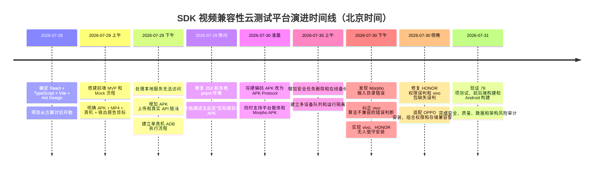

# SDK 视频兼容性云测试平台：问题、Bug 与改动时间线（清晰版）

> 版本：V2.0  
> 整理日期：2026-07-31  
> 时间口径：北京时间（Asia/Shanghai）  
> 项目目录：`/Users/hanzhen/Documents/云测试的项目`

本文是面向项目复盘、汇报和后续开发的清晰版总结。重点回答四个问题：

1. **什么时候遇到了什么问题？**
2. **为什么必须改？根因是什么？**
3. **具体改了什么？**
4. **改完有什么优点，如何证明有效？**

更详细的诊断内容、数据库统计和风险解释见：

- [《项目问题与 Bug 处理总结（详细版）》](/Users/hanzhen/Documents/云测试的项目/docs/项目问题与Bug处理总结.md)

---

## 1. 状态和类型说明

### 1.1 问题类型

| 标记 | 类型 | 说明 |
|---|---|---|
| 🔴 | Bug | 代码行为与需求或真实设备行为不一致 |
| 🟠 | 环境/运维问题 | 服务、命令、设备连接或前台状态导致流程不可用 |
| 🟡 | 设计缺陷 | 当前可能能运行，但结构会造成误判、耦合或扩展困难 |
| 🛡️ | 安全改动 | 为避免误点击、误删除、越权或伪造成功而增加的保护 |
| 🔵 | 能力增强 | 在主流程可用后补充多设备、报告、删除、备份等能力 |
| ⚠️ | 未解决风险 | 已确认，但截至 2026-07-31 尚未完成闭环 |

### 1.2 处理状态

| 状态 | 含义 |
|---|---|
| ✅ 已解决并验证 | 代码已修改，且有测试、构建或真机成功记录 |
| 🟢 历史故障已恢复 | 曾真实失败，之后同设备或同类流程已通过 |
| 🛡️ 安全兜底生效 | 平台主动拒绝不确定操作；任务失败但避免了误操作 |
| 🟨 部分解决 | 主路径可用，但仍存在边界问题或质量缺口 |
| ❌ 未解决 | 已确认需要处理，但尚未完成 |
| 📌 规划项 | 属于后续范围，不是当前实现中的回归 Bug |

---

## 2. 一页看懂项目演进



### 2.1 最重要的四次方向纠正

| 转折点 | 原来的认识/做法 | 纠正后的做法 | 价值 |
|---|---|---|---|
| APK 执行协议 | 所有 APK 都按 `com.sdktest.platform` 执行 | 按 APK 包名和能力选择独立 Protocol | 避免“安装成功但执行方式错误” |
| vivo 可疑输出 | 初期怀疑 vivo 或算法不兼容 | 对照官方脚本后确认是输入目录和 Worker 协议错误 | 避免把平台 Bug 错报为 SDK 兼容性 Bug |
| OEM 自动化 | 看到按钮文字后尝试点击 | 必须同时匹配 package、activity、应用身份和页面特征 | 避免误点系统或无关弹窗 |
| 任务通过语义 | 有 `output.mp4` 就容易理解为质量通过 | 只认定当前已实现的执行链路通过 | 避免把基础兼容执行冒充算法质量认证 |

---

## 3. 完整时间线

> 部分历史聊天只适合确认到日期或阶段；能够从聊天消息确认的关键节点，下面给出北京时间。时间用于帮助理解先后关系，不作为正式发布版本号。

### 2026-07-28：技术选型和项目定义

#### 12:38 起——确定前端框架

- **遇到的问题**：项目只有目标和参考界面，还没有技术栈和可运行工程。
- **为什么要改/做**：需要一个适合企业后台、任务列表、设备管理、报告和实时状态的前端方案。
- **改动**：确定 `React + TypeScript + Vite + Ant Design`。
- **优点**：
  - React 适合组件化复杂控制台；
  - TypeScript 降低任务、设备和报告数据结构出错概率；
  - Vite 本地开发快；
  - Ant Design 能快速搭建表格、表单、步骤条和抽屉。
- **状态**：✅ 已落地。

### 2026-07-29：从前端 Mock 进入真实执行链路

#### 上午——完成前端 MVP

- **遇到的问题**：没有任务创建、执行过程、设备选择和结果报告页面。
- **为什么要改/做**：需要先验证产品流程，再接真实设备。
- **改动**：搭建创建任务、任务列表、执行详情、设备和报告页面，并提供 Mock Runner。
- **优点**：在后端尚未完成时，可以先对齐页面结构和用户流程。
- **状态**：✅ 已完成；后续已从纯 Mock 扩展为真实 API。

#### 14:57 左右——本地页面无法访问

- **现象**：浏览器显示 `ERR_CONNECTION_REFUSED`。
- **根因**：5173 端口没有正在运行的 Vite 开发服务器，不是项目没有写入本机。
- **为什么要改**：用户无法打开页面，也无法判断源码和运行服务的关系。
- **改动**：恢复开发服务，解释浏览器 → Vite → React 的访问链路，并统一运行方式。
- **优点**：以后可以快速区分“代码问题”“构建问题”和“服务没启动”。
- **状态**：✅ 已解决。

#### 17:54 左右——增加 APK 上传

- **遇到的问题**：页面最初只围绕视频素材，无法提供待测 APK。
- **为什么要改**：真实兼容性测试必须明确“测哪个 APK、用哪个 MP4、在哪些设备执行”。
- **改动**：增加 APK 选择、扩展名、空文件和大小校验。
- **优点**：任务输入开始从演示数据转为真实制品。
- **状态**：✅ 已完成；请求级上传限制仍需加强。

#### 晚间——从 Mock 走向 Fastify + SQLite + ADB

- **遇到的问题**：Mock 只能展示流程，不能证明真机安装、SDK 处理和输出回收成功。
- **为什么要改**：项目目标是 SDK 真机兼容测试，而不是页面演示。
- **改动**：增加 Fastify API、SQLite、本地制品存储、ADB Worker、日志、检查结果和输出回收。
- **优点**：建立真实的浏览器 → API → ADB → Android → 输出报告链路。
- **状态**：✅ 主链路已落地。

#### 23:39 左右——处理 JSX 构建错误和本地环境问题

- **现象**：`ExecutionPage.tsx` 曾报 `JSX attributes must only be assigned a non-empty expression`；Shell 也曾出现 `pnpm: command not found`。
- **根因**：历史 JSX 空表达式；Shell PATH、pnpm 命令入口和 Homebrew 初始化不稳定。
- **为什么要改**：前端无法稳定启动和构建，后续所有真机问题都会被环境噪声干扰。
- **改动**：修复 JSX；恢复 pnpm；修正 `.zprofile`、`.zshrc` 和 Homebrew 条件初始化；恢复依赖。
- **优点**：建立可重复的本地开发和构建环境。
- **状态**：✅ 已解决，当前测试和构建通过。

### 2026-07-30：协议、数据安全和 OEM 真机自动化集中修复

#### 00:25 起——发现后端 APK 协议被硬编码

- **现象**：点击“开始测试”后 APK 已经上传，但后端拒绝 Morpho APK，用户感知为按钮没有反应。
- **根因**：后端要求包名固定为 `com.sdktest.platform`；Morpho 实际包名是 `com.morphoinc.videopostprocessor`。
- **为什么要改**：不同 APK 的输入目录、启动 Intent、日志、输出和取消方式并不相同，不能共用一套假设。
- **改动**：引入 APK Protocol，分别描述平台载体和 Morpho；未知 APK 明确拒绝。
- **优点**：
  - 消除包名和路径硬编码；
  - 支持未来增加新 APK；
  - 不会用错误协议制造假失败或假通过。
- **状态**：✅ 已解决并有测试。

#### 上午——建立多设备队列和运行隔离

- **遇到的问题**：同一设备并发会争用安装器和前台 Activity；单个设备失败也可能影响整批任务。
- **为什么要改**：多真机是平台核心能力，必须保证设备间隔离。
- **改动**：同设备串行、不同设备并行；每个设备使用独立 `deviceRunId`、状态、日志和输出。
- **优点**：并行提高效率，同时避免同设备任务互相覆盖。
- **状态**：✅ 已解决并有队列测试。

#### 11:06 左右——增加安全删除

- **遇到的问题**：删除任务可能误删共享 APK/MP4，或造成数据库已删但文件未删的半完成状态。
- **为什么要改**：任务数据、共享制品和设备记录有引用关系，简单递归删除风险很高。
- **改动**：新增 `TaskDeletionService`、终态限制、引用检查、路径白名单、Trash 暂存、事务回滚和删除审计。
- **优点**：删除范围可控、失败可恢复、操作可审计。
- **状态**：✅ 已解决；当前已有 15 条真实删除审计。

#### 上午——改进 SQLite 备份

- **遇到的问题**：运行中的 SQLite 使用 WAL 时，直接复制主文件可能丢失尚未合并的数据。
- **为什么要改**：数据库是任务、日志和结果的主要事实来源，备份必须一致。
- **改动**：使用 SQLite 在线备份、`.incomplete-*` 暂存目录、原子重命名和 manifest 表计数。
- **优点**：降低不完整备份被误认为可恢复备份的风险。
- **状态**：✅ 已完成，当前有两份可读取备份。

#### 15:34 左右——纠正 Morpho 输入目录

- **现象**：平台执行得到的 vivo 输出异常，曾怀疑设备或算法不兼容。
- **根因**：平台使用 `.../files/tasks/{taskId}/input`，官方脚本使用 `.../files/VideoStabilizerDataPack`。
- **为什么要改**：SDK Demo 必须按真实协议寻找输入，路径错误会让兼容性结论失真。
- **改动**：对齐官方 `batch_process.sh` 的输入路径、启动行为、日志标记和输出规则。
- **优点**：
  - 排除平台协议错误；
  - 避免错误归因给 vivo 或 SDK 算法；
  - 修复后输出体积和执行结果恢复正常。
- **状态**：✅ 已解决并有真机通过记录。

#### 16:14 起——第一版无人值守安装模块完成

- **遇到的问题**：消费级 vivo/HONOR 安装 APK 时会出现外部来源和风险确认页，单纯 `adb install` 会一直等待。
- **为什么要改**：人工点击无法支持批量、夜间和无人值守测试。
- **改动**：新增 `AndroidAppPreparer`、`SystemDialogController`，采用“ADB 优先、严格 UI Automator 兜底”。
- **优点**：把设备准备从巨大 Worker 中拆出，OEM 规则可测试、可扩展。
- **状态**：🟨 第一版完成，但随后真实回归暴露了权限和窗口解析问题。

#### 16:33 左右——三台设备回归失败，确认是两类根因

| 设备 | 表面现象 | 根因 | 改动 | 优点 | 状态 |
|---|---|---|---|---|---|
| HONOR Magic V3 | 权限未授予 | 使用了 HONOR 不支持的 `check-permission` | 改用 `dumpsys package` 检查 `granted=true` | 不把验证命令不兼容误判为权限失败 | ✅ |
| HONOR X50 | 权限未授予 | 与 Magic V3 相同 | 同上 | 同上 | ✅ |
| vivo V2324A | 安装前 ADB 失败 | OEM 的“包不存在”输出被当成命令失败 | 区分 absent package 与 ADB failure | 干净安装前的正常状态不再报错 | ✅ |

该次回归使用的 APK、MP4 哈希与此前成功任务一致，因此排除了素材损坏。

#### 17:12 左右——确认初版自动安装仍依赖人工点击

- **现象**：任务最终通过，但自动点击数为 0，实际上由用户手工完成 vivo/HONOR 安装确认。
- **根因**：
  - vivo 的 `dumpsys window windows` 没有返回 `mCurrentFocus`；
  - OEM 包名和 Activity 与通用假设不同；
  - 页面仍在扫描时被过早判定为未知；
  - UI XML 解析不完整。
- **为什么要改**：如果平台把人工点击后的成功当成自动化成功，会夸大无人值守能力。
- **改动**：
  - 完整 `dumpsys window` 回退；
  - 增加 vivo/HONOR 真实 package/activity Profile；
  - 从 XML `bounds` 计算点击位置；
  - 增加已知页面加载宽限期；
  - 保存 XML、截图和窗口诊断。
- **优点**：真正实现无人值守，并保留未知页面的排查证据。
- **状态**：✅ 已解决并有真机回归。

#### 17:30 至 18:20——OPPO/ColorOS 三阶段适配

1. **安装风险页**
   - 根因：新设备使用 `com.oplus.appdetail`，旧 Profile 未覆盖。
   - 改动：增加 OPlus 专用安装 Profile。
   - 优点：只对精确的 ColorOS 安装页面执行继续安装。

2. **组合运行时权限页**
   - 根因：ColorOS 拒绝 shell `pm grant`，且 CAMERA/RECORD_AUDIO 组合展示。
   - 改动：只在明确 OEM 限制时回退到严格 UI 自动化，之后用 `dumpsys package` 验证。
   - 优点：不会把所有 grant 失败都危险地降级为 UI 点击。

3. **启动后存储兼容警告**
   - 根因：安装和权限之后又出现 `OplusCompatibilityAlertActivity`，旧流程没有第三阶段。
   - 改动：新增 `post-launch-dialog-coordinator.ts` 和精确 Profile。
   - 优点：安装、权限、应用启动后警告职责分开，规则更安全、更可维护。

- **状态**：✅ OPPO 后续真机任务通过。

### 2026-07-31：风险审计和当前基线确认

#### 无关 vivo USB 对话框触发安全失败

- **现象**：任务返回 `INSTALL_DIALOG_UNRECOGNIZED`，诊断显示前台是“USB 已连接/仅充电/管理文件”。
- **根因**：无关系统页面占据前台，阻塞了安装流程。
- **为什么没有直接自动点掉**：这不是受支持安装页，放宽规则可能误操作用户设备。
- **当前行为**：保存诊断并安全失败。
- **优点**：证明“宁可不执行，也不误点未知页面”的安全原则有效。
- **状态**：🛡️ 安全兜底生效；设备预检仍需增加无关前台弹窗提醒。

#### 完成工程风险审计

- **确认的重点风险**：无 Git 基线、输出质量校验不足、LAN 未认证暴露、APK 信任不足、上传限制过宽、数据生命周期缺失、内存队列无法恢复。
- **为什么要审计**：项目已经能跑真机，下一阶段的主要风险从“能不能跑”转向“结果是否可信、设备和数据是否安全、服务能否恢复”。
- **优点**：为后续从内部原型升级为稳定测试服务提供优先级。
- **状态**：✅ 风险已识别；具体治理项仍待实施。

#### 当前验证基线

| 验证项 | 结果 |
|---|---|
| 自动化测试 | 19 个测试文件、78 个测试全部通过 |
| 前端/API 构建 | `pnpm build` 成功 |
| Android 构建 | `assembleDebug` 成功 |
| 当前任务 | 23 个：19 passed、3 failed、1 cancelled |
| 当前设备运行 | 53 条 |
| 当前输出视频 | 48 个 MP4 |
| 当前数据目录 | 约 3.5 GB |

---

## 4. Bug 与改动总台账

### 4.1 开发环境和前端

| ID | 时间 | 问题 | 为什么要改/根因 | 具体改动 | 改动优点 | 验证 | 状态 |
|---|---|---|---|---|---|---|---|
| DEV-01 | 7/29 | 页面 `ERR_CONNECTION_REFUSED` | Vite 服务未运行，用户无法区分“未部署”和“服务停止” | 恢复服务并明确本地请求链路 | 更容易定位服务、构建和代码问题 | 页面和构建可用 | ✅ |
| DEV-02 | 7/29 | `pnpm: command not found` | PATH 和 Shell 初始化不稳定 | 修复 pnpm 入口、`.zprofile`、`.zshrc` 和 Homebrew 条件初始化 | 新终端也能稳定运行项目 | `pnpm test/build` 通过 | ✅ |
| DEV-03 | 7/29 | JSX 空表达式构建错误 | `ExecutionPage.tsx` 历史语法错误 | 修复 JSX | 消除前端编译阻塞 | 当前构建通过 | ✅ |
| UI-01 | 7/29-30 | “开始测试”像是没反应 | 实际已上传，但后端拒绝 Morpho 包名；Toast 太短 | 改善持久错误反馈并引入协议识别 | 用户能看到真实失败原因 | 创建任务和协议测试 | ✅ |
| UI-02 | 7/30 | 旧任务缺少 `capabilities` 时白屏 | 前端假设接口字段永远存在 | HTTP Client 标准化并补默认能力 | 兼容旧数据和旧后端 | 专项测试通过 | ✅ |
| UP-01 | 7/29-30 | 上传空文件/错后缀/超限反馈不足 | 输入校验不完整 | 前后端增加 APK/MP4 基础校验和错误代码 | 更早阻止无效任务 | 上传校验测试 | 🟨 请求级限制待加强 |

### 4.2 APK Protocol 和 SDK 执行

| ID | 时间 | 问题 | 为什么要改/根因 | 具体改动 | 改动优点 | 验证 | 状态 |
|---|---|---|---|---|---|---|---|
| APK-01 | 7/30 | 所有 APK 被当作平台载体 | 包名、Intent、目录、日志和输出规则被硬编码 | 新增 `apk-protocols.ts` | 支持多 APK，未知协议可安全拒绝 | Protocol 测试 | ✅ |
| APK-02 | 7/30 | Morpho 输入目录错误 | Worker 未按官方 Demo 协议执行 | 改为 `VideoStabilizerDataPack` 并对齐官方脚本 | 消除平台造成的假兼容失败 | vivo/其他设备后续通过 | ✅ |
| APK-03 | 7/30 | Morpho 进度/完成判断不可靠 | 仍按平台载体的 `result.json` 假设判断 | 按 Morpho 日志标记和稳定输出组合判断 | 进度、失败和完成更符合真实 APK | 日志映射测试 | ✅ |
| APK-04 | 7/30 | 未知 APK 可能被错误执行 | 套用默认协议会制造危险或假结果 | 返回 `APK_PROTOCOL_NOT_FOUND`/`UNSUPPORTED_APK_PROTOCOL` | 明确失败优于猜测执行 | Protocol 测试 | ✅ |
| SDK-01 | 当前 | 真实 SDK Bridge 缺失 | 仓库没有 `VendorSdkBridgeImpl` | 保留明确 `SDK_INITIALIZE_FAILED`，不复制视频伪造成功 | 保证结果诚信 | 代码路径确认 | ❌ 需 SDK 方接入 |

### 4.3 多设备、队列和取消

| ID | 时间 | 问题 | 为什么要改/根因 | 具体改动 | 改动优点 | 验证 | 状态 |
|---|---|---|---|---|---|---|---|
| QUEUE-01 | 7/30 | 同设备并发相互干扰 | 安装器、前台 Activity 和目录是设备级共享资源 | 按设备建立串行队列 | 避免同设备任务互相覆盖 | 队列测试 | ✅ |
| QUEUE-02 | 7/30 | 不同设备无法有效并行 | 全局串行浪费设备能力 | 不同设备队列并行 | 提升整体吞吐量 | 队列测试 | ✅ |
| QUEUE-03 | 7/30 | Worker 异常可能污染其他运行 | 失败边界不清晰 | 异常只更新目标 `deviceRun`，队列继续 | 单设备失败不会拖垮整批 | 异常隔离测试 | ✅ |
| QUEUE-04 | 7/30 | 任务取消后仍可能执行/点击 | 队列、Worker、UI Controller 生命周期未统一 | 移除排队项、通知 Worker、停止弹窗控制器、忽略晚到更新 | 取消行为真正可控 | 测试及 1 条真实取消记录 | ✅ |
| RUN-01 | 7/30 | 多设备输出和状态可能混用 | 只按 task 组织不足以表达设备级结果 | 每台设备独立 `deviceRunId` | 可独立追踪、报告和重跑 | DB 和测试 | ✅ |

### 4.4 设备发现和 ADB

| ID | 时间 | 问题 | 为什么要改/根因 | 具体改动 | 改动优点 | 验证 | 状态 |
|---|---|---|---|---|---|---|---|
| DEVICES-01 | 7/29-30 | online/offline/unauthorized 混淆 | ADB 状态解析不完整 | 显式解析状态，只读取在线授权设备属性 | 不把离线设备伪装成在线 | 设备 Provider 测试 | ✅ |
| DEVICES-02 | 7/30 | 属性读取失败时设备信息不可信 | 错误时仍可能填入假属性 | 失败返回 `unknown` | 数据更诚实 | 测试 | ✅ |
| DEVICES-03 | 7/30 | 重复发现可能生成重复设备 | 注册与发现 ID 对齐不足 | 幂等注册并映射历史设备 ID | 保留历史任务关联 | Registry 测试 | ✅ |
| ADB-01 | 7/30 | vivo “包不存在”被当作 ADB 失败 | OEM 输出格式不同 | 区分 absent package 与 command failure | 干净安装更稳定 | `adb-client.test.ts` | ✅ |
| ADB-02 | 7/29 | HONOR 设备离线 | USB/ADB 连接异常 | 恢复连接并重新发现设备 | 设备重新进入可执行状态 | 后续同设备通过 | 🟢 |

### 4.5 OEM 安装、权限和弹窗安全

| ID | 时间 | 问题 | 为什么要改/根因 | 具体改动 | 改动优点 | 验证 | 状态 |
|---|---|---|---|---|---|---|---|
| OEM-01 | 7/30 | 自动安装实际依赖人工点击 | OEM 窗口、包名、Activity 和 XML 解析不完整 | `AndroidAppPreparer` + `SystemDialogController` + OEM Profile | 真正支持无人值守 | 真机和测试 | ✅ |
| OEM-02 | 7/30 | 固定坐标点击不可靠 | 分辨率、旋转和页面布局会变化 | 从 XML 节点 `bounds` 计算点击点 | 跨设备更稳定 | XML 测试 | ✅ |
| OEM-03 | 7/30 | 已知页面加载中被判未知 | 风险扫描期间文案/按钮尚未出现 | 对可信安装器增加加载宽限期 | 减少错误的 `UNRECOGNIZED` | 测试 | ✅ |
| OEM-04 | 7/30 | HONOR 权限已授予却判失败 | 不支持 `check-permission` | 用 `dumpsys package` 验证 `granted=true` | 兼容 OEM 差异 | 权限测试 | ✅ |
| OEM-05 | 7/30 | 安全锁屏可能被错误绕过 | 自动化边界未明确 | 只尝试无密码解锁；安全锁存在则拒绝 | 不突破设备安全边界 | 测试 | ✅ |
| OEM-06 | 7/30 | 通用“继续/确定”可能误点 | 单一文字无法证明页面身份 | 同时校验 package、activity、应用身份和多个特征 | 宁可失败，不误操作 | 多组负向测试 | ✅ |
| VIVO-01 | 7/30 | vivo 安全守护页不识别 | OriginOS Profile 和窗口解析不足 | 增加真实 vivo Profile、完整 window 回退和 XML fixture | 无需人工继续安装 | 后续 vivo 通过 | 🟢 |
| HONOR-01 | 7/30 | HONOR 风险页步骤不完整 | 真实页面先勾选、再继续 | Profile 中按顺序处理勾选和继续 | 符合真实 MagicOS 流程 | Fixture 测试和真机 | ✅ |
| OPPO-01 | 7/30 | `com.oplus.appdetail` 安装超时 | ColorOS 新安装页未覆盖 | OPlus 专用安装 Profile | 支持新 OPPO 安装器 | 后续 OPPO 通过 | 🟢 |
| OPPO-02 | 7/30 | `pm grant` 被 ColorOS 拒绝 | OEM 限制 shell 授权 | 仅对明确限制回退 UI，并再次验证 | 既兼容 ColorOS，又不隐藏普通 ADB 错误 | 测试和真机 | ✅ |
| OPPO-03 | 7/30 | 相机/麦克风组合权限页不匹配 | 使用 OEM 组合页面 | 增加专用权限 Profile | 首次启动可自动完成 | Fixture 测试 | ✅ |
| OPPO-04 | 7/30 | 启动后存储兼容警告阻塞 | 原流程没有“应用启动后弹窗”阶段 | 新增 Post-launch Coordinator | 职责分离，支持协议专属启动后处理 | 后续 OPPO 通过 | ✅ |
| SAFE-01 | 7/31 | vivo USB 无关弹窗挡住安装 | 无关系统 UI 占据前台 | 不点击，保存 XML/截图/window 诊断并失败 | 避免误改 USB 模式 | 真实失败诊断 | 🛡️ |

### 4.6 输出、报告、删除和备份

| ID | 时间 | 问题 | 为什么要改/根因 | 具体改动 | 改动优点 | 验证 | 状态 |
|---|---|---|---|---|---|---|---|
| OUT-01 | 7/30 | 多设备输出可能覆盖 | 输出只按任务组织不够 | 绑定 `deviceRunId` | 每台设备证据独立 | DB 和报告 | ✅ |
| OUT-02 | 7/30 | 视频无法稳定拖动播放 | 缺少完整 HTTP Range 语义 | 支持完整文件、206、416 和下载端点 | 浏览器可播放、定位和下载 | `http-file.test.ts` | ✅ |
| OUT-03 | 7/30 | 输出证据难以核对 | 只保存路径不足 | 增加大小和 SHA-256 | 可识别文件变化和基础完整性 | DB 输出记录 | ✅ |
| OUT-04 | 当前 | 有输出不等于质量通过 | 缺少 ffprobe、解码和画面质量检查 | 尚待增加视频质量门禁 | 可减少坏文件和假通过 | 尚无 | ❌ P0 |
| DEL-01 | 7/30 | 删除可能误删共享数据 | 任务、运行、制品存在引用关系 | 终态限制、引用检查、Trash、事务、审计 | 删除可控、可恢复、可追踪 | 测试 + 15 条审计 | ✅ |
| BAK-01 | 7/30 | 直接复制 SQLite 可能丢 WAL 数据 | 备份方式不一致 | 在线备份、原子目录和 manifest | 备份可信度更高 | 两份备份可读 | ✅ |

---

## 5. 真实失败记录与处理结果

| 时间 | 设备/范围 | 失败代码或现象 | 根因 | 后续处理 | 当前结论 |
|---|---|---|---|---|---|
| 7/29 | HONOR | `DEVICE_OFFLINE`，至少 4 个历史任务 | USB/ADB 状态异常 | 恢复连接并重新发现 | 🟢 后续同设备已有通过 |
| 7/30 | vivo | 输出异常、曾怀疑算法不兼容 | Worker 输入目录不符合官方 Morpho 协议 | 对齐 `VideoStabilizerDataPack` | ✅ 平台协议 Bug，不是已证实的 SDK 算法 Bug |
| 7/30 | HONOR ×2 | `RUNTIME_PERMISSION_NOT_GRANTED` | 权限验证命令不受支持 | 改用 `dumpsys package` | ✅ 已修复 |
| 7/30 | vivo | APK 准备失败 | “包不存在”被误判为命令错误 | 区分正常缺失和 ADB 失败 | ✅ 已修复 |
| 7/30 | vivo/HONOR | 任务通过但需要人工点击 | OEM 窗口识别失败，自动点击数为 0 | 增加真实 Profile 和完整窗口解析 | ✅ 后续实现无人值守 |
| 7/30 | vivo | `INSTALL_DIALOG_UNRECOGNIZED` | 未覆盖安全守护页面或页面仍在加载 | Profile + 宽限期 + 诊断 | 🟢 主流程恢复 |
| 7/30 | OPPO | `INSTALL_DIALOG_TIMEOUT` | 新 `com.oplus.appdetail` 流程未覆盖 | OPlus Profile | 🟢 后续 OPPO 通过 |
| 7/30 | OPPO | 权限阶段失败 | ColorOS 拒绝 shell grant、使用组合权限页 | 明确 OEM 回退和专用 Profile | ✅ 已修复 |
| 7/30 | OPPO | “权限异常提示”阻塞 | 启动后还有存储兼容警告 | Post-launch Coordinator | ✅ 已修复 |
| 7/31 | vivo | `INSTALL_DIALOG_UNRECOGNIZED` | 无关 USB 页面占据前台 | 安全拒绝并保存诊断 | 🛡️ 不应放宽为通用点击 |
| 当前 | 1 个任务 | `TASK_CANCELLED`，约 79% 取消 | 用户主动取消 | 队列、Worker 和 UI 自动化停止 | ✅ 行为符合预期 |

---

## 6. 每类改动带来的总体优点

### 6.1 Protocol 化

**改动前**：包名、输入、Intent、日志和输出都散落在 Worker 中。  
**改动后**：每个 APK 用独立协议描述。

**优点**：

- 新增 APK 时不需要重写整个 Worker；
- 未知 APK 可以明确拒绝；
- 执行结果更可信；
- 减少“设备不兼容”与“平台协议错误”的混淆。

### 6.2 按设备队列化

**改动前**：任务和设备运行边界不清晰。  
**改动后**：同设备串行、跨设备并行、每设备独立运行和输出。

**优点**：

- 不会同时控制一台设备上的两个前台流程；
- 一台设备失败不污染其他设备；
- 报告可以准确定位到设备；
- 为未来重试和 Attempt 模型打基础。

### 6.3 OEM 弹窗 Profile 化

**改动前**：容易依赖人工，或根据通用按钮文字判断。  
**改动后**：严格匹配系统身份、应用身份、Activity、页面特征和 XML bounds。

**优点**：

- 自动化更稳定；
- OEM 规则可以用真实 XML 回归测试；
- 新系统页面不会被盲目点击；
- 诊断材料能支持后续快速补 Profile。

### 6.4 数据操作事务化和可审计化

**改动前**：删除和备份容易产生半完成或不一致结果。  
**改动后**：Trash 暂存、数据库事务、恢复、审计和在线备份。

**优点**：

- 降低误删除风险；
- 失败后可以恢复；
- 保留操作证据；
- 历史数据库可以用于回溯设备故障。

### 6.5 失败优先、拒绝伪造

**改动前的潜在危险**：未知 APK、未知弹窗、真实 SDK 缺失时，如果用默认行为继续，可能制造假成功。  
**当前做法**：协议未知则失败、页面未知则不点击、SDK 未接入则明确初始化失败。

**优点**：

- 测试结论更诚实；
- 不会把输入视频复制成输出冒充 SDK 处理；
- 不会为了通过率牺牲设备安全；
- 为未来正式质量门禁保留可信基础。

---

## 7. 尚未完成的改动：为什么要改、改完有什么好处

### P0：必须优先处理

| ID | 未解决问题 | 为什么必须改 | 建议改动 | 完成后的优点 |
|---|---|---|---|---|
| RISK-01 | 没有 Git commit | 无法回滚、Review、定位每个 Bug 的引入和修复版本 | 检查敏感文件后建立首个基线提交，之后小步提交和 PR | 每项改动可追溯、可回滚、可审计 |
| RISK-02 | 输出质量验证过浅 | 非空 MP4 也可能无法解码、黑屏、绿屏或时长错误 | 引入 ffprobe、解码、时长/分辨率/帧率和异常画面检测 | “通过”结果更接近真实质量门禁 |
| RISK-03 | 真实 SDK Bridge 缺失 | 平台载体 APK 无法证明真实 SDK 初始化和处理 | 接入 `VendorSdkBridgeImpl` | 完成真实 SDK 端到端闭环 |
| RISK-04 | Vite `0.0.0.0` + API 代理无认证 | 局域网用户可能间接调用上传、ADB、取消和删除接口 | 默认 loopback；共享模式增加认证、RBAC、审计和 TLS | 保护设备、数据和管理接口 |
| RISK-05 | APK 只按包名/协议信任 | 恶意 APK 可伪造受支持包名 | 校验签名证书、来源和 SHA-256 白名单 | 降低恶意 APK 安装到真机的风险 |
| RISK-06 | multipart 请求限制过宽 | APK 可能传输大量数据后才因业务上限失败 | 按 APK/视频设置请求级上限，统一 413 | 更早拒绝、节省磁盘和带宽 |
| RISK-07 | 无数据生命周期 | `data/` 已约 3.5 GB，会持续增长直至磁盘不足 | TTL、配额、低水位拒绝、去重、孤儿清理、备份轮转 | 防止测试因磁盘耗尽突然中断 |

### P1：进入稳定服务前处理

| ID | 未解决问题 | 为什么要改 | 建议改动 | 完成后的优点 |
|---|---|---|---|---|
| ARCH-01 | 队列只在内存 | 服务重启后排队信息丢失 | 持久化 Queue/Lease | 可恢复执行和明确接管 |
| ARCH-02 | 没有 Run/Attempt | 重试只能新建任务，历史统计失真 | 分离任务、运行和尝试 | 重试历史和通过率更准确 |
| ARCH-03 | 没有冻结执行清单 | 同一任务以后难以复现 | 保存 SDK、协议、服务构建、设备系统和运行配置 | 结果可复现、可审计 |
| ARCH-04 | 数据库迁移非正式 | Schema 演进可能不可逆或环境不一致 | 版本化 migration | 部署升级更安全 |
| ARCH-05 | 创建任务/上传不幂等 | 网络重试可能重复创建 | 增加 idempotency key 和哈希去重 | 减少重复任务和空间浪费 |
| TEST-01 | 缺少 Fake ADB E2E | 单元测试无法覆盖完整 Worker 编排 | 建立可脚本化 Fake ADB | 不依赖真机即可覆盖主流程 |
| TEST-02 | 缺少浏览器级测试 | 页面、API 和路由组合回归可能漏掉 | 增加 Playwright | 覆盖真实用户操作路径 |
| TEST-03 | 缺少 Android instrumentation | APK 播放、旋转和权限行为主要依赖人工/宿主观察 | 增加设备侧测试 | 提高载体 APK 的回归可信度 |

### P2：后续性能和扩展

| ID | 问题 | 建议改动 | 优点 |
|---|---|---|---|
| PERF-01 | 前端主包约 1.32 MB | 路由懒加载和代码分包 | 缩短首次加载 |
| PERF-02 | 页面每秒轮询 | 达到规模阈值后评估 SSE | 减少无效请求、提升实时性 |
| PLATFORM-01 | iOS/HarmonyOS 仍是规划能力 | 独立 Runner/Protocol/Provider | 不把 Android 假设扩散到其他平台 |
| SCALE-01 | 单控制进程设备队列 | 增加设备所有权和分布式 lease | 支持多 Runner 扩容 |
| MODEL-01 | 前后端领域类型重复 | 生成共享 API Schema/类型 | 减少字段漂移和白屏回归 |

---

## 8. 后续每次改动建议采用的记录模板

为了避免以后再次依靠聊天记录人工还原，建议每个 Bug 或改动统一记录：

```text
改动 ID：
发现时间：
问题类型：Bug / 环境 / 设计 / 安全 / 能力增强
影响设备或模块：

现象：
根因：
为什么必须修改：
具体改动：
改动优点：
可能副作用：
验证方式：单元测试 / 集成测试 / 真机 / 构建
验证结果：
关联 commit / PR：
当前状态：
```

建议 Git commit 也引用同一个 ID，例如：

```text
fix(OEM-04): use dumpsys package to verify runtime permissions
```

这样后续可以从：

```text
问题记录 → 改动 ID → commit → 测试 → 真机任务记录
```

完整追踪一次 Bug 的发现、修复和验证过程。

---

## 9. 当前项目的准确结论

### 已经做到

- 真实 Android ADB 执行；
- 多设备队列和失败隔离；
- 平台载体与 Morpho APK Protocol；
- vivo、HONOR、OPPO 安装和权限自动化；
- 输出、日志、截图、报告和 Range 播放；
- 取消任务、安全删除和在线备份；
- 78 项自动化测试、前后端构建和 Android 构建通过。

### 还不能宣称

- 不能仅凭存在 `output.mp4` 宣称算法质量完全通过；
- 不能宣称平台载体已经完成真实 SDK 集成；
- 不能直接作为开放局域网的多用户生产服务；
- 不能宣称服务重启后任务可以恢复；
- 不能宣称已覆盖 iOS/HarmonyOS 真机执行。

### 最终定位

> **当前已经是具备真实 Android 多设备兼容执行能力的内部测试平台原型。最核心的执行链路和 OEM 适配已经可用；下一阶段重点应从“让流程跑通”转为“版本可追溯、结果可信、安全可控、数据可持续、任务可恢复”。**
